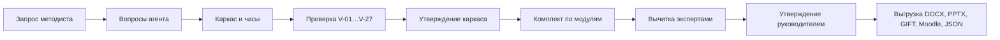

# МетодАгент

ИИ-агент методиста Академии цифрового развития (АЦР). По запросу свободным текстом он собирает дополнительную программу и полный комплект материалов к ней по шаблону АЦР. Поддерживаются три типа программ: повышение квалификации (ДПП ПК), стажировка и дополнительная общеобразовательная программа для детей (ДООП). В комплект входят:

- карта компетенций, учебный план и учебно-тематический план (УТП);
- календарный график и рабочие программы модулей;
- лекции со слайдами, тесты с ключами, задания семинаров с критериями;
- материалы итоговой аттестации и проект приказа.

Перед выдачей комплект проходит автопроверку по 27 правилам, 10 из них блокирующие. Часы считает детерминированный солвер, а реквизиты нормативных актов, профстандартов и литературы берутся только из проверенных реестров. Методист, эксперты и руководитель доводят программу до утверждения в одном интерфейсе, каждый в своей роли.

- **Демо:** https://methodagent.ru (ведёт на стенд https://tochka-sborki-2026-team-098.hub.gigaschool.ru, сначала нужен вход хаба)
- **Справка в интерфейсе:** `/help`
- **OpenAPI:** `/docs`
- **Лицензия:** GPL-3.0

## Документация

Подробная документация лежит в [`docs/`](docs/).

| Раздел | О чём |
|---|---|
| [Архитектура](docs/architecture.md) | Схема системы, каталоги, жизненный цикл запроса, фоновые задания, хранение данных |
| [Руководство пользователя](docs/user-guide.md) | Работа методиста, эксперта и руководителя по шагам, демо-учётки |
| [Руководство администратора](docs/admin-guide.md) | Пользователи и роли, ключи и модели, лимиты, навыки, база знаний, журнал, безопасность |
| [Роли и права](docs/roles-and-access.md) | Матрица «действие × роль», аутентификация, JWT, `X-MA-Token`, регистрация, шифрование секретов |
| [Конвейер агента](docs/agent-workflow.md) | Этапы от запроса до утверждения, режимы interactive и auto, разделы шаблона, инструменты методиста |
| [Навыки](docs/skills.md) | Формат навыка (SKILL.md, schema_in.json, run.py), каждый навык: вход, выход, модель, фолбэки |
| [LLM-шлюз](docs/llm.md) | Модели, ретраи, резерв, параллелизм, токены и рубли, дневной бюджет |
| [Солверы часов и графика](docs/solvers.md) | Раскладка часов, доля практики, стажировка, календарный график и конфликты |
| [Автопроверка](docs/validation.md) | Правила V-01…V-27, судья, автоисправление, песочница, оригинальность, отчёт |
| [Выгрузка](docs/export.md) | DOCX по шаблону АЦР, PPTX, GIFT, Moodle XML, JSON 4.8 |
| [Модель данных](docs/data-model.md) | Документ программы, статусы и переходы, таблицы БД, схема JSON 4.8 |
| [REST API](docs/api.md) | Все методы `/api/v1` с ролями, параметрами, ошибками и примерами curl |
| [База знаний](docs/knowledge-base.md) | Реестры НПА, профстандартов и ФГОС, 52 выжимки актов, документы организации, поиск |
| [Интерфейс](docs/frontend.md) | Маршруты, экраны по ролям, клиент API, сборка |
| [Настройки](docs/configuration.md) | Переменные окружения и настройки из админки |
| [Развёртывание](docs/deployment.md) | Локальный запуск, Docker, ВМ, хаб и домен, резервные копии |
| [Разработка и тесты](docs/development.md) | pytest, автопрогон кейсов, testset, как добавить навык, акт или правило |
| [История изменений](docs/changelog.md) | Версии поставки и главное в каждой |

## Как это работает



1. **Запрос.** Методист описывает программу и прикладывает референсы (`.docx`, `.pdf`, `.txt`). Агент распознаёт параметры, тип программы и шаблон, а в референсе проверяет таблицы часов.
2. **Вопросы.** Если не хватает обязательных сведений, агент задаёт до пяти вопросов с вариантами ответа. Ответ «На ваше усмотрение» берёт значение из профиля организации и записывает его в допущения.
3. **Каркас.** Модель предлагает цель, компетенции (знать, уметь, владеть), модули и темы. Часы раскладывает солвер методом наибольших остатков, поэтому суммы сходятся на всех уровнях. Нормативная база и профстандарт с трудовыми функциями подбираются из реестров.
4. **Проверка каркаса.** Правила V-01…V-27 и матрица покрытия. Методист принимает решение по каждому пункту «!» и утверждает каркас. До этого содержание не генерируется.
5. **Комплект.** Содержание генерируется по модулям параллельно, не больше двух запросов к шлюзу одновременно. Упавшие элементы чинятся кодом. Отчёт показывает правила, затраты и время.
6. **Согласование.** Эксперты вычитывают свои модули, руководитель утверждает программу. Реквизиты приказа, ФИО и подписи остаются пустыми полями для людей.

Подробно: [конвейер агента](docs/agent-workflow.md), [автопроверка](docs/validation.md).

## Роли

| Роль | Что делает |
|---|---|
| Методист | Создаёт программу, отвечает на вопросы, утверждает каркас, собирает комплект, назначает экспертов, отправляет руководителю, выгружает |
| Эксперт | Вычитывает только назначенные ему модули, оставляет замечания, принимает или возвращает модуль |
| Руководитель | Видит все программы, качество, сроки и затраты, утверждает или возвращает программу |
| Администратор | Ведёт пользователей и роли, ключи и модели, лимиты, навыки, базу знаний и журнал; программ не создаёт и не утверждает |
| API | Служебная учётка для автопрогона и интеграций |

Роли не пересекаются, права проверяются сервером на каждом действии. Подробно: [роли и права](docs/roles-and-access.md).

Демо-учётки, пароль у всех `demo`: `madina` (методист), `timur` и `olga` (эксперты), `ahmed` (руководитель), `admin` (администратор), `api` (API-клиент).

## Модели

Используется OpenAI-совместимый шлюз хакатона (Cloud.ru Foundation Models). Ключ задаётся в окружении (`/opt/hackathon/ai.env`) или в админке.

| Роль | Модель |
|---|---|
| Каркас и содержание | `GigaChat/GigaChat-3-Pro` |
| Судья (включён по умолчанию, отключается в настройках) | `ai-sage/GigaChat3.5-432B-A28B-Reasoning` |
| Эмбеддинги | `ai-sage/Giga-Embeddings-instruct-3B` |

Если шлюз недоступен или исчерпан дневной лимит, агент собирает программу по библиотеке типовых структур направлений и пишет об этом в заметках. Стоимость каждого прогона в токенах и рублях попадает в ответ (`tokens.cost_rub`). Подробно: [LLM-шлюз](docs/llm.md).

## Нормативная база

В `registry/` лежат реестры: 74 действующих нормативных акта, профстандарты с кодами трудовых функций, ФГОС, литература и версии инструментов. Каждая запись содержит дату проверки и ссылку на источник. В `registry/norms/` — 52 выжимки актов с номерами пунктов, для ДПП и ДООП, а также для школ, колледжей и вузов. Утратившие силу акты не используются. Обязательные акты типа программы входят в нормативную базу всегда, остальные подбираются по ключевым словам запроса. Подробно: [база знаний](docs/knowledge-base.md).

## Быстрый старт

Локально (Python 3.12, Node 20+):

```bash
python3.12 -m venv .venv && . .venv/bin/activate
pip install -r requirements-dev.txt
cd frontend && npm ci && npm run build && cd ..
PYTHONPATH=src uvicorn app.main:app --host 0.0.0.0 --port 8000
```

Без ключа шлюза можно работать в режиме `LLM_PROVIDERS=fixtures`: ответы навыков детерминированные, сеть не нужна.

Docker:

```bash
docker compose up -d --build
```

На ВМ команды: `./scripts/deploy_vm.sh`. Подробно: [развёртывание](docs/deployment.md), [настройки](docs/configuration.md).

## Автопрогон

Эндпоинт без авторизации собирает полный комплект без вопросов:

```bash
curl -X POST 'http://localhost:8000/api/v1/programs?mode=auto' \
  -H 'Content-Type: application/json' \
  -d '{"request": "Программа ПК «Анализ данных на Python», 72 часа, 4 недели, итог — защита проекта"}'
```

Ответ содержит `status`, `assumptions`, `skeleton`, `kit`, `report` (блокирующие проверки, упавшие правила, матрица покрытия), `files` (ссылки на выгрузки), `timing_s` и `tokens`. Можно приложить файлы (`attachments` в base64) и заранее известные ответы на вопросы (`answers`). Все методы: [REST API](docs/api.md).

## Тесты

```bash
PYTHONPATH=src pytest -q          # модульные и API-тесты
python scripts/autorun.py         # пять открытых кейсов с проверкой по чек-листам
```

Подробно: [разработка и тесты](docs/development.md).

## Структура репозитория

```
src/app/
  agent/        оркестратор (конечный автомат) и разделы шаблона АЦР
  skills/       навыки: SKILL.md + schema_in.json + run.py
  solver/       солверы часов и календарного графика
  validation/   27 правил, судья, отчёт, матрица покрытия, починка, песочница
  kb/           реестры, выжимки актов, документы организации, разбор референсов
  auth/         вход, регистрация, личный кабинет, администрирование
  llm/          клиент шлюза: ретраи, резервная модель, учёт токенов и рублей
  export/       DOCX, PPTX, GIFT, Moodle XML, JSON
  programs/     API /api/v1, хранилище программ и версий
  core/         настройки, БД, безопасность, шифрование, ошибки
frontend/       интерфейс на React + Vite
registry/       проверенные реестры и выжимки актов (norms/)
testset/        открытые запросы кейса
scripts/        автопрогон и развёртывание на ВМ
tests/          pytest
docs/           документация
```
