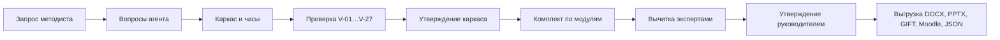

# МетодАгент

ИИ-агент методиста Академии цифрового развития (АЦР). По запросу свободным текстом он собирает дополнительную программу и полный комплект материалов к ней по шаблону АЦР. Поддерживаются три типа программ: повышение квалификации (ДПП ПК), стажировка и дополнительная общеобразовательная программа для детей (ДООП). В комплект входят:

- карта компетенций, учебный план и учебно-тематический план (УТП);
- календарный график и рабочие программы модулей;
- лекции со слайдами, тесты с ключами, задания семинаров с критериями;
- материалы итоговой аттестации и проект приказа.

Перед выдачей комплект проходит автопроверку по 27 правилам, 10 из них блокирующие. Часы считает детерминированный солвер, а реквизиты нормативных актов, профстандартов и литературы берутся только из проверенных реестров. Методист, эксперты и руководитель доводят программу до утверждения в одном интерфейсе, каждый в своей роли.

- **Демо:** https://methodagent.ru (ведёт на стенд https://tochka-sborki-2026-team-098.hub.gigaschool.ru, сначала нужен вход хаба)
- **Справка в интерфейсе:** `/help`
- **OpenAPI:** `/docs`
- **Лицензия:** GPL-3.0

## Команда

Команда «Команда 1», хакатон «Точка сборки 2026», задача № 1 «ИИ-агент для создания образовательных программ».

| Участник | Роль в команде |
|---|---|
| Емельянов Сергей (капитан) | Архитектура и агентная логика, бэкенд и LLM-шлюз, развёртывание на Cloud.ru, итоговая сборка |
| Кодзаева Мария | Методология и нормативная база: шаблоны АЦР, реестры НПА и профстандартов, чек-листы кейсов, вычитка комплектов |
| Кутранов Владислав | Интерфейс и сценарии ролей: экраны методиста, эксперта, руководителя и администратора, справка |
| Синякин Даниил | Тестирование и качество: регресс по ролям, автопрогон кейсов, спецификации и покрытие; защита и расчёт эффекта |

## Документация

Подробная документация лежит в [`docs/`](docs/). Подробная wiki для пользователей и разработчиков — в [`wiki/`](wiki/Home.md), спецификации требований (SDD, формат EARS) — в [`specs/`](specs/README.md).

| Раздел | О чём |
|---|---|
| [Материалы к защите](docs/defense/) | Презентация со схемами (`presentation.pptx`), архитектура и вопросы к защите (`architecture-qa.docx`), сценарий показа (`demo-script.docx`) |
| [Архитектура](docs/architecture.md) | Схема системы, каталоги, жизненный цикл запроса, фоновые задания, хранение данных |
| [Руководство пользователя](docs/user-guide.md) | Работа методиста, эксперта и руководителя по шагам, демо-учётки |
| [Руководство администратора](docs/admin-guide.md) | Пользователи и роли, ключи и модели, лимиты, навыки, база знаний, журнал, безопасность |
| [Роли и права](docs/roles-and-access.md) | Матрица «действие × роль», аутентификация, JWT, `X-MA-Token`, регистрация, шифрование секретов |
| [Конвейер агента](docs/agent-workflow.md) | Этапы от запроса до утверждения, режимы interactive и auto, разделы шаблона, инструменты методиста |
| [Навыки](docs/skills.md) | Формат навыка (SKILL.md, schema_in.json, run.py), каждый навык: вход, выход, модель, фолбэки |
| [LLM-шлюз](docs/llm.md) | Модели, ретраи, резерв, параллелизм, токены и рубли, дневной бюджет |
| [Солверы часов и графика](docs/solvers.md) | Раскладка часов, доля практики, стажировка, календарный график и конфликты |
| [Автопроверка](docs/validation.md) | Правила V-01…V-27, судья, автоисправление, песочница, оригинальность, отчёт |
| [Выгрузка](docs/export.md) | DOCX по шаблону АЦР, PPTX, GIFT, Moodle XML, JSON 4.8 |
| [Модель данных](docs/data-model.md) | Документ программы, статусы и переходы, таблицы БД, схема JSON 4.8 |
| [REST API](docs/api.md) | Все методы `/api/v1` с ролями, параметрами, ошибками и примерами curl |
| [База знаний](docs/knowledge-base.md) | Реестры НПА, профстандартов и ФГОС, 52 выжимки актов, документы организации, поиск |
| [Интерфейс](docs/frontend.md) | Маршруты, экраны по ролям, клиент API, сборка |
| [Настройки](docs/configuration.md) | Переменные окружения и настройки из админки |
| [Развёртывание](docs/deployment.md) | Локальный запуск, Docker, ВМ, хаб и домен, резервные копии |
| [Отчёт качества](docs/reports/quality.md) | Живой замер на Cloud.ru: время, токены, стоимость; как воспроизвести |
| [Решение проблем](docs/troubleshooting.md) | Частые ошибки: 500 в вычитке, откат версий, песочница на macOS, дневной лимит модели, связь с сервером, токены и пароли |
| [Разработка и тесты](docs/development.md) | pytest, автопрогон кейсов, testset, как добавить навык, акт или правило |
| [История изменений](docs/changelog.md) | Версии поставки и главное в каждой |
| [Сверка с ТЗ](docs/tz-compliance.md) | Матрица соответствия кода требованиям ТЗ по каждому пункту, с доказательствами и разрывами |

## Как это работает



1. **Запрос.** Методист описывает программу и прикладывает референсы (`.docx`, `.pdf`, `.txt`). Агент распознаёт параметры, тип программы и шаблон, а в референсе проверяет таблицы часов.
2. **Вопросы.** Если не хватает обязательных сведений, агент задаёт до пяти вопросов с вариантами ответа. Ответ «На ваше усмотрение» берёт значение из профиля организации и записывает его в допущения.
3. **Каркас.** Модель предлагает цель, компетенции (знать, уметь, владеть), модули и темы. Часы раскладывает солвер методом наибольших остатков, поэтому суммы сходятся на всех уровнях. Нормативная база и профстандарт с трудовыми функциями подбираются из реестров.
4. **Проверка каркаса.** Правила V-01…V-27 и матрица покрытия. Методист принимает решение по каждому пункту «!» и утверждает каркас. До этого содержание не генерируется.
5. **Комплект.** Содержание генерируется по модулям параллельно, не больше двух запросов к шлюзу одновременно. Упавшие элементы чинятся кодом. Для лекций модель отдельным вызовом пишет 6–12 подробных слайдов: пункты «Тезис — пояснение» и заметки докладчика; при сбое остаются слайды модуля. Отчёт показывает правила, затраты и время.
6. **Согласование.** Эксперты вычитывают свои модули: замечание к конкретному элементу агент превращает в правку, которую эксперт подтверждает; замечание к модулю целиком уходит методисту. Руководитель утверждает программу, методист выпускает проект приказа и отмечает регистрацию. Реквизиты приказа, ФИО и подписи остаются пустыми полями для людей.
7. **Архив.** Методист убирает ненужные программы в архив: они пропадают из рабочего списка, остаются доступными в фильтре «Архив» только на просмотр и выгрузку и возвращаются одной кнопкой.

Подробно: [конвейер агента](docs/agent-workflow.md), [автопроверка](docs/validation.md).

## Роли

| Роль | Что делает |
|---|---|
| Методист | Создаёт программу, отвечает на вопросы, утверждает каркас, собирает комплект, назначает экспертов, отправляет руководителю, выгружает, убирает программы в архив |
| Эксперт | Вычитывает только назначенные ему модули, оставляет замечания, принимает или возвращает модуль |
| Руководитель | Видит все программы, качество, сроки и затраты, утверждает или возвращает программу |
| Администратор | Ведёт пользователей и роли, ключи и модели, лимиты, навыки, базу знаний и журнал; программ не создаёт и не утверждает |
| API | Служебная учётка для автопрогона и интеграций |

Роли не пересекаются, права проверяются сервером на каждом действии. Подробно: [роли и права](docs/roles-and-access.md).

Демо-учётки, пароль у всех `demo`: `madina` (методист), `timur` и `olga` (эксперты), `ahmed` (руководитель), `admin` (администратор), `api` (API-клиент).

## Модели

Используется шлюз хакатона на базе Cloud.ru Evolution Foundation Models, зарубежные API не используются и не подключаются. Ключ задаётся в окружении (`/opt/hackathon/ai.env`) или в админке.

| Роль | Модель |
|---|---|
| Каркас и содержание | `GigaChat/GigaChat-3-Pro` |
| Судья (включён по умолчанию, отключается в настройках) | `ai-sage/GigaChat3.5-432B-A28B-Reasoning` |
| Эмбеддинги | `ai-sage/Giga-Embeddings-instruct-3B` |

Если шлюз недоступен или исчерпан дневной лимит, агент собирает программу по библиотеке типовых структур направлений и пишет об этом в заметках. Стоимость каждого прогона в токенах и рублях попадает в ответ (`tokens.cost_rub`). Подробно: [LLM-шлюз](docs/llm.md).

## Эффект для методиста

Каждый автопрогон возвращает блок `effect`, а на странице программы он показан в карточке «Эффект». Ручная трудоёмкость считается по нормам разработки: каркас и нормативная база 6 ч, учебный план и УТП 0,05 ч на академический час, рабочая программа 1,5 ч на модуль, лекция со слайдами 3 ч, тестовый вопрос 0,25 ч, задание с критериями 1 ч, итоговая аттестация 3 ч. Вычитка черновика методистом принимается за 25 % от ручной трудоёмкости. Для программы «Анализ данных на Python» на 72 часа (кейс 3, живой прогон на стенде) это около 59 ч вручную против примерно 15 ч вычитки, то есть экономия около 44 ч при стоимости генерации 5,49 ₽. Стоимость генерации в рублях по тарифу Cloud.ru берётся из фактического расхода токенов (`tokens.cost_rub`), рядом показана цена одного сэкономленного часа. Нормы заданы в `EFFECT_NORMS` (`src/app/agent/workflow.py`).

Живой замер на реальной модели Cloud.ru (кейс 3: полный отклик 139 с, стоимость 5,49 ₽, 10/10 блокирующих проверок) и регресс на фикстурах — в [отчёте качества](docs/reports/quality.md).

## Нормативная база

В `registry/` лежат реестры: 74 действующих нормативных акта, профстандарты с кодами трудовых функций, ФГОС, литература и версии инструментов. Каждая запись содержит дату проверки и ссылку на источник. В `registry/norms/` — 52 выжимки актов с номерами пунктов, для ДПП и ДООП, а также для школ, колледжей и вузов. Утратившие силу акты не используются. Обязательные акты типа программы входят в нормативную базу всегда, остальные подбираются по ключевым словам запроса. Подробно: [база знаний](docs/knowledge-base.md).

## Быстрый старт

Нужны **Python 3.12** и **Node 22** с npm 10+ (версии записаны в `.python-version`, `.nvmrc` и `frontend/package.json → engines`); `make` не обязателен (`make check` повторяет CI одной командой, включая контроль ограничений кейса `scripts/check_constraints.py`). Зависимости ставятся из lock-файлов с точными версиями и sha256 всех пакетов, включая транзитивные: `requirements.lock` (сервис) и `requirements-dev.lock` (плюс тесты). Для интерфейса используется `frontend/package-lock.json` и `npm ci`. Базовые образы Docker закреплены по digest. Основной сценарий можно повторить тремя способами. Пошагово, с ожидаемым выводом: [развёртывание](docs/deployment.md#воспроизведение-основного-сценария).

## Проверка за 5 минут

```bash
python3.12 -m venv .venv && . .venv/bin/activate
pip install --require-hashes -r requirements-dev.lock      # сервис + тесты
cd frontend && npm ci && npm run build && cd ..            # интерфейс собирается в frontend/dist
make demo                                                  # поднимет сервер на фикстурах и соберёт комплект кейса 1
```

`make demo` делает всё сам: поднимает API на `http://127.0.0.1:8765` (режим `fixtures`, без сети и без ключа), ждёт `/health`, прогоняет кейс 1 через `POST /api/v1/programs?mode=auto` и печатает итог: статус `done`, блокирующие проверки `10/10`, время и ссылки на выгрузки `.docx/.pptx/JSON`. Ожидаемый результат — `PASS` по всем пунктам и код выхода 0.

**А. Без Docker и без ключа LLM.** Генерация детерминированная (`LLM_PROVIDERS=fixtures`), сеть нужна только для установки пакетов.

```bash
bash scripts/run_local.sh                 # .venv из requirements.lock, npm ci && npm run build, uvicorn на 127.0.0.1:8000
# в другом терминале:
bash scripts/smoke.sh                     # /health → вход madina/demo → автопрогон кейса 1 → все выгрузки 200
.venv/bin/python scripts/autorun.py --url http://127.0.0.1:8000   # пять открытых кейсов по чек-листам
```

Ожидаемый итог `smoke.sh`: `status=done`, `блокирующие проверки 10/10`, семь выгрузок (`docx, pptx, gift, moodle_xml, json, order_draft, lectures_docx`) с `HTTP 200`, последняя строка `OK: основной сценарий пройден`. Интерфейс откроется на http://127.0.0.1:8000, вход `madina` / `demo`.

**Б. Без Docker, с ключом Cloud.ru.** Те же команды, но с ключом в окружении или в `.env`:

```bash
export LLM_API_KEY='<ключ Cloud.ru Foundation Models>'
export LLM_BASE_URL='https://foundation-models.api.cloud.ru/v1'   # или адрес шлюза хакатона
bash scripts/run_local.sh                 # печатает «Режим LLM_PROVIDERS=cloudru»; /health → "llm": true
```

Сборка кейса занимает минуты, а не доли секунды: время зависит от шлюза и записывается в `timing_s`. В ответе `tokens.in`/`tokens.out` > 0 и `tokens.cost_rub` > 0. Если ключ неверен или шлюз недоступен, агент переходит на резервную генерацию и пишет об этом в `agent_notes`.

**В. Docker Compose.**

```bash
cat > .env <<'ENV'
SECRET_KEY=<64 hex-символа: python3 -c "import secrets; print(secrets.token_hex(32))">
LLM_API_KEY=<ключ Cloud.ru; пусто — резервная генерация>
LLM_BASE_URL=https://foundation-models.api.cloud.ru/v1
ENV
chmod 600 .env
docker compose up -d --build
BASE_URL=http://127.0.0.1:8000 bash scripts/smoke.sh
```

На ВМ команды достаточно `./scripts/deploy_vm.sh`: он сам допишет `SECRET_KEY` в `.env`, перенесёт ключ и адрес шлюза из `/opt/hackathon/ai.env` в `LLM_API_KEY` и `LLM_BASE_URL`, соберёт образ и дождётся `/health`. Подробно: [развёртывание](docs/deployment.md), [настройки](docs/configuration.md).

## Автопрогон

Эндпоинт без авторизации собирает полный комплект без вопросов:

```bash
curl -X POST 'http://localhost:8000/api/v1/programs?mode=auto' \
  -H 'Content-Type: application/json' \
  -d '{"request": "Программа ПК «Анализ данных на Python», 72 часа, 4 недели, итог — защита проекта"}'
```

Ответ содержит `status`, `assumptions`, `questions_skipped`, `step_errors`, `skeleton`, `kit`, `report` (блокирующие проверки, упавшие правила, матрица покрытия), `files` (ссылки на выгрузки), `timing_s` и `tokens`. Можно приложить файлы (`attachments` в base64) и заранее известные ответы на вопросы (`answers`). Все методы: [REST API](docs/api.md).

Если в запросе не хватает данных (тип, объём, аудитория, форма, итоговая аттестация):

- `mode=auto` не останавливается и не угадывает молча: каждое заполненное по умолчанию поле — в `assumptions` (`field`, `value`, `source`), вопросы без ответа — в `questions_skipped` (все заданные — в `questions_asked`);
- без `mode=auto` (по умолчанию `interactive`) ответ — `status: questions`, `needs_answers: true`, до 5 вопросов с вариантами и `answers_url`. Ответы — `POST /api/v1/programs/{id}/answers` с `{"answers": {"program_type": "...", "volume_h": "72"}}`: `?wait=true` вернёт каркас, `?mode=auto` — полный комплект в формате автопрогона.

Без модели (`LLM_PROVIDERS=fixtures` или отказ шлюза) комплект собирается по шаблонам, включая слайды хотя бы одного модуля; отказы навыков перечислены в `step_errors`.

Оба свойства проверяются одной командой на запущенном сервисе, в том числе без ключа модели:

```bash
LLM_PROVIDERS=fixtures PYTHONPATH=src uvicorn app.main:app --port 8000 &
python scripts/demo_clarify_slides.py --base http://127.0.0.1:8000
```

```text
1) Неполный запрос: «Нужен курс по Excel для бухгалтеров»
OK   конвейер остановился на шаге clarify и вернул вопросы
     ? Какой это тип программы?  [Повышение квалификации (удостоверение) / Общеразвивающая (сертификат) / Стажировка]
     ? Сколько всего академических часов?  [36 / 72 / 144]
     …
2) Ответы через API: {'program_type': 'Повышение квалификации', 'volume_h': '36'}
OK   тот же конвейер дошёл до комплекта: status done
OK   объём из ответа учтён: 36 ч
3) Слайды в выгрузке PPTX
OK   в PPTX 11 слайдов
     модель: не используется — слайды собраны без LLM
```

Те же свойства закреплены тестами: `test_spec_robustness.py::test_interactive_returns_questions_and_resumes`, `test_answers_then_auto_completes_kit`, `test_pptx_slides_without_llm` (все 5 кейсов) и `test_slides_guaranteed_when_content_returns_none`.

## Тесты

```bash
PYTHONPATH=src pytest -q          # модульные и API-тесты
python scripts/autorun.py         # пять открытых кейсов с проверкой по чек-листам
PYTHONPATH=src pytest --cov=src/app --cov-report=term   # покрытие, порог 70% (.coveragerc)
python scripts/spec_trace.py      # трассировка требований specs/ → тесты
```

Разработка ведётся по SDD: сначала требование в `specs/` с идентификатором `SPEC-<МОДУЛЬ>-NN`, потом тест, который ссылается на него в docstring, потом код.

Подробно: [разработка и тесты](docs/development.md).

## Структура репозитория

```
src/app/
  agent/        оркестратор (конечный автомат) и разделы шаблона АЦР
  skills/       навыки: SKILL.md + schema_in.json + run.py
  solver/       солверы часов и календарного графика
  validation/   27 правил, судья, отчёт, матрица покрытия, починка, песочница
  kb/           реестры, выжимки актов, документы организации, разбор референсов
  auth/         вход, регистрация, личный кабинет, администрирование
  llm/          клиент шлюза: ретраи, резервная модель, учёт токенов и рублей
  export/       DOCX, PPTX, GIFT, Moodle XML, JSON
  programs/     API /api/v1, хранилище программ и версий
  core/         настройки, БД, безопасность, шифрование, ошибки
frontend/       интерфейс на React + Vite
registry/       проверенные реестры и выжимки актов (norms/)
testset/        открытые запросы кейса
scripts/        автопрогон, сквозной регресс, run_local.sh и smoke.sh, развёртывание на ВМ, spec_trace.py
tests/          pytest
docs/           документация
wiki/           подробная wiki (страницы в формате Gitea Wiki)
specs/          спецификации требований SDD (EARS)
```
