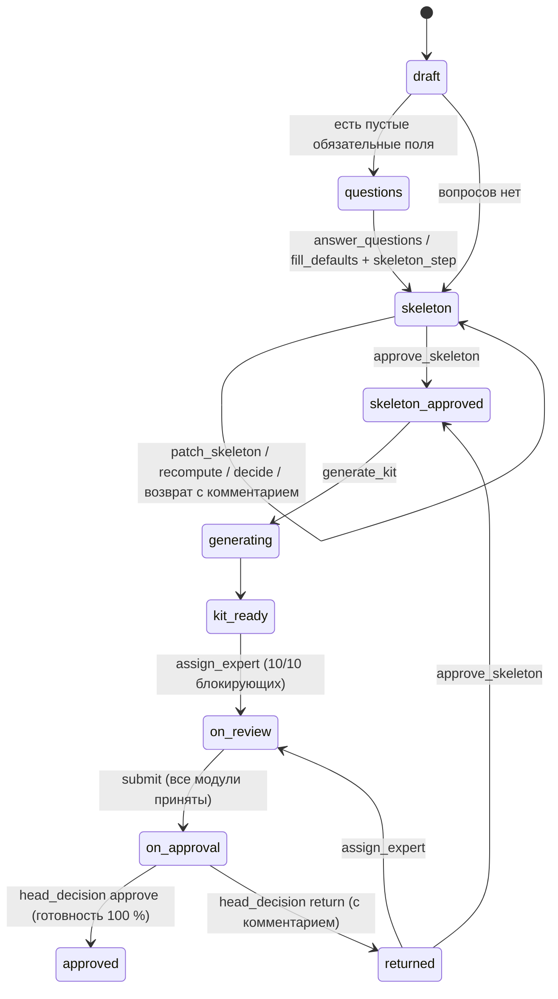
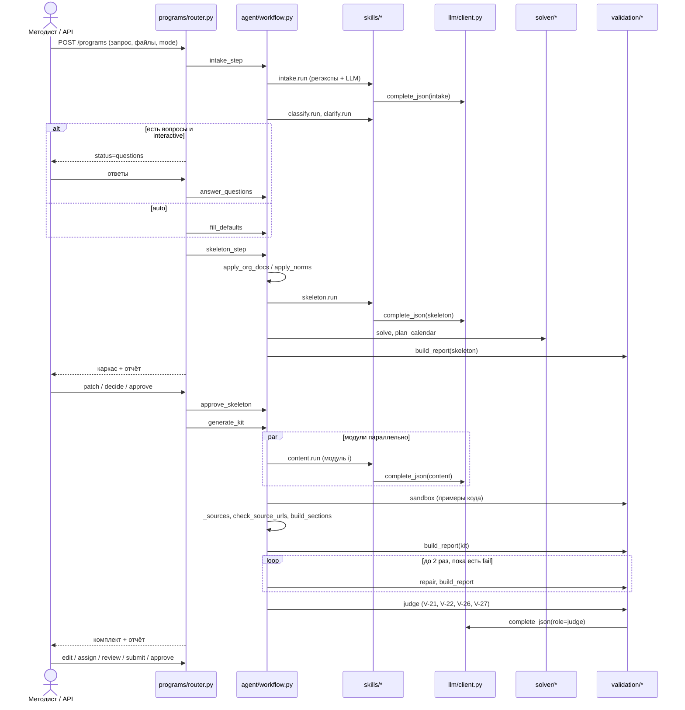

# Конвейер агента

Оркестратор агента (навык `workflow`) реализован в `src/app/agent/workflow.py` как конечный автомат над документом программы `ProgramDoc`. Он последовательно вызывает навыки разбора запроса, классификации, уточняющих вопросов, построения каркаса и генерации содержания, затем солверы часов и календаря, правила автопроверки, автоисправление и судью. Генерация содержания недоступна, пока каркас не утверждён (FR-23). Тексты разделов шаблона АЦР собирает код (`src/app/agent/sections.py`), а сценарии сверх основного потока (смена шаблона, адаптация, актуализация, песочница, нормативная база, документы организации) вынесены в `src/app/agent/extras.py`. Пайплайн режима `auto` собран в `src/app/programs/router.py` (`_auto_pipeline`).

## Состояния программы

Статус `failed` выставляет роутер, если автопрогон прервался исключением. Состояние сохраняется после шагов в `src/app/programs/service.py` (снимки версий делает роутер).

## Этапы

| Этап | Функция | Что происходит |
|---|---|---|
| 1. Запрос | `intake_step` | Навык `intake` извлекает параметры (`Params`); для приложенных референсов пишутся заметки о сходимости таблиц часов («ошибки в каркас не переносятся»). Если запрос ссылается на образец, а файла нет, `_note_known_sample` берёт известные ошибки образца из реестра организации. |
| 2. Классификация | `_classify` | Навык `classify`: тип программы, шаблон АЦР, выдаваемый документ, нормативная база, ПС. Сообщение классификатора ставится первой заметкой агента. |
| 3. Уточняющие вопросы | `clarify.run`, `answer_questions`, `fill_defaults` | До 5 вопросов по пустым обязательным полям. Ответы применяются `clarify.apply_answers`, после чего классификация повторяется. «На ваше усмотрение» и режим `auto` берут значения профиля организации и записываются в `assumptions`. |
| 4. Каркас | `skeleton_step` | Требует определённый тип (иначе `QUESTIONS_PENDING`). Подключает документы организации (`apply_org_docs`, при `norm_mode == 'org'`) и выдержки НПА (`apply_norms`), вызывает навык `skeleton`, затем `apply_solver` (часы), `plan_doc_calendar` (график), `_resolve_slide_modules`, `_expectation_note` и строит отчёт `build_report(doc, 'skeleton')`. Статус `skeleton`. |
| 5. Проверка каркаса | `patch_skeleton`, `recompute`, `decide`, `approve_skeleton`, `return_skeleton` | Методист правит часы и формулировки, принимает или отклоняет предложения по пунктам «!», утверждает каркас. |
| 6. Комплект | `generate_kit` | Модули генерируются параллельно навыком `content`, затем лекции без слайдов, итоговая аттестация, песочница примеров, источники, разделы шаблона, 27 правил, до двух проходов `repair`, судья. Статус `kit_ready`. |
| 7. Отчёт | `build_report` (`src/app/validation/report.py`) | Правила, блокирующие проверки, матрица покрытия, действия, предложения, допущения. См. [validation.md](validation.md). |
| 8. Точечная правка | `edit` | Пересобираются только потомки узла; при регрессии правка откатывается целиком. |
| 9. Согласование | `assign_expert`, `review_decision`, `add_comment`, `submit`, `head_decision` | Вычитка экспертами по модулям, отправка руководителю, утверждение. |

## Режимы

**Интерактивный** (`mode=interactive`, по умолчанию). `POST /programs` выполняет `intake_step`; если есть вопросы (шаг clarify: до 5 вопросов по пустым обязательным полям `program_type`, `volume_h`, `audience`, `form`, `final_assessment_form`) — статус `questions`, `needs_answers: true`, вопросы с вариантами и `answers_url`, и конвейер стоит до ответов; иначе сразу `skeleton_step`. Если `answers` переданы в теле, вопросы закрываются сразу (неотвеченные — значением профиля в `assumptions`) и строится каркас. `POST /programs/{id}/answers` (роли methodist и api, API-клиент — только для своих программ) продолжает конвейер: по умолчанию — фоновая сборка каркаса (`202`, `job_id`), `?wait=true` — каркас в ответе, `?mode=auto` — дальше как автопрогон (каркас, auto-approve, комплект; ответ по таблице 21). Дальше каждый шаг запускает человек: ответы, правка и утверждение каркаса, генерация комплекта (фоновая задача с прогрессом), вычитка, согласование.

**Автоматический / API** (`mode=auto`, `_auto_pipeline` в `src/app/programs/router.py`):

1. Если в теле переданы `answers`, они применяются `answer_questions`; затем `fill_defaults` заполняет оставшиеся пустые поля значениями профиля.
2. `skeleton_step`.
3. Если в календаре конфликт и вариант не выбран: выбирается `six_days`, когда в запросе задан максимум часов в день, иначе `extend`; выбор пишется в допущения.
4. До трёх попыток `approve_skeleton(..., auto=True)`. В режиме `auto` по каждому пункту «!» автоматически принимается первое предложение (`decide(..., 'accept', 'auto-approve')`); заранее выбранный календарь не трогается. Если остаются ошибки ✕ — `repair` + `recompute` и повтор. Если не помогло, программа всё равно переводится в `skeleton_approved` с заметкой о статусе `done_with_errors`.
5. `generate_kit`, сохранение снимков и событие `kit_ready`.

Нехватка данных в `auto` не скрывается: каждое значение по умолчанию — в `assumptions` (`field`, `value`, `source`), вопросы без ответа вызывающего — в `questions_skipped`. Кто хочет вопросы вместо значений по умолчанию, вызывает `POST /programs` без `mode=auto` и затем `answers?mode=auto`.

При `wait=false` автопрогон ставится в очередь задач и возвращает `202` с `job_id`. При исключении документ получает статус `failed`, а не HTTP 500; причина — в `agent_notes` и `step_errors`, трассировка — в журнале (`logger.exception` с id программы и шагом).

### Параллельная генерация и отказы

`generate_kit` запускает задачи модулей через `asyncio.gather` под семафором `max(4, gen_workers)`. Задачи не пишут в `doc` и в общий `CallStats`: каждая возвращает `ModuleRun` (модуль, содержание, свой `CallStats`). После `gather` результаты сортируются в порядке модулей каркаса и сливаются последовательно — порядок и id элементов комплекта и суммы токенов не зависят от порядка завершения задач (SPEC-FLOW-38). Общее у задач только состояние прогресса; его меняет и отправляет `_report` под `asyncio.Lock`.

Сбой навыка content (`LLMUnavailable`, неразбираемый ответ) даёт шаблонный модуль; непредвиденная ошибка задачи модуля перехватывается страховкой конвейера: модуль собирается по шаблону, остальные — как обычно (SPEC-FLOW-39). Каждый отказ — запись в `doc.step_errors` (`step`, `skill`, `module`, `error`, `fallback`) и заметка агента. Затем `ensure_module_slides` гарантирует слайды хотя бы одного модуля (заказанного, иначе первого с лекциями) по каркасу без модели (SPEC-FLOW-40). Стратегия таймаутов и повторов — [llm.md](llm.md), раздел «Таймауты, повторы и отказы». Анонимный доступ с ролью `api` ограничен частотой (`anon_runs_per_hour`).

## Основные функции `workflow.py`

### Каркас и часы

- `_final_hours(doc)` — часы итоговой аттестации: из запроса, иначе для ДООП 2 ч (объём ≤ 24 ч) или 4 ч; для ДПП 2 ч (≤ 36 ч), 4 ч (≤ 144 ч), 6 ч (больше).
- `apply_solver(doc, modules)` — вызывает `solve` из `src/app/solver/hours.py`. Режим стажировки включается для типа `dpp_pk_internship` или при `no_classroom`. Минимум практики: `min_practice_hours` или `ceil(volume × min_practice_share)`. Для ДООП без ДОТ доля СРС обнуляется. Темы, отброшенные солвером (тем больше, чем часов), отдают свои РО последней оставшейся теме. У стажировки форма контроля модулей — «Собеседование с руководителем стажировки». Итоговая аттестация по умолчанию — «Зачёт».
- `plan_doc_calendar(doc)` — календарь через `plan_calendar`; для стажировки без ограничения нагрузки берётся 4 ч в день. Элементы графика — темы с часами по видам и строка итоговой аттестации (`_schedule_items`).
- `choose_calendar_option(doc, option_id)` — применяет вариант разрешения конфликта (`apply_option`) и запоминает `chosen_option`.
- `recompute(doc)` — пересчёт после правки часов методистом. Если в модуле `manual_topics` (часы тем заданы вручную), модуль становится суммой тем, солвер темы не трогает (FR-17). Иначе часы модуля по видам делятся по темам `_split_topics`. Календарь перестраивается; ранее выбранный вариант применяется снова, если конфликт остался. Отчёт пересобирается.
- `patch_skeleton(doc, patch)` — правка каркаса (только в статусах `skeleton` и `returned`, иначе `SKELETON_LOCKED`): названия модулей и тем (до 200 символов), часы модуля (сбрасывает `manual_topics`) и тем (ставит `manual_topics`), формулировки компетенций и РО, цель, часы ИА, вариант календаря. В конце `recompute`.
- `decide(doc, rule_id, decision, ...)` — решение по пункту «!» (FR-22). При `accept`: V-22 заменяет текст РО предложением, V-10 применяет вариант календаря, V-21 меняет местами содержание двух тем (`_swap_topics`: название, описание, РО, пререквизиты; позиции и часы остаются). Решение пишется в `doc.decisions`.
- `approve_skeleton(doc, actor, auto=False)` — запрещено при правилах со статусом `fail` (`SKELETON_HAS_ERRORS`) и, в интерактивном режиме, при нерешённых предложениях (`DECISIONS_PENDING`).
- `return_skeleton` — фиксирует возврат с обязательным комментарием; повторная сборка каркаса с комментарием идёт через `skeleton_step(doc, comment)`: модели передаётся текущий каркас (`_skeleton_brief`), и, если модель недоступна, каркас не заменяется типовым, а методисту пишется заметка.

### Комплект

`generate_kit(doc, progress)`:

1. Проверка статуса (`SKELETON_NOT_APPROVED`), статус `generating`.
2. `slide_topic_ids` — темы со слайдами: модули из запроса (темы с лекциями, для ДООП все) и темы, попадающие на номера занятий из `slides_lessons` (по длительности занятия календаря).
3. `_distribute_final_test` — если в запросе задано число вопросов итогового теста, оно делится по модулям пропорционально часам (`largest_remainder`), все вопросы идут в тест `test-final` с id `qf.N`. Иначе у каждого модуля свой тест на `max(4, min(12, часы // 3))` вопросов.
4. Модули генерируются параллельно: семафор на `max(4, gen_workers)` задач, к шлюзу одновременно идут не больше `llm_concurrency` запросов. Прогресс (статусы модулей, лента, токены, стоимость, ETA) отдаётся через `progress`.
5. Сборка: программы модулей, вопросы, задания, лекции; модули, собранные без модели, попадают в `kit.drafts`. Оценочные средства: `test-<m>`, `sem-<m>` (для стажировки вид `interview`), `final`.
6. Для тем с лекционными часами без лекции добавляется план по умолчанию (`_default_plan`) длительностью `lk × 45` мин.
7. `_final_assessment` — задание и критерии ИА по форме: отчёт о стажировке, портфолио, экзамен, проект (для ДООП — детский проект), иначе общий вариант; требования к отчёту (`report_requirements`). Для стажировки — вопросы собеседования по модулям (от модели, если их не меньше трёх, иначе `interview_questions`).
8. `_fix_examples` — каждый пример кода прогоняется в песочнице (первые 12); упавший пример модель переписывает один раз (`temperature=0.2`, `max_tokens=900`), иначе пример убирается; оба исхода пишутся в заметки.
9. `_sources` — нормативная база, ПС, литература из реестра (`literature_for`, для ДООП только детская), источники от модели: найденные в реестре подтверждаются, остальные (до 14 источников всего) помечаются «[не подтверждено]». `check_source_urls` проверяет до 8 ссылок HEAD/GET-запросом (таймаут 4 с) и подтверждает открывшиеся; в режиме `fixtures` проверка пропускается.
10. `build_sections`, отчёт, до двух проходов `repair` с пересборкой разделов и отчёта, `_limit_note`, судья (если включён, модель доступна и суточный лимит не исчерпан), финальный отчёт, статус `kit_ready`, учёт токенов и времени.

### Точечная правка

- `resolve_target` — если цель не указана (`auto`), элемент ищется по словам инструкции (слова от 4 букв, совпадение по первым 6 символам) среди тем, вопросов, заданий и, если в инструкции есть «слайд»/«лекци», лекций.
- `descendants` — что пересоберётся и что останется (FR-36) для темы, вопроса, задания, теста `test-*`, лекции или слайда, часов темы `hours:<topic>`.
- `edit(doc, target, instruction, new_title, dry_run, hours)` — запрещена на утверждении. `dry_run` возвращает план и превью «было/станет» (`_preview`). Иначе делается снимок, снимаются хэши узлов (`kit_hashes`), навык `content` пересобирает потомков с припиской «Правка методиста…». Для часов — `_apply_hours`: итог модуля сохраняется за счёт самой большой соседней темы (`_hours_peer`), хронометраж лекций пересчитывается. После правки сравниваются хэши: изменения вне потомков, расхождение часов или менее двух средств проверки у РО (`_edit_guard`, V-13) откатывают документ к снимку с ошибкой `EDIT_REJECTED`. Успешная правка возвращает принятый модуль эксперту (`in_review`, FR-43).

### Согласование и метрики

- `blocking_ok` — отчёт этапа `kit` и `blocking_passed == blocking_total`.
- `assign_expert` — только при 10/10 блокирующих (`BLOCKING_FAILED`); переводит программу в `on_review`.
- `module_items`, `review_items` — элементы модуля для вычитки (рабочая программа, лекции, вопросы, задания) и сколько принято.
- `review_decision` — эксперт видит только свои модули; `accept_item` принимает элемент; `accept` модуля требует принятия всех элементов (`ITEMS_NOT_CHECKED`) и сохраняет оценку 1–5; `return` требует комментарий.
- `add_comment` — комментарий переводит модуль в статус «вопрос».
- `submit` — 10/10 блокирующих и все модули приняты, статус `on_approval`.
- `readiness` — индекс готовности (FR-51): `round(100 × (блокирующие + принятые модули) / (10 + число модулей))` и список незакрытых пунктов с владельцами.
- `head_decision` — утверждение при индексе 100 %, возврат только с комментарием.
- `quality(doc, events)` — доля элементов, правленных людьми; модули, принятые без правок; средняя оценка экспертов; число примеров кода и доля работающих (по V-24); рабочие дни (пн–пт) от создания до утверждения; оценка времени команды — 6 минут на одно решение человека из журнала; стоимость и время генерации.
- `restore_into` — откат версии возвращает содержание, но не статус и не решения людей (FR-38).

## Разделы программы (`sections.py`)

`build_sections(doc)` возвращает словарь «ключ раздела → текст». Заголовки и порядок разделов задаются в `src/app/validation/rules.py` (`SECTIONS_DPP` — 31 строка для ДПП ПК, `SECTIONS_DOOP` — 21 строка для ДООП), здесь только тексты. Строки «— …» выгружаются в DOCX маркированным списком, «N. …» — нумерованным. Тексты собираются из графа комплекта, текст референса не копируется.

Особенности:

- Реквизиты остаются полями: `approval` — «Приказом № ____-<префикс> от «___» ______ 20__ г.», `authors` и `conditions_org` — `________________` для ФИО и подписей.
- Режим занятий берётся из календаря: по занятиям («N раз в неделю по H ак. ч») или по дням («не более H ак. ч в день»).
- Падежи аудитории приводятся к именительному (`nominative`), первая буква — к строчной/прописной по месту.
- `results`: для ДПП — компетенции с ТФ и ПС и РО «Знать/Уметь/Владеть»; для ДООП — блоки «Знания/Умения/Навыки».
- `volume` для ДПП содержит контактную работу (её сверяет правило V-05), СРС, ИА и срок.
- `attestation_forms`: критерии ИА с баллами и порог «зачтено» — 70 % суммы баллов.
- `software` подбирается по упоминаниям инструментов в программе с версиями из реестра `tools()['current']`, плюс Linux-стенд, сервисы ИИ, доступные в России, и офисное ПО.
- Литература (`_literature`) делится на НПА (`law`, `ps`), основную (первые 4 книги, подтверждённые вперёд), дополнительную и интернет-ресурсы.
- `process` дополняется требованиями подключённых актов: ЭО и ДОТ (акты с «816» или «1678») при дистанционной форме, СанПиН (`4283-26`, `1.2.3685-21`) для ДООП, акт о практической подготовке для стажировки.

### Раздел 1.4 «Программа разработана на основе»

Ключ `ps`. Состав:

1. Для ДПП с выбранным ПС — «Профессиональный стандарт <код> «<название>» (<приказ>)»; если ПС не подтверждён, добавляется пометка о сверке кодов ТФ с реестром Минтруда.
2. Все акты вида `law` из `doc.norm_base` (обязательные для типа программы и подобранные по запросу, см. `norm_base_for` в `src/app/kb/registry.py` и `apply_norms`). Если их нет — 273-ФЗ и приказ Минпросвещения № 629 (ДООП) или приказ Минобрнауки № 266 (ДПП).
3. При наличии обязательных тем — «Требования заказчика к содержанию: …» (до 6 тем).

Следом (`competencies_list`, раздел 1.5) — ТФ из ПС по кодам компетенций или сами компетенции.

## Сценарии сверх потока (`extras.py`)

| Функция | Назначение |
|---|---|
| `apply_norms(doc)` | Поиск по нормативной базе знаний (`app.kb.norms.search`, `registry/norms/*.md`, детерминированный поиск по словам, k = 12) по запросу и параметрам. В промпт берутся до 4 фрагментов актов, относящихся к запросу (обязательных `core` или совпавших по ключевым словам). Акт добавляется в `norm_base`, если применим к типу программы. Вызывается из `skeleton_step`, если `norm_fragments` пусты. |
| `apply_org_docs(doc)` | Режим «документы организации» (FR-09): `orgdocs.search(k=4)`; найденные документы — в `norm_base` (вид `doc`), фрагменты — в `org_fragments` для промптов; если референса нет, структура берётся из первого шаблона организации. Пустая база — заметка и госстандарты. |
| `change_template(doc, type)` | Смена шаблона до утверждения каркаса (FR-06): переклассификация, для ДООП снимаются ПС и ТФ, для ДПП ТФ раздаются по кругу; часы, календарь, отчёт пересчитываются. |
| `adapt(src, new_id, volume_h, audience, title, duration_weeks)` | Новая программа по готовой (FR-60): копия графа компетенций и модулей, объём 8–2000 ч, пропорциональный пересчёт срока, минимума практики и числа вопросов (при уменьшении объёма), сброс комплекта, решений, согласований; часы — солвером. |
| `scan_text`, `actualize_doc` | Актуализация (FR-61): устаревшие конструкции (`outdated`), версии ниже минимальной или ниже текущей, недоступные в России сервисы ИИ, источники 1950–2015 гг. Находки привязаны к узлам для точечной правки. |
| `diff(a, b)` | Сравнение версий (FR-38): поля, модули, темы, часы, компетенции, РО и узлы комплекта по хэшам. |
| `sandbox_report(doc, limit=20)` | Песочница (FR-46): запуск каждого примера, версии библиотек, время, устаревшие конструкции. |
| `tasks_for` | Счётчик задач по ролям (FR-63). |
| `suggest_experts` | Подсказка эксперта на модуль по совпадению навыков с темами, при равенстве — по нагрузке (FR-39). |

## Последовательность вызовов

