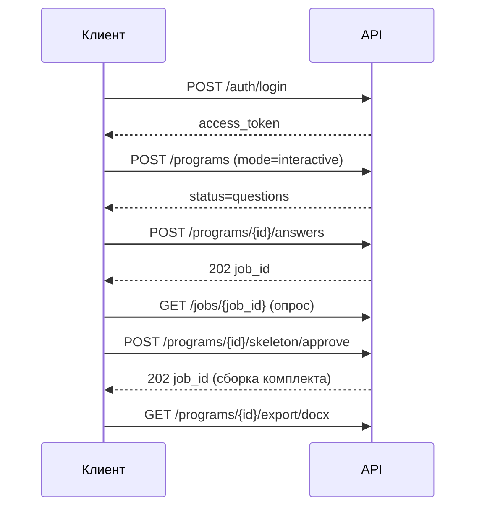

# Справочник REST API

МетодАгент предоставляет REST API с префиксом `/api/v1` (настройка `API_V1_PREFIX`), собранный в `src/app/main.py` из роутеров `auth` и `admin` (`src/app/auth/router.py`), `programs` и `misc` (`src/app/programs/router.py`) и `extras` (`src/app/programs/extra_router.py`), плюс несколько служебных методов, объявленных прямо в `main.py`. Доступ к каждому методу проверяется зависимостями `require(...)` и `current_principal` из `src/app/core/security.py`: токен JWT несёт одну активную роль, и метод либо пропускает её, либо отвечает `403 FORBIDDEN_ROLE`. Ошибки возвращаются в едином формате `{"code", "message_ru", "details"}` (`src/app/core/errors.py`). Интерактивная документация OpenAPI (Swagger UI) доступна по адресу `/docs`, если включена настройка `DOCS_ENABLED` (по умолчанию включена); ReDoc отключён.

## 1. Общие сведения

| Параметр | Значение |
|---|---|
| Базовый путь | `/api/v1` |
| Формат | JSON (кроме загрузки файлов `multipart/form-data` и выгрузки файлов) |
| CORS | разрешены все источники, методы и заголовки |
| OpenAPI | `GET /docs` (при `DOCS_ENABLED=true`), схема `GET /openapi.json` |
| Состояние | `GET /health` и `GET /api/v1/health` |
| Неизвестный путь под `/api/...` | `404 NOT_FOUND` в формате ошибок (если собран интерфейс, остальные пути отдают SPA) |

## 2. Аутентификация

### 2.1. Токен

- Токен выдают `POST /auth/login`, `POST /auth/register` и `POST /auth/switch-role`. Ответ: `{"access_token", "token_type": "bearer", "user": {...профиль, "role"}}`.
- Токен — JWT (`HS256` по умолчанию, настройка `JWT_ALGORITHM`), подписан `SECRET_KEY`, поля: `sub` (id пользователя), `role` (активная роль), `exp`.
- Срок жизни — `ACCESS_TOKEN_EXPIRE_MINUTES`, по умолчанию 720 минут (12 часов); администратор может изменить его в настройках (15 минут — 30 суток).
- Если `SECRET_KEY` короче 16 символов или содержит `change-me`, при старте генерируется случайный ключ и сохраняется в `data_dir/.secret_key`.

### 2.2. Заголовки

| Заголовок | Назначение |
|---|---|
| `X-MA-Token: <токен>` | Используется интерфейсом. **Имеет приоритет**: если передан, `Authorization` не читается |
| `Authorization: Bearer <токен>` | Для API-клиентов и автопрогона. Схема должна быть `Bearer`, иначе `401` |

При проверке токена сервер дополнительно требует: пользователь существует, активен, роль из токена есть среди его ролей. Токен демо-учётки (кроме `u-api` и `u-admin`) отклоняется, если администратор выключил демо-учётки.

### 2.3. Запросы без токена (автопрогон)

Без обоих заголовков запрос выполняется от анонимного принципала с ролью `api` (пользователь `u-api`) по правилам:

| Запрос | Результат |
|---|---|
| `GET`, `HEAD`, `OPTIONS` | Пропускается как роль `api` (дальше действуют проверки конкретного метода) |
| `POST .../programs?mode=auto` | Пропускается как роль `api`, не больше `ANON_RUNS_PER_HOUR` (по умолчанию 12) запусков в час с одного IP (учитывается `X-Forwarded-For`); сверх — `429 RATE_LIMIT` |
| Любой другой запрос | `401 UNAUTHORIZED` |

Анонимный клиент видит только программы пользователя `u-api`; при обращении к чужой программе получает `401`.

## 3. Ошибки

Тело ошибки: `{"code": "...", "message_ru": "...", "details": {...}}`.

| HTTP | `code` | Класс / источник | Когда |
|---|---|---|---|
| 400 | `BAD_REQUEST` | `BadRequest` | Некорректные данные; также частные коды: `CONSENT_REQUIRED`, `WRONG_PASSWORD`, `WEAK_PASSWORD`, `BAD_LOGIN`, `BAD_EMAIL`, `SSO_NOT_AVAILABLE` |
| 401 | `UNAUTHORIZED` | `Unauthorized` | Нет входа, неверный логин или пароль, токен недействителен или истёк |
| 403 | `FORBIDDEN_ROLE` | `ForbiddenRole` | Роль не допущена к методу; `details.allowed` — список допустимых ролей (для `require`). Частный код: `REGISTRATION_CLOSED` |
| 404 | `NOT_FOUND` | `NotFound` | Программа, версия, задание, пользователь, навык или документ не найдены |
| 409 | `STATE_CONFLICT` | `Conflict` | Действие недоступно в текущем состоянии программы; частные коды `LOGIN_TAKEN`, `EMAIL_TAKEN`, `LAST_ADMIN` |
| 422 | `VALIDATION_ERROR` | `RequestValidationError` | Тело или параметры не соответствуют схеме; `details.errors` — список `{loc, msg}` |
| 429 | `RATE_LIMIT` | `RateLimited` | Лимит автопрогонов без токена, регистраций (10 в час с IP) или параллельных заданий (`MAX_PARALLEL_JOBS`, по умолчанию 4) |
| 500 | `INTERNAL_ERROR` | любое необработанное исключение | Внутренние детали не раскрываются |

## 4. Обозначения ролей

`methodist` — методист, `expert` — эксперт, `head` — руководитель, `admin` — администратор, `api` — API-клиент (автопрогон). «Любая» означает `current_principal` без ограничения ролей (включая анонимный `api` для GET). «Вошедший» — любой неанонимный пользователь.

## 5. Вход и учётная запись (`/auth`)

| Метод и путь | Кто | Тело / параметры | Ответ | Ошибки |
|---|---|---|---|---|
| `POST /auth/login` | все (без токена) | `login` (логин или почта), `user_id` (совместимость, напр. `u-madina`), `password` (по умолчанию `demo`), `role` (необязательно) | сессия: `access_token`, `token_type`, `user` | 401: неверный логин/пароль, учётка отключена, демо-учётки отключены, нет такой роли |
| `POST /auth/register` | все (без токена) | `name` (2–120), `login` (3–32), `email`, `password` (8+), `consent` | 201, сессия с ролью по умолчанию | 403 `REGISTRATION_CLOSED`, 400 `CONSENT_REQUIRED`, 400 `BAD_LOGIN`/`BAD_EMAIL`/`WEAK_PASSWORD`, 409 `LOGIN_TAKEN`/`EMAIL_TAKEN`, 429 |
| `GET /auth/config` | все | — | `demo_accounts` (логин, имя, роль, должность), `demo_password`, `registration_enabled`, `registration_default_role`, `sso` (`enabled`, `provider`, `display_name`, `configured`, `available: false`) | — |
| `GET /auth/sso/start` | все | — | всегда ошибка | 400 `SSO_NOT_AVAILABLE` |
| `GET /auth/users` | все | — | демо-пользователи (`id`, `login`, `name`, `roles`, `title`); пустой список, если демо-учётки выключены | — |
| `GET /auth/me` | вошедший | — | профиль (`id`, `login`, `name`, `roles`, `title`, `email`, `source`, `active`) + `role` | 401 для анонимного |
| `PUT /auth/me` | вошедший | `name`, `email`, `title` (все необязательные) | обновлённый профиль | 403 для демо-учётки, 400/409 при проверке почты |
| `PUT /auth/me/password` | вошедший | `current`, `new` (8+) | `{"status": "ok"}` | 403 для демо-учётки, 400 `WRONG_PASSWORD`, 400 `WEAK_PASSWORD` |
| `POST /auth/switch-role` | вошедший | `role` | новая сессия с другой ролью | 403, если роли нет у пользователя |

Пример входа:

```bash
curl -s -X POST https://<host>/api/v1/auth/login \
  -H 'Content-Type: application/json' \
  -d '{"login": "madina", "password": "demo"}'
# {"access_token": "eyJ...", "token_type": "bearer", "user": {"id": "u-madina", ..., "role": "methodist"}}
```

## 6. Администрирование (`/admin`)

Все методы — только `admin` (`require('admin')`). Изменения пишутся в журнал организации (`program_id = 'org'`).

| Метод и путь | Тело / параметры | Ответ | Ошибки |
|---|---|---|---|
| `GET /admin/users` | — | список профилей пользователей | 403 |
| `POST /admin/users` | `login`, `name`, `password` (8+), `roles` (по умолчанию `["expert"]`), `email`, `title` | 201, профиль | 400 (логин, почта, пароль, роли), 409 `LOGIN_TAKEN`/`EMAIL_TAKEN` |
| `PATCH /admin/users/{user_id}` | любые из `login`, `name`, `email`, `title`, `roles`, `active`, `password` | профиль | 404, 400, 409 `LAST_ADMIN` (нельзя снять роль или отключить последнего активного администратора) |
| `GET /admin/settings` | — | `groups` (группы настроек), `fields` (описание полей, секреты — маской) | 403 |
| `PUT /admin/settings` | `values` (ключ → значение), `clear` (ключи, вернуть значение окружения) | `changed`, `groups`, `fields` | 400 |
| `GET /admin/skills` | — | навыки: `name`, `description`, `model_role`, `instruction`, редактируемые параметры, `overridden`, `defaults` | 403 |
| `PUT /admin/skills/{name}` | `temperature`, `max_tokens`, `timeout_s`, `retries`, `instruction` (не короче 20 символов), `reset` | обновлённый навык | 404, 400 (выход за допустимый диапазон) |
| `GET /admin/journal` | — | события организации: регистрации, смены паролей, пользователи, настройки, навыки, профиль, реестры | 403 |

## 7. Программы (`/programs`)

### 7.1. Создание и чтение

| Метод и путь | Кто | Тело / параметры | Ответ | Ошибки |
|---|---|---|---|---|
| `POST /programs` | methodist, api (без токена — только `mode=auto`) | query `mode`: `interactive` (по умолчанию) или `auto`. Тело: `request` (5–5000 символов), `attachments` (до 5: `name`, `content_base64`), `norm_mode` (`gos`/`org`), `wait` (по умолчанию `true`), `answers` (ответы на вопросы заранее) | см. ниже | 400 (base64, число и размер файлов, формат), 422, 429 |
| `POST /programs/upload` | methodist, api | `multipart/form-data`: `text`, `norm_mode`, `files` | `program_id`, `status` (`questions` или `skeleton_building` с `job_id`), `program` | 400, 422 |
| `GET /programs` | любая, кроме admin | query `status` (через запятую), `since`, `until` (`ГГГГ-ММ-ДД`) | список программ. api видит только свои; expert — только программы с назначенными ему модулями | 403 для admin, 422 |
| `GET /programs/{id}` | любая, кроме admin | — | состояние программы + `readiness`, `totals`, `program` (комплект по схеме; у эксперта `null`), для methodist и head — `quality`. Эксперт получает только назначенные модули, их элементы комплекта и комментарии | 403 (admin; эксперт без модулей; api к чужой), 401 (анонимный к чужой), 404 |

Ответ `POST /programs`:

- `mode=interactive`: если нужны уточнения — `{"program_id", "status": "questions", "questions", "program"}`; иначе каркас собирается синхронно — `{"program_id", "status", "program"}`.
- `mode=auto`, `wait=true`: полный ответ автопрогона (поля ниже). При сбое — тот же формат со `status: "failed"`, а не 500.
- `mode=auto`, `wait=false`: `202 {"program_id", "job_id", "status": "queued"}`; результат забирается через `GET /jobs/{job_id}`.

Поля ответа автопрогона: `program_id`, `status` (`done` — комплект готов и нет проваленных правил; `done_with_errors` — комплект есть, но есть ошибки; `failed`), `assumptions`, `questions_skipped`, `skeleton` (`template`, `type`, `issued_document`, `title`, `goal`, `ps_code`, `volume_h`, `competencies`, `modules` с темами и часами, `final_assessment`, `totals` с `lk/pr/lb/srs/ia/all`, `calendar`), `kit`, `report` (`rules_passed`, `rules_total`, `blocking_checks`, `failed_rules`, `unconfirmed_sources`, `rules`, `coverage`), `agent_notes`, `files` (ссылки на выгрузку во всех форматах), `timing_s`, `tokens` (`in`, `out`, `cost_rub`, `calls`).

### 7.2. Каркас

| Метод и путь | Кто | Тело | Ответ |
|---|---|---|---|
| `POST /programs/{id}/answers` | methodist | `answers` (id вопроса → ответ) | `202 {"job_id", "status": "queued"}` — сборка каркаса |
| `PATCH /programs/{id}/skeleton` | methodist | произвольный объект правок (часы, названия, формулировки, `final_hours`, `calendar_option` и др.) | `program`, `totals` |
| `POST /programs/{id}/skeleton/decisions` | methodist | `rule_id`, `decision` (`accept`/`keep`), `node`, `proposal`, `option_id` | `program` |
| `POST /programs/{id}/skeleton/approve` | methodist | `decision` (`approve`/`return`), `comment` | `202 {"job_id", "status": "queued"}`: при `approve` — сборка комплекта (с проверкой лимита заданий, 429), при `return` — пересборка каркаса с комментарием |
| `POST /programs/{id}/template` | methodist | `program_type`: `dpp_pk`, `dpp_pk_internship` или `doop` | `program` |

### 7.3. Комплект, правки, версии

| Метод и путь | Кто | Параметры | Ответ |
|---|---|---|---|
| `GET /programs/{id}/report` | methodist, head, api | — | отчёт автопроверки и матрица покрытия (`{}`, если отчёта ещё нет) |
| `POST /programs/{id}/edits` | methodist, expert | `target` (id элемента; `hours:<id темы>`; пусто — агент найдёт по тексту), `instruction`, `new_title`, `hours`, `dry_run` | результат правки (при `dry_run` — затрагиваемые элементы и «было / станет») + `program`. Эксперт: 403 для часов и чужих модулей; 409 при конфликте состояния |
| `GET /programs/{id}/versions` | methodist, head | — | список версий |
| `POST /programs/{id}/versions/{version}/restore` | methodist | — | `version`, `status`; 404 для несуществующей версии |
| `GET /programs/{id}/versions/{a}/diff/{b}` | methodist, head | — | сравнение версий |
| `GET /programs/{id}/sections` | любая (api — только свои) | — | разделы шаблона: `key`, `title`, `level`, `text` |
| `GET /programs/{id}/export/{fmt}` | любая, кроме expert (api — только свои) | `fmt`: `docx`, `pptx`, `gift`, `moodle_xml`, `json`, `order_draft`, `lectures_docx` | файл с `Content-Disposition: attachment` |
| `GET /programs/{id}/events` | methodist, head | — | журнал событий программы |
| `GET /programs/{id}/actualize` | methodist, expert, head, api | — | `program_id`, `findings`, `total`, `registry_checked_at` |
| `POST /actualize` | methodist, api | `multipart`: `file` (.docx, .pdf, текст) | `name`, `chars`, `structure`, `findings`, `total`; 400 при превышении размера или неподдерживаемом формате |
| `GET /programs/{id}/sandbox` | methodist, expert, head | — | отчёт запуска примеров кода (эксперту — только по своим модулям) |
| `POST /programs/{id}/adapt` | methodist, api | `volume_h` (8–2000), `audience`, `title`, `duration_weeks` | новая программа: `program_id`, `status`, `program` |

Примечание: `GET /programs/{id}` у роли `admin` возвращает 403 явно; методы с `require(...)` без `admin` также дают 403.

### 7.4. Команда, вычитка и утверждение

| Метод и путь | Кто | Тело | Ответ |
|---|---|---|---|
| `GET /programs/{id}/experts` | methodist, head | — | эксперты профиля с подсказкой агента по модулям |
| `PUT /programs/{id}/modules/{module_id}/expert` | methodist | `expert_id` | `program`; 400, если пользователь не эксперт. Эксперт получает уведомление |
| `POST /programs/{id}/comments` | expert, methodist | `module_id`, `text` (1–2000), `node_id`, `ask_agent` | `comment`; эксперт — только свои модули (403) |
| `POST /programs/{id}/comments/answer` | methodist, expert | `comment_id`, `answer`, `apply_proposal`, `ask_agent` | `program`, `comment`; 400, если комментарий не найден |
| `POST /programs/{id}/reviews/decision` | expert | `module_id`, `decision` (`accept`/`return`/`question`/`accept_item`), `comment`, `node_id`, `score` (1–5) | `program` |
| `POST /programs/{id}/submit` | methodist | — | `status`; руководители получают уведомления |
| `POST /programs/{id}/approval` | head | `decision` (`approve`/`return`), `comment` | `status`; владелец получает уведомление |

## 8. Задания, вычитка, уведомления (`misc`)

| Метод и путь | Кто | Тело / параметры | Ответ |
|---|---|---|---|
| `GET /jobs/{job_id}` | любая (по правам на программу задания) | — | статус `queued`/`running`/`done`/`failed`, `progress`; при `done`: для `auto` — `result` в формате автопрогона, иначе `{program_id, status, version}`. 404, если задания нет |
| `GET /reviews` | expert | — | задания на вычитку: `rid` (`program_id__module_id`), `program_id`, `program`, `module_id`, `n`, `title`, `status`, `hours`, `items_total`, `items_done` |
| `POST /reviews/{rid}/comments` | expert, methodist | `text`, `node_id`, `ask_agent` | как `POST /programs/{id}/comments`; 400 при неверном `rid` |
| `POST /reviews/{rid}/decision` | expert | `decision`, `comment`, `node_id`, `score` | как `POST /programs/{id}/reviews/decision` |
| `GET /notifications` | любая | — | уведомления текущего пользователя |
| `POST /notifications/read` | любая | `ids` (пусто — все) | `{"marked": N}` |
| `GET /me/tasks` | вошедший | — | `user_id`, `roles`, `tasks` (число задач по ролям methodist, expert, head) |

## 9. База знаний и профиль организации

| Метод и путь | Кто | Тело / параметры | Ответ |
|---|---|---|---|
| `GET /kb/documents` | admin, methodist, head | — | документы организации |
| `POST /kb/documents` | admin | `multipart`: `file`, `kind` (`template`, `regulation`, `other`) | карточка документа; 400 при размере или формате |
| `POST /org/documents` | admin | то же | то же |
| `DELETE /kb/documents/{doc_id}` | admin | — | `{"status": "deleted"}`; 404 |
| `POST /kb/search` | admin, methodist, head, expert | `query` (2–2000), `k` (1–20, по умолчанию 5) | фрагменты документов организации и выжимок НПА, отсортированные по оценке |
| `GET /kb/norms` | admin, methodist, head, expert | — | `documents` (выжимки без текста фрагментов), `counts` (`npa`, `ps`, `fgos`, `literature`) |
| `GET /org/profile` | admin, methodist, head | — | профиль организации; блок `smtp` — только администратору |
| `PUT /org/profile` | admin | частичный профиль (допустимые поля см. `knowledge-base.md`) | итоговый профиль; 400 при неизвестных полях или пароле SMTP |
| `GET /org/registry` | admin, methodist, head | query `kind`: `ps`, `npa`, `fgos`, `tools`, `literature` | раздел реестра; 400 при другом `kind` |
| `PUT /org/registry` | admin | `kind` (`ps`, `npa`, `tools`, `literature`), `items` | `{"kind", "items": N}`; 400 при пустом списке или отсутствии обязательных полей |

## 10. Служебные методы

| Метод и путь | Кто | Ответ |
|---|---|---|
| `GET /health` | все | `{"status": "ok", "version", "llm"}` |
| `GET /api/v1/health` | все | то же |
| `GET /api/v1/llm/status` | все | результат проверки шлюза LLM, `spent_today_rub`, `daily_budget_rub`, `daily_limit_reached`, `models` (`generate`, `judge`, `embed`), `judge_enabled` |
| `GET /api/v1/skills` | все | навыки агента: `name`, `description`, `version` |

## 11. Типовой сценарий



### Создание программы в режиме auto

С токеном:

```bash
TOKEN=$(curl -s -X POST https://<host>/api/v1/auth/login \
  -H 'Content-Type: application/json' \
  -d '{"login": "api", "password": "demo"}' | python3 -c 'import sys,json; print(json.load(sys.stdin)["access_token"])')

curl -s -X POST 'https://<host>/api/v1/programs?mode=auto' \
  -H "Authorization: Bearer $TOKEN" \
  -H 'Content-Type: application/json' \
  -d '{"request": "Программа повышения квалификации по анализу данных на Python, 72 часа, для аналитиков"}'
```

Без токена (лимит частоты на IP) и асинхронно:

```bash
curl -s -X POST 'https://<host>/api/v1/programs?mode=auto' \
  -H 'Content-Type: application/json' \
  -d '{"request": "ДООП по робототехнике для детей 10-12 лет, 144 часа", "wait": false}'
# 202 {"program_id": "prg-...", "job_id": "...", "status": "queued"}

curl -s https://<host>/api/v1/jobs/<job_id>
```

### Получение комплекта

```bash
# JSON-состояние программы с комплектом в поле program
curl -s https://<host>/api/v1/programs/<program_id> -H "Authorization: Bearer $TOKEN"

# Файлы комплекта
curl -s -OJ https://<host>/api/v1/programs/<program_id>/export/docx -H "Authorization: Bearer $TOKEN"
curl -s -OJ https://<host>/api/v1/programs/<program_id>/export/moodle_xml -H "Authorization: Bearer $TOKEN"
```

Демо-учётка `api` имеет роли `api` и `methodist`; при входе без поля `role` выдаётся первая роль — `api`.
