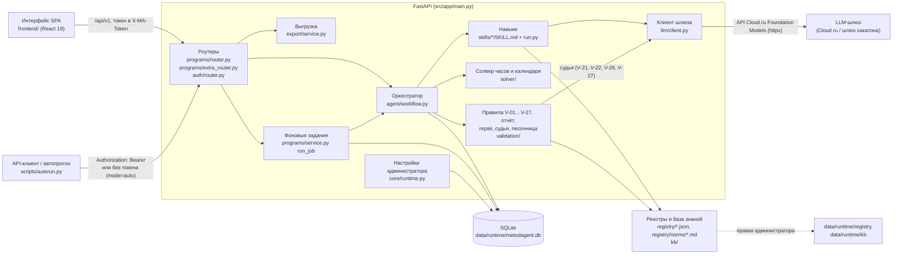

# Архитектура МетодАгента

МетодАгент — веб-сервис для методиста: по запросу свободным текстом (и, при желании, файлам-референсам) он собирает дополнительную программу трёх типов — ДПП ПК, ДПП ПК в форме стажировки или ДООП — по шаблону АЦР, затем полный комплект материалов (рабочие программы модулей, тесты с ключами, задания с критериями, планы и слайды лекций, материалы итоговой аттестации), проверяет его 27 правилами и проводит через вычитку экспертами и утверждение руководителем. Бэкенд — FastAPI с асинхронным SQLAlchemy поверх SQLite (`src/app`), интерфейс — React 19 + Vite (`frontend/`), который собирается в `frontend/dist` и раздаётся тем же процессом FastAPI. Языковая модель вызывается через шлюз Cloud.ru Foundation Models; всё, что можно посчитать детерминированно (часы, календарь, реквизиты, проверки), считает код.

## Общая схема

## Структура каталогов

| Путь | Назначение |
|---|---|
| `src/app/main.py` | Точка входа: создание FastAPI-приложения, `lifespan` (инициализация БД, загрузка пользователей и настроек, возобновление заданий), `/health`, раздача SPA |
| `src/app/core/config.py` | Настройки `Settings` (pydantic-settings), генерация `SECRET_KEY` при его отсутствии |
| `src/app/core/runtime.py` | Настройки, которые администратор меняет в интерфейсе (перекрывают окружение) |
| `src/app/core/crypto.py` | Шифрование секретов из админки ключом, производным от `SECRET_KEY` |
| `src/app/core/db.py` | ORM-модели таблиц, движок и фабрика сессий, `init_db()` (`create_all`) |
| `src/app/core/security.py` | Роли, JWT, демо-учётки, `current_principal`, `require(...)`, анонимный доступ с лимитом |
| `src/app/core/errors.py` | Ошибки API в формате `{"code", "message_ru", "details"}` |
| `src/app/agent/workflow.py` | Оркестратор: конечный автомат статусов, шаги intake → каркас → комплект, правки, вычитка, утверждение |
| `src/app/agent/sections.py` | Тексты разделов шаблона АЦР, собираемые кодом из графа программы |
| `src/app/agent/extras.py` | Смена шаблона, адаптация, актуализация, сравнение версий, песочница, задачи по ролям |
| `src/app/skills/base.py` | Загрузка навыков из `skills/*/SKILL.md`, правки администратора поверх (`data/runtime/skills_overrides.json`) |
| `src/app/skills/<имя>/` | Навыки: `SKILL.md` (frontmatter + инструкция), `schema_in.json`, `run.py` (есть не у всех, см. ниже) |
| `src/app/solver/hours.py` | Детерминированный солвер часов (метод наибольших остатков) |
| `src/app/solver/calendar.py` | Календарный график, конфликты ограничений и варианты их разрешения |
| `src/app/validation/rules.py` | 27 правил автопроверки, перечни разделов шаблонов ДПП и ДООП |
| `src/app/validation/report.py` | Отчёт: 10 блокирующих проверок, матрица покрытия, действия методиста |
| `src/app/validation/repair.py` | Детерминированная починка элементов, не прошедших правило (до 2 попыток) |
| `src/app/validation/judge.py` | Уточнение смысловых правил моделью-судьёй |
| `src/app/validation/sandbox.py` | Запуск примеров кода в отдельном процессе без сети (V-24) |
| `src/app/validation/ngrams.py` | Доля совпадений 8-грамм с референсами (V-17) |
| `src/app/kb/registry.py` | Чтение реестров `registry/*.json` с правками администратора из `data/runtime/registry` |
| `src/app/kb/norms.py` | Выжимки актов `registry/norms/*.md`, поиск по словам |
| `src/app/kb/orgdocs.py` | Документы организации в базе знаний (`data/runtime/kb/index.json`), разбиение на фрагменты |
| `src/app/kb/files.py` | Разбор референсов .docx/.pdf/.txt, проверка таблиц часов |
| `src/app/llm/client.py` | Клиент шлюза: ретраи, резервная модель, семафор, учёт токенов и рублей, дневной бюджет |
| `src/app/export/service.py` | Выгрузки: docx, pptx, GIFT, Moodle XML, JSON 4.8, проект приказа, лекции docx |
| `src/app/programs/schemas.py` | Pydantic-модель документа программы `ProgramDoc` |
| `src/app/programs/service.py` | Загрузка/сохранение, версии, журнал, уведомления, фоновые задания |
| `src/app/programs/router.py` | Основные методы `/api/v1/programs`, `/jobs`, `/reviews`, `/notifications` |
| `src/app/programs/extra_router.py` | Дополнительные сценарии, база знаний, профиль организации, реестры |
| `src/app/auth/router.py` | Вход, регистрация, личный кабинет; `/admin/*` — пользователи, настройки, навыки, журнал |
| `src/app/auth/service.py` | Хранение учётных записей в таблице `users`, кэш в памяти |
| `frontend/src/App.tsx` | Маршруты SPA и оболочка (`/`, `/auth`, `/help`, `/app`, `/app/p/:id`, `/app/reviews`, `/app/kb`, `/app/admin`, `/app/me`) |
| `frontend/src/api.ts` | Клиент API интерфейса |
| `frontend/src/pages/` | Страницы: `Landing`, `Login`, `Help`, `Programs`, `Program`, `ProgramTools`, `Reviews`, `Kb`, `Admin`, `Me` |
| `frontend/src/components/ui.tsx` | Общие компоненты интерфейса |
| `registry/` | Проверенные реестры: НПА, профстандарты с кодами ТФ, ФГОС, литература, инструменты, профиль организации |
| `registry/norms/` | 52 выжимки нормативных актов (Markdown с YAML-заголовком) |
| `testset/cases.json` | 5 открытых запросов кейса для автопрогона |
| `tests/` | Тесты pytest (см. `docs/development.md`) |
| `scripts/` | `autorun.py` (автопрогон), `deploy_vm.sh` (Docker), `run_vm.sh` (без Docker) |
| `data/samples/` | Образцы программ АЦР (.docx) |
| `data/runtime/` | Рабочие данные сервиса (не в git) |
| `logs/` | Журналы приложения и результаты автопрогона |
| `Dockerfile`, `docker-compose.yml` | Сборка и запуск контейнера |

### Навыки

| Навык | `model_role` | `run.py` | Назначение |
|---|---|---|---|
| `intake` | generate | есть | Разбор запроса и референсов в `Params` |
| `classify` | rules | есть | Тип программы, шаблон АЦР, нормативная база, кандидаты ПС |
| `clarify` | rules | есть | До 5 вопросов по пустым обязательным полям |
| `skeleton` | generate | есть (+ `library.py`) | Цель, компетенции З/У/Н, модули и темы с весами; `library.py` — типовые структуры на случай недоступности модели |
| `hours_solver` | none | нет | Описание; код — `src/app/solver/` |
| `content` | generate | есть | Содержание модуля: рабочая программа, тест, задания, лекции, слайды |
| `validate` | judge | нет | Описание; код — `src/app/validation/rules.py`, `judge.py` |
| `repair` | judge | нет | Описание; код — `src/app/validation/repair.py` |
| `review_assist` | generate | есть | Предложение правки по комментарию эксперта |
| `export` | none | нет | Описание; код — `src/app/export/service.py` |
| `workflow` | none | нет | Описание; код — `src/app/agent/workflow.py` |

## Жизненный цикл запроса

1. **Создание.** `POST /api/v1/programs` (JSON, вложения в base64) или `POST /api/v1/programs/upload` (multipart, используется интерфейсом). Роль `methodist` или `api`. Файлы разбираются `kb/files.py` (не больше `MAX_FILES_PER_REQUEST`, каждый до `MAX_FILE_SIZE_MB`). Создаётся `ProgramDoc` с id вида `prg-xxxxxxxxxx`, вызывается `workflow.intake_step` (навыки intake, classify, clarify), пишется событие `created`.
2. **Вопросы.** Если `clarify` вернул вопросы, статус `questions`; методист отвечает через `POST /programs/{id}/answers`, после чего ставится задание `skeleton`.
3. **Каркас.** `workflow.skeleton_step`: навык skeleton предлагает структуру и веса, `apply_solver` раскладывает часы, `plan_doc_calendar` строит календарь, затем прогоняются правила каркаса (`SKELETON_RULES`). Статус `skeleton`, сохраняется снимок версии.
4. **Работа с каркасом.** `PATCH /programs/{id}/skeleton` (часы, названия, формулировки, вариант графика), `POST .../skeleton/decisions` (решение «принять/оставить» по пунктам «!»), `POST .../skeleton/approve` с `decision=return` — пересборка каркаса с комментарием.
5. **Утверждение каркаса.** `POST .../skeleton/approve` (`approve`): проверяются блокирующие ошибки и решения по всем пунктам «!», статус `skeleton_approved`, создаётся задание `kit` (с проверкой лимита `MAX_PARALLEL_JOBS`, иначе 429).
6. **Комплект.** `workflow.generate_kit`: статус `generating`, модули генерируются параллельно навыком content (семафор на `max(4, GEN_WORKERS)` модулей; к шлюзу одновременно идёт не больше `LLM_CONCURRENCY` запросов — ограничение в `llm/client.py`), затем разделы шаблона, источники, проверка 27 правилами, repair, при включённом судье — смысловые замечания. Статус `kit_ready`. Прогресс по модулям пишется в `jobs.progress` и читается интерфейсом через `GET /jobs/{job_id}`.
7. **Правки.** `POST /programs/{id}/edits` — точечная правка элемента (с `dry_run` для предпросмотра «было/станет»); после правки пересобираются только потомки узла (V-20).
8. **Вычитка.** Методист назначает экспертов на модули (`PUT .../modules/{module_id}/expert`, статус `on_review`), эксперты комментируют, просят агента предложить правку, принимают элементы и модули (`/reviews/{rid}/...`).
9. **Утверждение.** `POST .../submit` (нужны 10/10 блокирующих проверок и все модули приняты) → `on_approval`; руководитель `POST .../approval` → `approved` или `returned`.
10. **Выгрузка.** `GET /programs/{id}/export/{fmt}`, где `fmt` — `docx`, `pptx`, `gift`, `moodle_xml`, `json`, `order_draft`, `lectures_docx`. Эксперту выгрузка запрещена.

**Автопрогон** (`POST /programs?mode=auto`) выполняет шаги 1–6 без участия человека: заранее известные ответы берутся из `answers`, остальные поля заполняются значениями профиля (`fill_defaults`) с записью в допущения, конфликт календаря разрешается автоматически, каркас утверждается от имени `auto-approve` после до двух попыток repair. При `wait=false` возвращается `202` с `job_id` (задание `auto`). Подробнее о статусах — `docs/data-model.md`.

## Фоновые задания

Отдельного брокера очередей нет. Задания — это корутины asyncio в том же процессе (`programs/service.py`):

- `create_job(program_id, kind)` создаёт строку в таблице `jobs` со статусом `queued`; `kind` — `skeleton`, `kit` или `auto`;
- `run_job(job_id, factory)` запускает `asyncio.create_task`, переводит задание в `running`, по завершении — `done` или `failed` (с `message_ru` ошибки); прогресс пишется в `jobs.progress`;
- `check_capacity()` отклоняет запуск с 429, если в процессе уже `MAX_PARALLEL_JOBS` задач (проверяется перед заданием `kit` и асинхронным автопрогоном; задания `skeleton` эту проверку не проходят);
- при старте `main.lifespan` вызывает `resume_jobs()`: незавершённые (`queued`/`running`) задания перезапускаются; `auto` после рестарта, если каркас уже утверждён, собирает только комплект.

`src/app/core/runtime.py` к очередям отношения не имеет: это модуль настроек, изменяемых администратором (см. `docs/configuration.md`).

Счётчики, живущие только в памяти процесса: множество активных задач `_tasks`, лимит анонимных автопрогонов по IP (`core/security.py`), кэш пользователей. При нескольких воркерах uvicorn они не разделяются; конфигурация запуска использует один процесс.

## Хранение данных

| Что | Где |
|---|---|
| База данных SQLite | `DATA_DIR/metodagent.db` (по умолчанию `data/runtime/metodagent.db`), либо `DATABASE_URL` |
| Сгенерированный `SECRET_KEY` (если не задан) | `DATA_DIR/.secret_key` (права 600) |
| Правки реестров и профиля организации | `DATA_DIR/registry/*.json` (перекрывают `registry/`) |
| Документы организации и полные тексты актов, загруженные администратором | `DATA_DIR/kb/` (индекс `index.json`) |
| Правки параметров навыков | `DATA_DIR/skills_overrides.json` |
| Расход LLM за сутки (переживает перезапуск) | `DATA_DIR/llm_spend.json` |
| Журнал приложения без Docker | `logs/app.log`, `logs/reboot.log` |
| Результаты автопрогона | `logs/autorun/<id>.json`, `logs/autorun/summary.md` |

`registry/` и `src/` в контейнере доступны только для чтения (`read_only: true` в `docker-compose.yml`), поэтому всё изменяемое лежит в `data/runtime`, который монтируется томом `./data:/app/data` и при обновлении не затирается.

## Принципы

- **Часы считает солвер.** Модель предлагает только структуру, веса модулей и тем, доли лекций и СРС; часы по видам работы раскладывает `solver/hours.py` методом наибольших остатков, поэтому суммы сходятся на всех уровнях, а одинаковый вход даёт одинаковый результат.
- **Реквизиты только из реестра.** Профстандарты, коды ТФ, НПА и литература берутся из `registry/`; источник, которого нет в реестре, помечается «не подтверждено» (V-15, V-16). Утратившие силу акты не используются.
- **Пустые поля для людей.** Реквизиты приказа, ФИО и подписи остаются пустыми полями (V-11).
- **Без утверждённого каркаса содержание не генерируется** (`generate_kit` отклоняет вызов с `SKELETON_NOT_APPROVED`).
- **Устойчивые идентификаторы и граф.** Компетенция → индикатор → РО → тема → лекция/слайд/вопрос/задание; правка пересобирает только потомков узла.
- **Деградация без модели.** При недоступном шлюзе, исчерпанном дневном бюджете или в режиме `LLM_PROVIDERS=fixtures` навыки собирают программу по библиотеке типовых структур и шаблонам, об этом пишется в `agent_notes`.
- **Разделение ролей.** Программы создаёт методист, вычитывает эксперт, утверждает руководитель; администратор ведёт пользователей, настройки и базу знаний и программ не видит (403).
- **Секреты только в окружении или зашифрованными в БД**; наружу ключи отдаются маской, в журнал не пишутся.

## Архитектурные решения (ADR)

| № | Решение | Почему | Цена и путь развития |
|---|---|---|---|
| ADR-1 | Часы раскладывает детерминированный солвер (`solver/hours.py`), модель даёт только веса | Арифметика часов — главная боль кейса; модель ошибается в суммах. Наибольшие остатки дают целые часы, суммы сходятся по построению, вход → тот же результат | Солвер не «понимает» смысл тем — смысл даёт модель через веса; правила V-01…V-07 перепроверяют итог |
| ADR-2 | Каждый шаг — навык-папка (`SKILL.md`, `schema_in/out.json`, `run.py`) | Принцип GigaCowork: шаг описан инструкцией и схемами; параметры меняются без перезапуска; логика переносится на платформу | Вызов навыков сейчас прямой импорт; следующий шаг — реестр навыков с вызовом по имени |
| ADR-3 | Реквизиты (НПА, ПС, коды ТФ, литература) только из `registry/`, остальное помечается «не подтверждено» | Выдуманные источники кейс называет неприемлемыми | Реестр надо обновлять: свежесть проверяется правилом V-16 (180 дней) |
| ADR-4 | Один процесс FastAPI + asyncio-задания с состоянием в БД, без брокера | Нагрузка — единицы методистов, комплект 72 ч за ~2 минуты; задания продолжаются после рестарта | Масштаб: задания в Redis/очередь с воркерами, интерфейсы `create_job`/`run_job` уже выделены |
| ADR-5 | SQLite через асинхронный SQLAlchemy, версии — снимками | Нет отдельного сервера, бэкап — файл в томе | Переход на PostgreSQL — смена `DATABASE_URL` |
| ADR-6 | Свой httpx-клиент к Cloud.ru вместо SDK | Ограничение кейса (только Cloud.ru), полный контроль повторов, резерва, бюджета и учёта рублей | Поддержка клиента своими силами; контракт проверяется тестами `test_spec_llm_client.py` |
| ADR-7 | Входные файлы проверяются до разбора: лимит тела (413), потоковое чтение, белый список и сигнатура (415) | Замечание прогона 22.10: большие и чужие файлы не должны попадать в память и давать 500 | Лимиты настраиваются `MAX_FILE_SIZE_MB`, `MAX_FILES_PER_REQUEST` |

Отказы и что происходит: модель недоступна, таймаут, 429, битый JSON — `docs/llm.md` (раздел «Таймауты, повторы и отказы», тесты `test_spec_llm_client.py`); рестарт сервиса — задания продолжаются (`SPEC-API-20`); неверный ввод — единый формат ошибок `{code, message_ru, details}` и коды 400/401/403/404/409/413/415/422/429 (`docs/api.md`, раздел «Ошибки»); необработанное исключение — 500 без внутренних деталей (`SPEC-API-04`); модель вернула битый JSON подробных слайдов лекции — остаются слайды ответа модуля, программа не помечается деградировавшей (`SPEC-CONTENT-16`); изменяющий запрос к программе в архиве — 409 `ARCHIVED` от зависимости уровня роутера `_archive_guard` (`SPEC-SVC-20`).

Подробные слайды лекций — второй вызов навыка content на каждую лекцию (`_detail_lecture` в `src/app/skills/content/run.py`), идёт через тот же семафор шлюза (не больше 2 запросов одновременно) и отключается настройкой `llm_slides_detail`.

## Доступ через хаб

Демо-стенд открыт через хаб хакатона (`https://tochka-sborki-2026-team-098.hub.gigaschool.ru`), у которого собственный вход. Прокси хаба перехватывает запросы с заголовком `Authorization`, поэтому интерфейс передаёт токен приложения в заголовке `X-MA-Token`; `Authorization: Bearer` остаётся для API-клиентов, которые обращаются к сервису напрямую (`core/security.py`, `current_principal`). Домен `methodagent.ru` указывает на GitHub Pages (отдельный репозиторий с редиректом, сертификат Let's Encrypt, Enforce HTTPS), откуда выполняется переадресация на адрес хаба.
