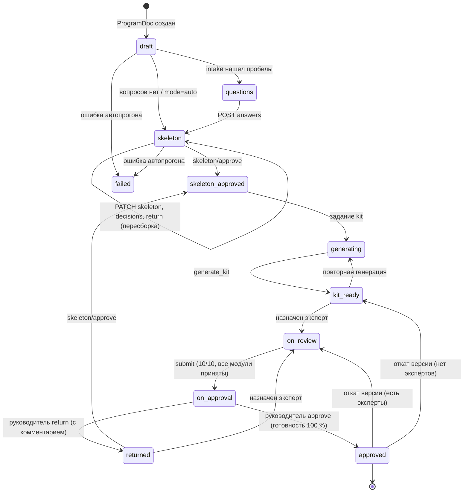

# Модель данных

Программа целиком хранится одним JSON-документом `ProgramDoc` (`src/app/programs/schemas.py`) в столбце `programs.doc`. Это граф с устойчивыми идентификаторами: компетенция → индикатор (знать/уметь/владеть) → результат обучения (РО) → тема → лекция, слайд, вопрос, задание. Граф используется для проверки покрытия (V-12…V-14) и для пересборки только потомков изменённого узла. Каждое сохранение со снимком увеличивает номер версии и кладёт копию документа в `program_versions`; действия людей и агента пишутся в `audit_events`. Внешний формат — JSON-выгрузка по схеме подраздела 4.8 ТЗ (`kit_json` в `src/app/export/service.py`), в которую не входят служебные поля (распознанные параметры, расход токенов, прогресс).

## ProgramDoc

| Поле | Тип | По умолчанию | Смысл |
|---|---|---|---|
| `id` | str | — | `prg-` + 10 hex-символов |
| `org_id` | str | `acr` | Организация |
| `status` | `Status` | `draft` | Статус (см. диаграмму ниже) |
| `version` | int | 1 | Номер версии; растёт при сохранении со снимком |
| `mode` | `interactive` \| `auto` | `interactive` | Режим создания |
| `request` | str | — | Исходный запрос методиста |
| `references` | list[`ReferenceInfo`] | [] | Разобранные референсы |
| `norm_mode` | `gos` \| `org` | `gos` | Нормативная база: государственная или документы организации |
| `org_fragments` | list[dict] | [] | Фрагменты документов организации для генерации |
| `norm_fragments` | list[dict] | [] | Выдержки НПА и ФГОС из базы знаний |
| `params` | `Params` | — | Распознанные параметры запроса |
| `assumptions` | list[`Assumption`] | [] | Значения, принятые агентом без ответа методиста |
| `questions` | list[`Question`] | [] | Уточняющие вопросы |
| `type` | `ProgramType` \| None | None | Тип программы |
| `template` | str | `''` | Шаблон АЦР |
| `issued_document` | str | `''` | Выдаваемый документ |
| `norm_base` | list[`Source`] | [] | Нормативная база программы |
| `profstandard` | `ProfStandard` \| None | None | Профстандарт с ТФ (только из реестра) |
| `title`, `goal` | str | `''` | Название и цель |
| `volume_h` | int | 0 | Объём, ч |
| `competencies` | list[`Competency`] | [] | Карта компетенций |
| `modules` | list[`Module`] | [] | Модули с темами и часами |
| `final_assessment` | `FinalAssessment` | — | Итоговая аттестация: форма, часы, описание |
| `calendar` | `Calendar` | — | Календарный график |
| `min_practice_hours` | int | 0 | Минимум практики |
| `sources` | list[`Source`] | [] | Литература и ресурсы |
| `kit` | `Kit` | — | Комплект материалов |
| `report` | `Report` \| None | None | Отчёт автопроверки |
| `decisions` | list[`Decision`] | [] | Решения методиста по пунктам «!» |
| `comments` | list[`Comment`] | [] | Комментарии экспертов и ответы |
| `approvals` | list[`Approval`] | [] | Утверждения и возвраты |
| `agent_notes` | list[str] | [] | Заметки агента (резервная генерация, лимиты и т. п.) |
| `usage` | `Usage` | — | Токены и стоимость |
| `timing_s` | dict[str, float] | {} | Длительность шагов, с |
| `progress` | dict | {} | Прогресс для интерфейса |
| `created_at`, `updated_at` | str | `''` | ISO 8601 (UTC, секунды) |

Методы: `all_outcomes()`, `all_topics()`, `module_by_id()`, `fit_lecture_plans()` (вызывается при каждом `save`: хронометраж плана лекции приводится к `duration_min` функцией `fit_plan` с шагом 5 минут), `totals()` (сумма часов модулей по видам работы, без итоговой аттестации).

## Перечисления

`ProgramType`: `dpp_pk` (ДПП ПК), `dpp_pk_internship` (ДПП ПК, стажировка), `doop` (ДООП).

Виды работы `KINDS`: `lk` (лекции), `pr` (практика), `lb` (лабораторные), `srs` (самостоятельная работа).

## Параметры запроса и вопросы

**Params** (результат навыка intake): `program_type`, `title`, `direction`, `volume_h`, `audience`, `entry_level`, `form`, `duration_weeks`, `sessions_per_week`, `session_hours`, `max_hours_per_day`, `days_per_week`, `final_assessment_form`, `final_assessment_hours`, `required_topics[]`, `constraints[]`, `min_practice_hours`, `min_practice_share`, `distance`, `no_classroom`, `customer_expectation`, `materials` (`Materials`), `reference_used`, `reference_structure_only` (по умолчанию `true`), `ps_hint`.

**Materials** (явно запрошенные материалы, V-09): `test_questions` (число вопросов итогового теста), `slides_modules[]`, `slides_lessons[]` (номера занятий для ДООП), `slides_topic_hint`.

**Question**: `id`, `field`, `text`, `options[]`, `allow_custom` (true), `answer`.

**Assumption**: `field`, `value`, `source` (откуда взято значение).

**ReferenceInfo**: `name`, `chars`, `structure[]`, `hours_issues[]` (ошибки в таблицах часов референса), `text_sample` (до 120 000 символов).

## Компетенции и результаты обучения

| Модель | Поля |
|---|---|
| `Competency` | `id`, `code`, `title`, `ps_code`, `tf_codes[]`, `indicators[]` |
| `Indicator` | `id`, `kind` (`know` \| `can` \| `own`), `text`, `outcomes[]` |
| `LearningOutcome` | `id`, `code`, `text`, `verb`, `bloom_level` (2) |
| `ProfStandard` | `code`, `title`, `order`, `confirmed` (true), `tf[]` |
| `TrudFunction` | `code`, `title` |

## Модули, темы, часы

| Модель | Поля |
|---|---|
| `Module` | `id`, `n`, `title`, `weight`, `lk_share` (0.33), `srs_share` (0.2), `lb_hours`, `hours`, `control` (`Тест`), `expert_id`, `review_status`, `accepted_items[]`, `manual_topics` (часы тем заданы вручную, солвер их не перераспределяет), `topics[]` |
| `Topic` | `id`, `n` (строка, например «1.2»), `title`, `description`, `weight` (1.0), `hours`, `lo_ids[]`, `prerequisites[]` |
| `Hours` | `total`, `lk`, `pr`, `lb`, `srs`; `kinds_sum()` = lk+pr+lb+srs; `contact` = lk+pr+lb |
| `FinalAssessment` | `form`, `hours`, `description` |

Веса и доли предлагает модель, часы раскладывает `src/app/solver/hours.py`. Итог программы = `totals().total` + `final_assessment.hours`.

`Module.review_status` (вычитка, `workflow.review_decision`): `not_started` → `in_review` (первое действие эксперта или ответ методиста на вопрос) → `accepted` | `returned` | `question`. Приём модуля требует, чтобы каждый элемент был принят (`accepted_items`).

## Календарь

| Модель | Поля |
|---|---|
| `Calendar` | `weeks`, `work_days`, `hours_per_day`, `days_per_week` (5), `hours_per_week`, `sessions`, `session_hours`, `requested_weeks`, `conflict` (текст конфликта ограничений), `options[]`, `chosen_option`, `schedule[]` |
| `CalendarOption` | `id` (например `extend`, `six_days`), `title`, `weeks`, `hours_per_day`, `days_per_week` |
| `CalendarWeek` | `week`, `hours`, `days`, `lk`, `pr`, `lb`, `srs`, `ia`, `items[]` |

## Комплект

| Модель | Поля |
|---|---|
| `Kit` | `module_programs[]`, `assessments[]`, `questions[]`, `tasks[]`, `lectures[]`, `sections` (dict ключ раздела → текст), `final_assessment` (dict), `report_requirements[]`, `drafts[]` (модули, собранные по шаблону без ответа модели), `judge` (замечания судьи по правилам) |
| `ModuleProgram` | `module_id`, `annotation`, `content[]` (`{topic_id, text}`), `control_questions[]` |
| `Assessment` | `id`, `module_id`, `kind` (`test` \| `seminar` \| `project` \| `final` \| `interview`), `title` |
| `Question_` (вопрос теста) | `id`, `assessment_id`, `module_id`, `stem`, `options[]`, `key` (индекс верного варианта), `lo_ids[]`, `difficulty` (2) |
| `Task` | `id`, `assessment_id`, `module_id`, `topic_id`, `title`, `statement`, `expected_result`, `criteria[]`, `lo_ids[]` |
| `Criterion` | `text`, `points` |
| `Lecture` | `id`, `topic_id`, `module_id`, `title`, `duration_min` (90), `plan[]` (`{min, text}`), `code_examples[]`, `slides[]` |
| `Slide` | `id`, `n`, `title`, `bullets[]`, `notes` |
| `Source` | `id`, `kind` (`book` \| `doc` \| `law` \| `ps` \| `url`), `bibl`, `url`, `confirmed` (false), `checked_at` |

## Проверка, решения, вычитка, утверждение

| Модель | Поля |
|---|---|
| `Report` | `stage` (`skeleton` \| `kit`), `rules[]`, `blocking_passed`, `blocking_total` (10), `coverage[]` (матрица покрытия), `actions[]`, `proposals[]`, `assumptions[]` |
| `RuleResult` | `id` (`V-01`…`V-27`), `title`, `check` (1–10 или `None` — предупреждение), `kind` (`code` \| `llm`), `status` (`pass` \| `warn` \| `fail` \| `skip`), `messages[]`, `nodes[]`, `owner` (`методист`) |
| `Decision` | `rule_id`, `node`, `proposal`, `decision` (`accept` \| `keep`), `actor`, `at` |
| `Comment` | `id`, `module_id`, `node_id`, `author`, `text`, `agent_proposal`, `new_text`, `affected[]` (что пересоберётся по графу), `status` (`open` \| `answered` \| `proposed` \| `applied`), `answer`, `at` |
| `Approval` | `stage` (`skeleton` \| `module` \| `program`), `actor`, `decision` (`approve` \| `return`), `comment`, `module_id`, `score` (1–5, оценка модуля экспертом), `at` |
| `Usage` | `tokens_in`, `tokens_out`, `cost_rub`, `calls`, `by_skill` |

`Comment.status = proposed` означает, что правка агента по замечанию к конкретному элементу ждёт подтверждения самого эксперта. Замечание к модулю целиком («Модуль целиком») в `proposed` не переходит: агент даёт рекомендацию, замечание остаётся `open` («ждёт ответа»), и отвечает методист (SPEC-API-46).

## Версии

Отдельного списка версий в `ProgramDoc` нет: поле `version` хранит текущий номер, а снимки лежат в таблице `program_versions`. `svc.save(..., snapshot=True)` присваивает `version = max(текущая, максимальная в таблице) + 1` и сохраняет копию с причиной (`каркас`, `комплект`, `каркас утверждён`, `правка <id>`, `на утверждении`, `решение руководителя`, `откат к версии N` и др.). Сохранение без снимка (`snapshot=False`, например ответы на вопросы, правка каркаса, решения по «!») обновляет документ, не меняя номер.

Откат (`POST /programs/{id}/versions/{v}/restore`, `workflow.restore_into`) возвращает содержание версии, но сохраняет текущие комментарии, утверждения и назначения экспертов; принятые модули снова уходят на вычитку, `accepted_items` очищается; статус пересчитывается (см. ниже), так что откат не возвращает утверждение без руководителя. Сравнение версий — `GET /programs/{id}/versions/{a}/diff/{b}`.

## Статусы и переходы



Правила переходов (`src/app/agent/workflow.py`):

| Действие | Допустимо из | Результат | Ошибка (код Conflict) |
|---|---|---|---|
| `answer_questions` | `questions` | — (роутер ставит `skeleton`) | `NO_QUESTIONS` |
| `skeleton_step` | тип программы определён | `skeleton` | `QUESTIONS_PENDING` |
| `patch_skeleton` | `skeleton`, `returned` | без смены статуса | `SKELETON_LOCKED` |
| `approve_skeleton` | `skeleton`, `returned`; нет блокирующих ошибок; решение по каждому «!» | `skeleton_approved` | `BAD_STATE`, `DECISIONS_PENDING` |
| `return_skeleton` | — | пересборка каркаса | `COMMENT_REQUIRED` |
| `generate_kit` | `skeleton_approved`, `kit_ready`, `generating` | `generating` → `kit_ready` | `SKELETON_NOT_APPROVED` |
| `edit` | не `on_approval`/`approved`; комплект собран | без смены статуса | `LOCKED`, `KIT_NOT_READY`, `EDIT_REJECTED`, `HOURS_MISMATCH` |
| `assign_expert` | не `on_approval`/`approved`; 10/10 блокирующих | из `kit_ready`/`returned` → `on_review` | `LOCKED`, `BLOCKING_FAILED` |
| `review_decision` | комплект собран | меняет `Module.review_status` | `KIT_NOT_READY`, `ITEMS_NOT_CHECKED`, `COMMENT_REQUIRED` |
| `submit` | 10/10 блокирующих; все модули приняты | `on_approval` | `BLOCKING_FAILED`, `MODULES_NOT_ACCEPTED` |
| `head_decision` | `on_approval`; для approve — готовность 100 % | `approved` или `returned` | `BAD_STATE`, `NOT_READY`, `COMMENT_REQUIRED` |
| `restore_into` | любой | если версия или текущий документ в `on_review`/`on_approval`/`approved`/`returned` — `on_review` (есть эксперты) или `kit_ready`, без комплекта — `skeleton` | — |

Замечания:

- `draft` — начальное значение; на практике роутер сразу переводит документ в `questions` или `skeleton` при первом сохранении.
- `failed` ставится только в синхронном автопрогоне (`POST /programs?mode=auto`, `wait=true`) при исключении. Ошибка фонового задания отражается в статусе задания (`jobs.status = failed`), а статус программы остаётся тем, каким был при последнем сохранении.
- В автопрогоне каркас с неисправимыми ошибками всё равно переводится в `skeleton_approved` с заметкой в `agent_notes`, а ответ получает статус `done_with_errors`.
- Из `returned` (возврат руководителем) диаграмма показывает переходы, допускаемые проверками; какой путь используется в интерфейсе, из кода однозначно не следует.

## Таблицы БД

`src/app/core/db.py`, SQLAlchemy 2 (async), создаются `Base.metadata.create_all` при старте.

| Таблица | Модель | Столбцы | Назначение |
|---|---|---|---|
| `programs` | `ProgramRow` | `id` PK str(40), `owner` str(64) idx, `title` str(300), `status` str(32) idx, `version` int, `doc` JSON, `updated_at` | Текущее состояние программы |
| `program_versions` | `VersionRow` | `id` PK autoinc, `program_id` idx, `version` int, `reason` str(200), `doc` JSON, `created_at` | Снимки версий |
| `audit_events` | `EventRow` | `id` PK, `program_id` idx, `actor`, `action` str(64), `node_id`, `text` Text, `version`, `at` | Журнал; «было/стало» хранятся в `text` через разделитель `\x1f`; события администратора пишутся с `program_id='org'` |
| `jobs` | `JobRow` | `id` PK (`job-…`), `program_id` idx, `kind` (`skeleton`, `kit`, `auto`), `status` (`queued`, `running`, `done`, `failed`), `progress` JSON, `error` Text, `created_at`, `updated_at` | Фоновые задания |
| `notifications` | `NotificationRow` | `id` PK, `user_id` idx, `program_id`, `text`, `read` int (0/1), `at` | Уведомления в интерфейсе (отдаются последние 30) |
| `users` | `UserRow` | `id` PK str(64), `login` unique idx, `name`, `email`, `title`, `roles` JSON, `password_hash` (bcrypt), `source` (`demo`, `local`, `sso`), `active` int, `created_at` | Учётные записи |
| `settings` | `SettingRow` | `key` PK, `value` JSON (секреты — строка `enc1:…`), `updated_by`, `updated_at` | Настройки администратора, перекрывающие окружение |

Связи между таблицами логические (по `program_id`), внешних ключей нет. Роли пользователей: `methodist`, `expert`, `head`, `admin`, `api`.

## JSON-выгрузка 4.8

`GET /api/v1/programs/{id}/export/json` (а также поле `kit` в ответе автопрогона и поле `program` в `GET /programs/{id}` для ролей, кроме эксперта) возвращает результат `kit_json(doc)`:

```json
{
  "program": {
    "id": "prg-…", "org_id": "acr", "type": "dpp_pk", "template": "…", "issued_document": "…",
    "title": "…", "volume_h": 72, "audience": "…", "entry_level": "…", "form": "…",
    "duration": {"weeks": 4, "work_days": 20},
    "calendar": { "…": "Calendar целиком" },
    "status": "kit_ready", "version": 5, "goal": "…",
    "final_assessment": {"form": "…", "hours": 4, "description": "…"},
    "profstandard": {"code": "…", "title": "…", "order": "…", "confirmed": true, "tf": [{"code": "…", "title": "…"}]},
    "competencies": [ "Competency → indicators → outcomes" ],
    "modules": [
      {"id": "…", "n": 1, "title": "…", "hours": {"total": 0, "lk": 0, "pr": 0, "lb": 0, "srs": 0},
       "control": "Тест", "expert_id": null, "review_status": "not_started",
       "topics": [{"id": "…", "n": "1.1", "title": "…", "hours": {"…": 0}, "weight": 1.0, "prerequisites": [], "lo_ids": []}]}
    ],
    "assessments": [], "questions": [], "tasks": [], "lectures": [], "module_programs": [],
    "final_assessment_materials": {},
    "sources": [ "norm_base + sources" ],
    "sections": {"annotation": "…"},
    "assumptions": [], "approvals": []
  }
}
```

Особенности:

- `duration.weeks` берётся из `calendar.weeks`, а если там 0 — из `params.duration_weeks`.
- `modules[]` содержит только перечисленные поля модуля и темы (без `weight`, долей и `accepted_items` у модуля, без `description` у темы).
- `sources` объединяет нормативную базу и литературу; неподтверждённые источники имеют `confirmed: false`.
- Не выгружаются: `params`, `questions` (уточняющие), `references`, `report`, `decisions`, `comments`, `usage`, `timing_s`, `progress`, `agent_notes`, фрагменты НПА и документов организации.
- Имя файла — `<slug>.json`, кодировка UTF-8, `ensure_ascii=False`, отступ 2.

Прочие форматы выгрузки (`FORMATS`): `docx` (программа по шаблону АЦР), `pptx` (слайды), `gift` (тесты, `.gift.txt`), `moodle_xml`, `order_draft` (проект приказа, `.docx`), `lectures_docx`.
