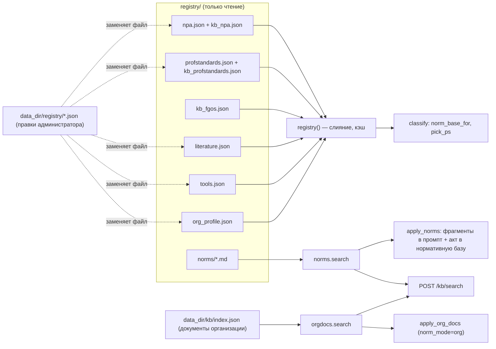

# Нормативная база и база знаний

Агент опирается на три слоя знаний. Первый — реестры в `registry/*.json`: нормативные правовые акты (НПА), профессиональные стандарты (ПС), ФГОС, литература, версии инструментов и профиль организации; коды и реквизиты в программу попадают только отсюда, всё прочее помечается «не подтверждено» (`src/app/kb/registry.py`). Второй — 52 выжимки актов и методических рекомендаций в `registry/norms/*.md` с заголовком YAML; поиск по ним детерминирован, не тратит бюджет LLM, а найденные фрагменты идут в промпты навыков каркаса и комплекта (`src/app/kb/norms.py`). Третий — документы самой организации (шаблоны, положения), которые загружает администратор: они режутся на фрагменты, индексируются эмбеддингами шлюза или ключевыми словами и используются в режиме «документы организации» (`src/app/kb/orgdocs.py`, `src/app/kb/files.py`). Правки администратора через API сохраняются в `data_dir/registry` поверх файлов образа.

## 1. Общая схема



## 2. Реестры `registry/*.json`

### 2.1. Файлы

| Файл | Раздел (`kind`) | Содержимое | Записей |
|---|---|---|---|
| `npa.json` | `npa` | Основной реестр НПА (обязательные акты) | 4 |
| `kb_npa.json` | `npa` (дополнение) | Нормативная база из открытых источников | 74 |
| `profstandards.json` | `ps` | Основной реестр ПС с вручную проверенными ключевыми словами | 6 |
| `kb_profstandards.json` | `ps` (дополнение) | ПС из открытых источников, с ОТФ и ТФ: ИТ, педагогика, а также профессии частых слушателей ДПП ПК (маркетолог, бухгалтер, HR, экономист, дизайнер, СМИ, документационное обеспечение, врач, медсестра) | 47 |
| `kb_fgos.json` | `fgos` | ФГОС (направления ВО, СПО) | 34 |
| `literature.json` | `literature` | Литература и официальная документация | 34 |
| `tools.json` | `tools` | Версии инструментов и устаревшие конструкции | объект |
| `org_profile.json` | `org` | Профиль организации | объект |

Соответствие файлов задано в `REGISTRY_FILES` (`npa`, `ps`, `tools`, `literature`, `org`) и `EXTRA_FILES` (`kb_npa.json`, `kb_profstandards.json`, `kb_fgos.json`, `kb_literature.json`). Файл `kb_literature.json` в репозитории отсутствует — дополнение литературы просто не подключается.

### 2.2. Поля записи НПА (`kb_npa.json`)

| Поле | Назначение |
|---|---|
| `id` | Идентификатор акта (`law-273`, `order-266`, `decree-1678`, ...); ключ слияния |
| `kind` | Вид: `law`, `order`, `decree`, `letter` и т. п. |
| `bibl` | Библиографическое описание — так акт попадает в программу |
| `url` | Ссылка на официальный или справочный источник |
| `applies` | Типы и уровни программ: `dpp_pk`, `dpp_pk_internship`, `dpp_pp`, `doop`, `vo`, `spo`, `school` |
| `topics` | Темы акта |
| `status` | Статус («действует», «действует (ред. от ...)»). Слова «утратил», «repealed», «отмен», «не действует» исключают акт |
| `replaced_by` | Чем заменён (у всех текущих записей `null`) |
| `summary` | Краткое содержание для методиста |
| `checked_at` | Дата проверки |
| `core` | Обязательный акт для типов из `applies` (у `law-273`, `order-266`, `order-629`, `order-245`, `order-762`) |
| `core_for` | Уровни, для которых акт обязателен в основных программах (`school`, `spo`, `vo`) |
| `cite` | Акт можно добавлять в нормативную базу, если запрос совпал по ключевым словам |
| `keywords` | Основы слов для сопоставления с запросом |

Правила по умолчанию в `norm_base_for`: если поля `core` нет, акт считается обязательным, когда у него нет `keywords` (так работают записи основного `npa.json` без ключевых слов, например `law-273`, `order-629`); если нет `cite`, акт цитируемый, когда у него есть `keywords`.

### 2.3. Профстандарты

`kb_profstandards.json`: `code`, `title`, `order` (приказ Минтруда), `url`, `keywords`, `otf` (обобщённые трудовые функции: `code`, `title`, `level`), `tf` (трудовые функции: `code`, `title`), `tf_verified`, `checked_at`. Основной `profstandards.json` содержит `code`, `title`, `order`, `keywords`, `tf_verified`, `tf`, `checked_at`.

### 2.4. ФГОС, литература, версии инструментов

- `kb_fgos.json`: `code`, `title`, `level` (например `vo_bachelor`), `order`, `url`, `status`, `keywords`, `competencies`, `related_ps`, `checked_at`.
- `literature.json`: `id`, `kind` (`url` — документация, `book` — книга), `bibl`, `url`, `tags`, `checked_at`. Подбор — `literature_for` (по тегам; для школьных программ — только документация и источники с тегами `школ`/`дет`), сверка ссылок — `match_source`.
- `tools.json`: `checked_at`, `current` (актуальные версии), `outdated` (устаревшая конструкция → пояснение), `min_supported`, `outdated_replacements`, `ai_services_ru`, `ai_services_blocked`. Используется актуализацией (`GET /programs/{id}/actualize`, `POST /actualize`).

## 3. Слияние и подбор (`src/app/kb/registry.py`)

### 3.1. `registry()`

Кэшируется (`lru_cache`), сбрасывается при `save_override`. Для каждого раздела читается файл из `data_dir/registry/`, если он есть, иначе из `registry/`. Затем `_merge` дополняет основные реестры записями из `EXTRA_FILES`:

- ключ записи — `code` для `ps` и `fgos`, иначе `id` (или `bibl`);
- запись дополнения заменяет одноимённую (у неё свежая проверка), поля объединяются;
- **утратившие силу** записи (`_in_force` = ложь) удаляются из результата, даже если были в основном реестре;
- для ПС ключевые слова основного реестра идут первыми и сохраняются как `curated`;
- для НПА по умолчанию проставляются `applies: []` и `url: ''`.

### 3.2. Функции

| Функция | Что делает |
|---|---|
| `_kw_hit(kw, low)` | Ключевое слово — фраза из основ; совпадение, если все основы встречаются в тексте. Короткая основа (до 3 символов: ДОТ, ИБ, SQL) ищется только с начала слова |
| `norm_base_for(program_type, text)` | Нормативная база ДПП/ДООП: действующие акты, у которых тип есть в `applies`, и которые обязательны (`core`) или цитируемы (`cite`) и совпали с текстом по ключевым словам. Вызывается навыком `classify` |
| `norm_base_for_level(level, text)` | То же для основных программ уровня `school`, `spo`, `vo`: всегда `law-273`, затем акты с уровнем в `core_for` и цитируемые по ключевым словам. Неизвестный уровень — `ValueError`. Задел на расширение агента |
| `pick_ps(text, hint)` | Подбор ПС: по коду-подсказке, иначе по наибольшей оценке `_ps_score` (проверенные слова и фразы — 2 балла, прочие — 1; слишком общие основы `программ`, `обучен`, `образован`, `курс`, `данн`, `систем`, `работ` не считаются, если не проверены вручную) |
| `to_ps(item, text)` | Превращает запись в `ProfStandard`; если ТФ больше 12 (`TF_LIMIT`), оставляет 12 ближайших к запросу по общим основам; `confirmed` = `tf_verified` |
| `find_ps`, `tf_codes` | Поиск ПС по коду и множество кодов его ТФ |
| `literature_for`, `match_source` | Подбор и сверка литературы |
| `tools()`, `org_profile()` | Разделы `tools` и `org` |
| `save_override(kind, data)` | Записывает раздел в `data_dir/registry/<файл>` и сбрасывает кэш |

## 4. Выжимки `registry/norms/*.md`

### 4.1. Формат

Каждый файл начинается с заголовка YAML:

```yaml
---
id: 02-poryadok-dpp-266
title: "Порядок по дополнительным профессиональным программам (...)"
source: "Приказ Минобрнауки России от 24.03.2025 № 266 ..."
url: https://base.garant.ru/411917644/
npa_id: order-266
applies: [dpp_pk, dpp_pk_internship]
keywords: [повышени квалификац, дополнительн профессиональн, стажировк, итогов аттестац, удостоверени]
checked_at: "2026-10-18"
---
```

`npa_id` связывает выжимку с записью реестра НПА (может отсутствовать). Тело — Markdown, режется на фрагменты функцией `chunks` (см. п. 5.2).

### 4.2. Поиск (`src/app/kb/norms.py`)

- `norms()` — загрузка и кэш всех выжимок с фрагментами и множествами слов (первые 6 символов слов от 4 букв).
- `search(query, program_type='', k=4)` — оценка фрагмента = доля слов запроса, найденных во фрагменте, плюс 0,15 за каждое ключевое слово выжимки, совпавшее с запросом (`_kw_hit`). Выжимки, у которых `applies` не содержит `program_type`, пропускаются. Фрагменты с оценкой не выше 0,05 отбрасываются. Результат: `doc_id`, `name`, `source`, `url`, `npa_id`, `kind: "norm"`, `chunk`, `score`, `text` (до 700 символов).
- `public(item)` — карточка для `GET /kb/norms` (число фрагментов вместо их текста).

При сборке каркаса `apply_norms` (`src/app/agent/extras.py`) берёт до 12 фрагментов по типу программы, оставляет до 4 из актов, относящихся к запросу (обязательных, уже в нормативной базе или совпавших по ключевым словам), передаёт их в промпты (`norm_fragments`) и добавляет акт в нормативную базу программы.

### 4.3. Перечень выжимок

Столбец «Уровни» — поле `applies`, столбец «НПА» — `npa_id`.

| Файл | Акт | Уровни | НПА |
|---|---|---|---|
| `01-fz-273-ob-obrazovanii.md` | Федеральный закон № 273-ФЗ «Об образовании в Российской Федерации»: нормы для разработчика программ | dpp_pk, dpp_pk_internship, doop | law-273 |
| `02-poryadok-dpp-266.md` | Порядок по дополнительным профессиональным программам (приказ Минобрнауки № 266 от 24.03.2025, заменил № 499) | dpp_pk, dpp_pk_internship | order-266 |
| `03-poryadok-doop-629.md` | Порядок по дополнительным общеобразовательным программам (приказ Минпросвещения № 629 от 27.07.2022) | doop | order-629 |
| `04-eo-dot-pp-1678.md` | Электронное обучение и ДОТ: Правила, утверждённые ПП РФ № 1678 (заменили приказ № 816) | dpp_pk, dpp_pk_internship, doop | decree-1678 |
| `05-sanitarnye-normy-deti.md` | Санитарные нормы для занятий с детьми: СанПиН 1.2.3685-21 и СП 2.4.2.4283-26 (заменили СП 2.4.3648-20) | doop | sanpin-sp-2-4-2-4283-26 |
| `06-fgos-noo-ooo-soo.md` | ФГОС НОО, ООО, СОО: структура требований и объём часов | doop, dpp_pk | — |
| `07-poryadok-vo-245.md` | Порядок по программам бакалавриата, специалитета, магистратуры (приказ Минобрнауки № 245) | vo | order-245 |
| `08-mr-dpp-vk-1032-06.md` | Методические рекомендации по разработке ДПП на основе профстандартов (письмо Минобрнауки № ВК-1032/06) | dpp_pk, dpp_pk_internship | letter-vk-1032-06 |
| `09-mr-doop-09-3242-i-ab-3935.md` | Методические рекомендации по проектированию ДООП: письмо № 09-3242 (2015) и письмо № АБ-3935/06 (2023) | doop | letter-09-3242 |
| `10-koncepciya-do-detej-678-r.md` | Концепция развития дополнительного образования детей до 2030 года (распоряжение Правительства № 678-р) | doop | decree-678-r |
| `11-prakticheskaya-podgotovka-885-390.md` | Положение о практической подготовке обучающихся (приказ Минобрнауки № 885 / Минпросвещения № 390) | dpp_pk_internship | order-885-390 |
| `12-profstandarty-i-dpp.md` | Профессиональные стандарты и ДПП: ТК РФ ст. 195.1–195.3, 273-ФЗ ст. 76, методические рекомендации ДЛ-1/05вн | dpp_pk, dpp_pk_internship | — |
| `13-pd-152-fz.md` | Федеральный закон № 152-ФЗ «О персональных данных»: что важно для программ и LMS | dpp_pk, dpp_pk_internship, dpp_pp, doop, vo, spo, school | law-152 |
| `14-zashchita-detej-436-fz.md` | Федеральный закон № 436-ФЗ «О защите детей от информации, причиняющей вред их здоровью и развитию» | doop, school | law-436 |
| `15-platnye-uslugi-pp-1441.md` | Правила оказания платных образовательных услуг (ПП РФ № 1441) | doop, dpp_pk, dpp_pk_internship, dpp_pp, school, spo, vo | decree-1441 |
| `16-setevaya-forma-882-391.md` | Порядок организации и осуществления образовательной деятельности при сетевой форме (приказ № 882/391) | doop, dpp_pk, dpp_pk_internship, dpp_pp, school, spo, vo | order-882-391 |
| `17-poryadok-spo-762.md` | Порядок организации и осуществления образовательной деятельности по программам СПО (приказ Минпросвещения № 762) | dpp_pp, spo | order-762 |
| `18-ps-01-003-pdo.md` | Профстандарт 01.003 «Педагог дополнительного образования детей и взрослых» | dpp_pk, dpp_pp, doop | order-652n |
| `19-ps-01-004-i-01-015.md` | Профстандарты 01.004 (утратил силу) и 01.015 «Педагог профессионального обучения, СПО»: что применять к преподавателям ДПП | dpp_pk, dpp_pp, doop | — |
| `20-ii-ukaz-490-i-regulirovanie.md` | ИИ в образовании: Указ № 490 (Национальная стратегия), закон № 243-ФЗ, рекомендации Минпросвещения 2026 | dpp_pk, dpp_pp, doop, vo, spo, school | decree-490 |
| `21-gost-eo-53620-55751.md` | ГОСТ Р 53620-2009 и ГОСТ Р 55751-2013: электронные образовательные ресурсы и ЭУМК | dpp_pk, dpp_pp, vo, spo, doop, school | gost-55751 |
| `22-dokumenty-st-60-frdo.md` | Документы по итогам ДПП и ДООП: ст. 60 273-ФЗ и ФИС ФРДО | dpp_pk, dpp_pk_internship, dpp_pp, doop | law-273-art60-frdo |
| `23-normy-chasov-269.md` | Нормы часов педагогической работы за ставку: приказ Минпросвещения № 269 (вместо приказа № 1601) | doop, spo, school | order-269 |
| `24-mr-doop-eo-dot-dg-245.md` | Методические рекомендации по реализации ДООП с ЭО и ДОТ (письмо Минпросвещения № ДГ-245/06) | doop | letter-dg-245-06 |
| `25-mr-dpp-eo-dot-vk-1013-06.md` | Реализация ДПП с ЭО, ДОТ и в сетевой форме: письмо Минобрнауки № ВК-1013/06 | dpp_pk, dpp_pk_internship, dpp_pp | letter-vk-1013-06 |
| `26-mr-doop-obnovlenie-ab-3935-06.md` | Обновление содержания, методов и технологий ДООП: письмо Минпросвещения № АБ-3935/06 | doop | letter-ab-3935-06 |
| `27-fz-149-informaciya.md` | Федеральный закон № 149-ФЗ «Об информации…»: что важно для ЭО, LMS и контента программ | doop, dpp_pk, dpp_pk_internship, dpp_pp, school, spo, vo | law-149 |
| `28-tk-195-profstandarty.md` | Трудовой кодекс РФ, ст. 195.1–195.3: квалификация и обязательность профстандартов | dpp_pk, dpp_pk_internship, dpp_pp, spo, vo | law-tk-195 |
| `29-fz-238-nok.md` | Федеральный закон № 238-ФЗ «О независимой оценке квалификации» и ДПП | dpp_pk, dpp_pk_internship, dpp_pp, spo | law-238 |
| `30-urovni-kvalifikacii-148n.md` | Уровни квалификации (приказ Минтруда № 148н): уровни 3–7 для ДПП | dpp_pk, dpp_pk_internship, dpp_pp, spo, vo | order-148n |
| `31-ps-pedagog-544n.md` | Профстандарт «Педагог» (приказ Минтруда № 544н): статус и что важно для ДПП учителей | dpp_pk, dpp_pk_internship, dpp_pp, school | order-544n |
| `32-eks-pedagogi-761n.md` | ЕКС, раздел «Квалификационные характеристики должностей работников образования» (приказ № 761н) | doop, dpp_pk, dpp_pk_internship, dpp_pp, school, spo | order-761n |
| `33-fis-frdo-pp-825.md` | ФИС ФРДО (постановление Правительства № 825): какие сведения о документах по ДПП вносятся и в какие сроки | dpp_pk, dpp_pk_internship, dpp_pp, school, spo, vo | decree-825 |
| `34-poryadok-profobucheniya-438.md` | Порядок профессионального обучения (приказ Минпросвещения № 438): чем отличается от ДПО | school, spo | order-438 |
| `35-celevaya-model-do-467.md` | Целевая модель развития региональных систем ДО детей (приказ Минпросвещения № 467) | doop | order-467 |
| `36-tradicionnye-cennosti-ukaz-809.md` | Основы политики по традиционным ценностям (указ № 809): воспитательный компонент ДООП | doop, school, spo, vo | ukaz-809 |
| `37-nacionalnye-celi-ukaz-309.md` | Национальные цели развития до 2030 года и на перспективу до 2036 года (указ № 309) | doop, dpp_pk, dpp_pk_internship, dpp_pp, school, spo, vo | ukaz-309 |
| `38-mr-dl-1-05vn-profstandarty.md` | МР по разработке ОПОП и ДПП с учётом профстандартов (Минобрнауки, № ДЛ-1/05вн) | dpp_pk, dpp_pk_internship, dpp_pp | letter-dl-1-05vn |
| `39-fop-noo-ooo-soo.md` | ФОП НОО, ООО, СОО: состав, федеральные рабочие программы, программа воспитания | dpp_pk, school, spo | order-372 |
| `40-poryadok-obshchee-115.md` | Порядок организации образовательной деятельности по ООП НОО, ООО, СОО (приказ Минпросвещения № 115) | dpp_pk, school | order-115 |
| `41-gia-9-11-promezhutochnaya-st58.md` | ГИА-9, ГИА-11 и промежуточная аттестация (ст. 58, 59 273-ФЗ) — что важно для оценивания в программе | doop, dpp_pk, dpp_pp, school, spo, vo | order-232-551-gia9 |
| `42-vospitanie-304-fz-st12-1.md` | Воспитание в образовательных программах: 304-ФЗ, ст. 12.1 273-ФЗ, рабочая программа воспитания и календарный план | doop, school, spo, vo | law-304 |
| `43-fpu-uchebniki-436-rabochie-programmy.md` | Федеральный перечень учебников (приказ № 436 от 22.06.2026) и рабочие программы учителей | dpp_pk, school | order-436-2026-fpu |
| `44-fgos-spo-struktura-336.md` | ФГОС СПО: общая структура (макет 2022+), ОК 01–09, практика, ГИА; перечень профессий и специальностей № 336 | dpp_pp, spo | order-464-2024-fgos-spo |
| `45-gia-spo-800-demoekzamen.md` | Порядок ГИА по программам СПО (приказ Минпросвещения № 800) и демонстрационный экзамен | spo | order-800-spo-gia |
| `46-priem-spo-457-professionalitet.md` | Приём в СПО (приказ № 457) и «Профессионалитет»: действующие акты | dpp_pp, spo | order-457-spo-priem |
| `47-reforma-urovnej-vo-ukaz-343.md` | Реформа уровней высшего образования: базовое высшее, специализированное высшее, аспирантура (статус на октябрь 2026) | vo | ukaz-343 |
| `48-fgos-vo-3pp-perechni-89-1061.md` | ФГОС ВО 3++: блоки, УК/ОПК/ПК, ПК на основе профстандартов, объём в з.е.; перечни направлений № 1061 и № 89 | dpp_pp, vo | order-89 |
| `49-gia-vo-636.md` | Порядок ГИА по программам бакалавриата, специалитета, магистратуры (приказ Минобрнауки № 636) | vo | order-636-vo-gia |
| `50-aspirantura-fgt-951-pp-2122.md` | Аспирантура: ФГТ (приказ Минобрнауки № 951) и Положение о подготовке (ПП РФ № 2122) | vo | order-951-fgt |
| `51-inklyuziya-st79-faop.md` | Инклюзивное образование: ст. 79 273-ФЗ, ФАОП (2022) и адаптированные программы на всех уровнях | doop, dpp_pk, dpp_pp, school, spo, vo | law-273-art79 |
| `52-cos-moya-shkola-eor.md` | Цифровая образовательная среда: ФГИС «Моя школа» (ПП РФ № 1241) и федеральный перечень ЭОР | school, spo | decree-1241-moya-shkola |

## 5. Документы организации

### 5.1. Загрузка и хранение (`src/app/kb/orgdocs.py`)

- Загружает администратор: `POST /kb/documents` или `POST /org/documents` (`multipart`: `file`, `kind`). Размер — не больше `MAX_FILE_SIZE_MB` (по умолчанию 20 МБ).
- Виды (`KINDS`): `template` — шаблон программы, `regulation` — положение, `other` — иной документ (неизвестный вид заменяется на `other`).
- Индекс хранится в `data_dir/kb/index.json` (запись через временный файл, под блокировкой). Идентификатор — `kb-001`, `kb-002`, ...
- Карточка документа: `id`, `name`, `kind`, `kind_label`, `author`, `uploaded_at`, `chars`, `structure` (до 60 заголовков), `indexed` (`embeddings` или `keywords`), `chunks` (число фрагментов).
- Удаление — `DELETE /kb/documents/{doc_id}` (404, если нет).

### 5.2. Разбор файлов (`src/app/kb/files.py`)

| Формат | Определение | Разбор |
|---|---|---|
| PDF | сигнатура `%PDF` | PyMuPDF (`fitz`), до 200 страниц; таблицы часов распознаются `find_tables` и пересчитываются |
| DOCX | сигнатура `PK\x03\x04` | `python-docx`; проверка размера после распаковки (не больше 100 МБ); макросы не исполняются; таблицы часов пересчитываются |
| Текст | первые 2000 байт декодируются как UTF-8 | как есть |
| Прочее | — | 400 «Неподдерживаемый формат файла» |

Формат определяется по сигнатуре, а не по расширению. Структура — строки до 140 символов вида «1.», «1.2.», «Раздел N», «Модуль N», «Тема N» (до 80). `check_hours_table` сверяет в таблицах с колонками «Всего» и не менее чем тремя из ЛК/ПР/ЛБ/СРС суммы по видам работы, темы против модуля и модули против итоговой строки; найденные расхождения показываются методисту и не переносятся в каркас.

Фрагменты (`chunks`): текст делится по абзацам, фрагмент не длиннее 900 символов (отдельный длинный абзац обрезается до 1800), не больше 200 фрагментов на документ.

### 5.3. Эмбеддинги и поиск

- При загрузке фрагменты отправляются в модель эмбеддингов шлюза (`LLM_MODEL_EMBED`, по умолчанию `ai-sage/Giga-Embeddings-instruct-3B`), если LLM включена. При ошибке или выключенной модели документ индексируется по словам (`indexed: keywords`).
- `search(query, k=5)`: если у документов есть векторы, запрос тоже векторизуется и оценка — косинусное сходство; иначе — доля общих слов. Пока часть документов без векторов, оценка по словам умножается на половину лучшего косинуса запроса, чтобы обе шкалы были сопоставимы и совпадение слов не вытесняло найденное по смыслу. Фрагменты с оценкой не выше 0,05 отбрасываются; текст — до 600 символов.
- `POST /kb/search` объединяет результаты документов организации и выжимок НПА и сортирует их, добавляя документам организации бонус 0,25: при близкой оценке свои документы важнее общей нормативной базы.

### 5.4. Режим «документы организации»

При создании программы `norm_mode` = `gos` (госстандарты, по умолчанию) или `org`. В режиме `org` при сборке каркаса `apply_org_docs` ищет до 4 фрагментов по запросу, добавляет документы в нормативную базу программы (`kind: doc`), передаёт фрагменты в промпт (`org_fragments`) и, если у референсов нет структуры, берёт структуру первого загруженного шаблона. Если ничего не найдено, агент оставляет пометку и использует госстандарты.

## 6. Профиль организации и реестры через API

| Метод | Кто | Назначение |
|---|---|---|
| `GET /org/profile` | admin, methodist, head | Профиль; блок `smtp` виден только администратору |
| `PUT /org/profile` | admin | Слияние с текущим профилем, `checked_at` = сегодня, запись в `data_dir/registry/org_profile.json` |
| `GET /org/registry?kind=` | admin, methodist, head | `ps`, `npa`, `fgos`, `tools`, `literature` (после слияния) |
| `PUT /org/registry` | admin | Полная замена раздела `ps`, `npa`, `tools` или `literature` |
| `GET /kb/norms` | admin, methodist, head, expert | Список выжимок и счётчики `npa`, `ps`, `fgos`, `literature` |

Допустимые поля профиля: `name`, `header`, `requisites`, `address`, `city`, `order_prefix`, `norm_mode`, `defaults`, `experts`, `head`, `methodists`, `notify_email`, `smtp`, `templates`, `note`, `checked_at`, `samples`. Допустимые ключи `defaults`: `program_type`, `volume_h`, `audience`, `form`, `final_assessment_form`, `questions_per_test`. Пароль в `smtp` запрещён.

Обязательные поля записей в `PUT /org/registry`: `ps` — `code`, `title`; `npa` — `id`, `bibl`; `literature` — `bibl`; `tools` — объект с `current` и `outdated`. Записям без `checked_at` проставляется сегодняшняя дата. Раздел `fgos` через API не меняется.

Важно: `PUT /org/registry` записывает файл основного реестра (`npa.json`, `profstandards.json`, ...) в `data_dir/registry`, а дополнения `kb_*.json` из образа продолжают сливаться поверх него. Поэтому запись, которая есть в `kb_npa.json`, нельзя удалить или полностью переопределить через API: её поля из дополнения всё равно окажутся в итоговом реестре.

## 7. Как добавить акт

1. **Запись в реестр.** Добавьте объект в `registry/kb_npa.json` с полями `id`, `kind`, `bibl`, `url`, `applies`, `status` («действует ...»), `checked_at`, `keywords`, а также `core: true` (если акт обязателен для типов из `applies`), `core_for` (для основных программ уровней) или `cite: true` (добавлять по совпадению ключевых слов). Ключевые слова — основы слов; короткие (до 3 символов) сопоставляются с начала слова.
2. **Выжимка (по желанию).** Создайте `registry/norms/NN-<slug>.md` с заголовком YAML (`id`, `title`, `source`, `url`, `npa_id` = `id` из шага 1, `applies`, `keywords`, `checked_at`) и текстом выжимки в Markdown. Фрагменты будут найдены `norms.search` и при подходящем запросе попадут в промпт.
3. **Утративший силу акт.** Поменяйте `status` на «утратил силу» — запись будет исключена при слиянии, в том числе из основного реестра.
4. **Перезапуск.** Реестры и выжимки кэшируются (`lru_cache`), изменения файлов образа применяются после перезапуска приложения. Изменения через `PUT /org/registry` применяются сразу.
5. **Проверка.** `GET /api/v1/org/registry?kind=npa` и `GET /api/v1/kb/norms`; поиск — `POST /api/v1/kb/search`.
