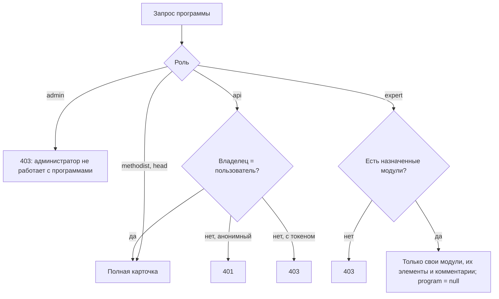

# Роли и права доступа

В МетодАгенте пять ролей — `methodist`, `expert`, `head`, `admin`, `api` (`ROLES` в `src/app/core/security.py`). У пользователя может быть несколько ролей, но токен JWT несёт ровно одну активную роль, и каждый метод API проверяет именно её через зависимость `require(...)`; без подходящей роли метод отвечает `403 FORBIDDEN_ROLE`. Роли не пересекаются: администратор ведёт пользователей, настройки агента и базу знаний, но не создаёт и не видит программы; методист создаёт программы, эксперт вычитывает назначенные модули, руководитель утверждает. Ниже — матрица прав строго по коду, правила видимости, учётные записи, токены, пароли, журнал и шифрование секретов, а также то, как интерфейс скрывает разделы.

## 1. Роли

| Роль | Подпись в интерфейсе | Назначение |
|---|---|---|
| `methodist` | методист | Создаёт программу, отвечает на вопросы, правит и утверждает каркас, назначает экспертов, отправляет на утверждение |
| `expert` | эксперт | Вычитывает только назначенные модули: правки, комментарии, решения по модулю |
| `head` | руководитель | Видит все программы, отчёты, версии и журнал; утверждает или возвращает программу |
| `admin` | администратор | Пользователи, настройки агента, навыки, база знаний, профиль и реестры организации, журнал |
| `api` | API | Служебная роль для автопрогона и интеграций; видит только свои программы |

## 2. Матрица «действие × роль»

Обозначения: «да» — разрешено; «свои» — с ограничением, описанным в примечании; «—» — 403 (или 401 для анонимного запроса).

### 2.1. Программы

| Действие (метод) | methodist | expert | head | admin | api |
|---|---|---|---|---|---|
| Создать программу `POST /programs`, `POST /programs/upload` | да | — | — | — | да |
| Список программ `GET /programs` | да (все) | свои (с назначенными модулями) | да (все) | — | свои (владелец) |
| Карточка программы `GET /programs/{id}` | да | свои (только назначенные модули) | да | — | свои |
| Ответы на вопросы `POST .../answers` | да | — | — | — | — |
| Правка каркаса `PATCH .../skeleton`, решения `.../skeleton/decisions` | да | — | — | — | — |
| Утвердить или вернуть каркас `.../skeleton/approve` | да | — | — | — | — |
| Сменить шаблон `.../template` | да | — | — | — | — |
| Отчёт автопроверки `.../report` | да | — | да | — | свои |
| Точечная правка `.../edits` | да | свои (без часов, только свои модули) | — | — | — |
| Версии `.../versions`, сравнение `.../diff` | да | — | да | — | — |
| Откат к версии `.../restore` | да | — | — | — | — |
| Текст по разделам `.../sections` | да | да | да | — | свои |
| Выгрузка `.../export/{fmt}` | да | — | да | — | свои |
| Журнал программы `.../events` | да | — | да | — | — |
| Актуализация программы `GET .../actualize` | да | да | да | — | да |
| Актуализация файла `POST /actualize` | да | — | — | — | да |
| Песочница кода `.../sandbox` | да | свои (лекции своих модулей) | да | — | — |
| Адаптация `.../adapt` | да | — | — | — | да |
| Подсказка экспертов `.../experts` | да | — | да | — | — |
| Назначить эксперта на модуль | да | — | — | — | — |
| Комментарий `.../comments`, `/reviews/{rid}/comments` | да | свои модули | — | — | — |
| Ответ на комментарий `.../comments/answer` | да | свои модули | — | — | — |
| Решение по модулю `.../reviews/decision`, `/reviews/{rid}/decision` | — | да | — | — | — |
| Задания на вычитку `GET /reviews` | — | да | — | — | — |
| Отправить на утверждение `.../submit` | да | — | — | — | — |
| Утвердить или вернуть программу `.../approval` | — | — | да | — | — |
| Статус задания `GET /jobs/{id}` | да | да | да | да* | свои |

\* Задания (`GET /jobs/{id}`) администратор видит только по идентификатору; разделы и выгрузка программы (`sections`, `export`) идут через общую проверку `_load_for`, которая отвечает администратору 403, как список и карточка программ.

### 2.2. База знаний, организация, администрирование

| Действие | methodist | expert | head | admin | api |
|---|---|---|---|---|---|
| Список документов организации `GET /kb/documents` | да | — | да | да | — |
| Загрузить или удалить документ `POST/DELETE /kb/documents`, `POST /org/documents` | — | — | — | да | — |
| Поиск `POST /kb/search`, выжимки НПА `GET /kb/norms` | да | да | да | да | — |
| Профиль организации `GET /org/profile` | да (без `smtp`) | — | да (без `smtp`) | да | — |
| Изменить профиль `PUT /org/profile` | — | — | — | да | — |
| Реестры `GET /org/registry` | да | — | да | да | — |
| Заменить раздел реестра `PUT /org/registry` | — | — | — | да | — |
| Пользователи, настройки, навыки, журнал `/admin/*` | — | — | — | да | — |

### 2.3. Учётная запись

| Действие | Кто |
|---|---|
| `GET /auth/me`, `POST /auth/switch-role`, `GET /me/tasks` | любой вошедший (анонимный — 401) |
| `PUT /auth/me`, `PUT /auth/me/password` | вошедший, кроме демо-учёток (403: их меняет только администратор) |
| `GET /notifications`, `POST /notifications/read` | любой, включая анонимный `api` |

## 3. Видимость программ

- **Эксперт** (`expert_view` в `src/app/programs/router.py`): в карточке остаются только модули с `expert_id` = эксперт; из комплекта — только `module_programs`, `questions`, `tasks`, `lectures`, `assessments` этих модулей; комментарии — только по этим модулям; поле `program` (полный комплект) = `null`. В списке программ — только программы из его заданий на вычитку. Выгрузка файлов эксперту запрещена.
- **Эксперт при правке**: нельзя менять часы (`target` вида `hours:...`) и элементы чужих модулей. Комментарий эксперта с `ask_agent=true` получает статус `proposed` — правка ждёт его подтверждения; правку по замечанию эксперта, переданную методистом, тоже подтверждает сам эксперт.
- **API-клиент** видит только программы, где он владелец (`svc.owner_of`), в списке — только свои.
- **Методист и руководитель** видят все программы; руководителю по умолчанию в интерфейсе включён фильтр статусов `on_approval,approved`. Поле `quality` в карточке есть только у methodist и head.

Методисты организации ведут программы совместно: любой методист может открыть и править любую программу. API-клиент видит только свои программы.

## 4. Переключение ролей

`POST /auth/switch-role {"role": "..."}` выдаёт новый токен с другой ролью, если она есть среди ролей пользователя, иначе 403. В интерфейсе переключатель показывается, если у пользователя больше одной роли (роль `api` в нём скрыта); рядом с ролью — число задач из `GET /me/tasks`. Для ролей, которые сейчас не активны, `/me/tasks` считает задачи демо-пользователей (`u-madina`, `u-timur`, `u-ahmed`).

При входе через интерфейс учётка с ролями `api` и `methodist` автоматически переключается на `methodist` (`login()` в `frontend/src/api.ts`).

## 5. Учётные записи

### 5.1. Хранение

Пользователи хранятся в таблице `users` (`src/app/auth/service.py`), в памяти — кэш, который перечитывается при старте и после каждого изменения. Поле `source`: `demo` — демо-учётка, `local` — созданная регистрацией или администратором.

### 5.2. Демо-учётки

Создаются при первом запуске (`DEMO` в `security.py`), пароль у всех — `demo`.

| id | Логин | Имя | Роли | Должность |
|---|---|---|---|---|
| `u-madina` | `madina` | Мадина | methodist | Методист |
| `u-timur` | `timur` | Тимур А. | expert | Эксперт-преподаватель |
| `u-olga` | `olga` | Ольга К. | expert | Эксперт-преподаватель |
| `u-ahmed` | `ahmed` | Ахмед | head | Руководитель учебного центра |
| `u-admin` | `admin` | Администратор | admin | Администратор профиля |
| `u-api` | `api` | API-клиент | api, methodist | Автопрогон |

`GET /auth/config` возвращает список демо-учёток и пароль `demo` для формы входа, только если включена настройка `demo_accounts_enabled`. Если её выключить, вход и токены демо-учёток отклоняются, кроме `u-api` и `u-admin` (администратору рекомендуется сменить пароль).

Вход возможен по логину, почте или id пользователя (`by_login`).

### 5.3. Регистрация

`POST /auth/register` (при `registration_enabled`):

- обязательно согласие на обработку персональных данных (`consent`, иначе 400 `CONSENT_REQUIRED`);
- не больше 10 регистраций в час с одного IP (429);
- роль — `registration_default_role` (по умолчанию `expert`, минимальные права: эксперт без назначенных модулей ничего не видит). Допускаются только `methodist`, `expert`, `head`; любое другое значение заменяется на `expert`;
- событие пишется в журнал организации.

### 5.4. Требования к данным

| Поле | Правило |
|---|---|
| Логин | `^[a-z0-9][a-z0-9._-]{2,31}$`, уникальный (409 `LOGIN_TAKEN`) |
| Почта | простой формат `x@y.z`, уникальная (409 `EMAIL_TAKEN`) |
| Пароль | не меньше 8 символов, хотя бы одна буква и одна цифра (400 `WEAK_PASSWORD`) |
| Роли | хотя бы одна, только из `ROLES` |
| Последний администратор | нельзя снять роль `admin` или отключить последнего активного администратора (409 `LAST_ADMIN`) |

## 6. Токены и пароли

- JWT подписывается `SECRET_KEY` алгоритмом `JWT_ALGORITHM` (`HS256`); содержимое: `sub`, `role`, `exp`.
- Срок жизни — `access_token_expire_minutes` (по умолчанию 720 минут), изменяется администратором в группе «Вход и регистрация» (15 — 43 200 минут).
- Учебный или короткий `SECRET_KEY` заменяется случайным ключом из `data_dir/.secret_key` (права `0600`); в production при недоступном каталоге приложение не стартует.
- Пароли хранятся только хешем bcrypt (`bcrypt.gensalt(rounds=10)`); проверка — `bcrypt.checkpw`.
- Заголовок `X-MA-Token` имеет приоритет над `Authorization: Bearer`. Интерфейс использует `X-MA-Token`, потому что прокси хаба перехватывает запросы с `Authorization`.
- Запросы без токена: GET/HEAD/OPTIONS выполняются как анонимный `api`, `POST /programs?mode=auto` — как анонимный `api` с лимитом `anon_runs_per_hour` в час с IP, остальное — 401.

## 7. Журнал администрирования

`GET /admin/journal` возвращает события с `program_id = 'org'`:

| Событие | Источник |
|---|---|
| `register` | регистрация пользователя |
| `password` | смена своего пароля |
| `user_create`, `user_update` | создание и изменение пользователя (для пароля пишется слово «пароль», не значение) |
| `settings` | изменение настроек (перечисляются названия полей, значения ключей не пишутся) |
| `skill` | изменение или сброс навыка |
| `org_profile`, `org_registry` | изменение профиля и реестров организации |

## 8. Шифрование секретов

Секреты, которые администратор вводит в интерфейсе (`llm_api_key`, `sso_client_secret`, `smtp_password` — поля типа `secret` в `src/app/core/runtime.py`), хранятся в базе зашифрованными (`src/app/core/crypto.py`):

- ключи выводятся из `SECRET_KEY` через PBKDF2-HMAC-SHA256 (200 000 итераций, соль `metodagent-settings`), отдельно ключ шифрования и ключ MAC;
- шифр — поток HMAC-SHA256 в режиме счётчика со случайным 16-байтовым nonce;
- целостность — HMAC-SHA256 поверх nonce и шифртекста;
- формат: `enc1:` + base64url(nonce + tag + шифртекст);
- при смене `SECRET_KEY` расшифровка невозможна (`SecretUnreadable`);
- наружу секрет отдаётся только маской `mask()`: `••••` и последние 4 символа (для значений длиннее 8 символов). Значение, начинающееся с `••••`, при сохранении считается неизменённым.

Пароль SMTP нельзя положить в профиль организации (`PUT /org/profile` вернёт 400): он задаётся настройкой `smtp_password` или переменной окружения `SMTP_PASSWORD`.

## 9. Как интерфейс скрывает разделы

Логика в `Shell` (`frontend/src/App.tsx`):

| Раздел | Путь | Кому показан пункт меню | Защита маршрута |
|---|---|---|---|
| Программы | `/app` | всем, кроме admin | admin перенаправляется на `/app/admin` |
| Карточка программы | `/app/p/:id` | — | admin перенаправляется на `/app/admin` |
| Вычитка | `/app/reviews` | expert | admin перенаправляется на `/app/admin` |
| База знаний | `/app/kb` | admin, methodist, head | нет (эксперт, открывший адрес вручную, получит 403 от API) |
| Администрирование | `/app/admin` | admin | не-admin перенаправляется на `/app` |
| Справка | `/help` | всем | — |
| Личный кабинет | `/app/me` | всем (через карточку пользователя) | — |

Без сессии любой маршрут `/app/*` перенаправляет на `/auth`. После входа эксперт попадает на `/app/reviews`, администратор — на `/app/admin`, остальные — на `/app`. Подписи прав по ролям для справки и лендинга — `ROLE_CAN` в `frontend/src/api.ts`. Скрытие в интерфейсе — только удобство: права всегда проверяет сервер.
