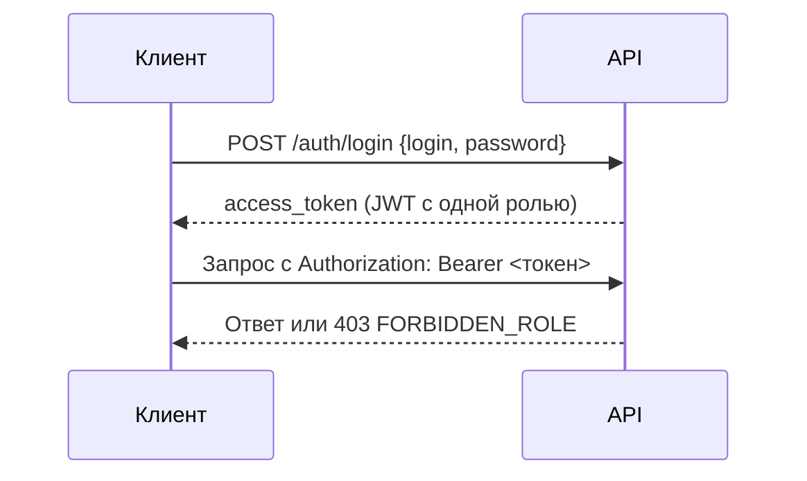
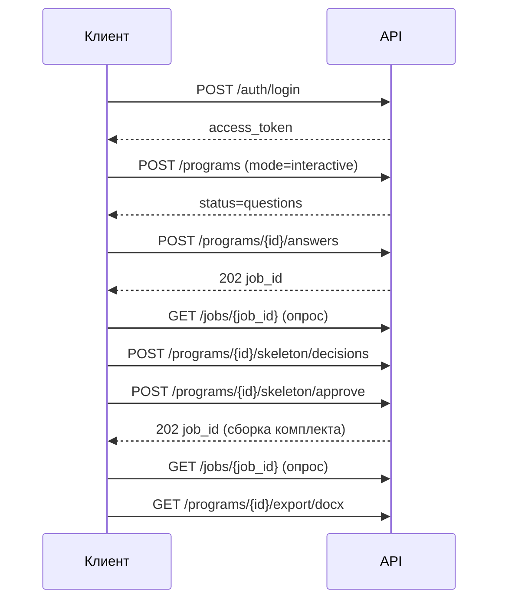

# API

МетодАгент предоставляет REST API с префиксом `/api/v1`. На этой странице — обзор и самые нужные вызовы с примерами. Полный справочник всех методов с ролями, параметрами и ошибками — `docs/api.md` в репозитории; интерактивная документация (Swagger UI) открывается на самом сервере по адресу `/docs`.

## Общие сведения

| Параметр | Значение |
|---|---|
| Базовый путь | `/api/v1` |
| Формат | JSON (кроме загрузки файлов `multipart/form-data` и выгрузки файлов) |
| OpenAPI | `GET /docs`, схема `GET /openapi.json` |
| Состояние | `GET /health` и `GET /api/v1/health` |
| CORS | разрешены все источники, методы и заголовки |

В примерах ниже `HOST=http://localhost:8000`. Демо-стенд стоит за входом хаба, поэтому для экспериментов из командной строки удобнее локальный запуск.

## Аутентификация



| Заголовок | Назначение |
|---|---|
| `Authorization: Bearer <токен>` | Для API-клиентов и автопрогона |
| `X-MA-Token: <токен>` | Используется интерфейсом. **Имеет приоритет**: если передан, `Authorization` не читается |

Интерфейс использует `X-MA-Token`, потому что прокси хаба перехватывает запросы с заголовком `Authorization`.

Токен — JWT с полями `sub` (id пользователя), `role` (активная роль), `typ` и `exp`. Вход выдаёт токен доступа на 30 минут (`access_token`) и токен обновления на 30 дней (`refresh_token`); `POST /api/v1/auth/refresh` меняет токен обновления на новую пару. Токены API для интеграций (`ma_…`) выдаёт и отзывает администратор: `/api/v1/admin/api-tokens`.

**Без токена:** `GET`, `HEAD`, `OPTIONS` выполняются как анонимный `api`; `POST /programs?mode=auto` — как анонимный `api` с лимитом 12 запусков в час с одного IP; всё остальное — `401`.

### Вход

```bash
TOKEN=$(curl -s -X POST $HOST/api/v1/auth/login \
  -H 'Content-Type: application/json' \
  -d '{"login": "madina", "password": "demo"}' \
  | python3 -c 'import sys,json; print(json.load(sys.stdin)["access_token"])')
```

Ответ: `{"access_token": "eyJ...", "token_type": "bearer", "user": {"id": "u-madina", ..., "role": "methodist"}}`.

Демо-учётка `api` имеет роли `api` и `methodist`; при входе без поля `role` выдаётся первая роль — `api`. Чтобы сменить роль, вызовите `POST /auth/switch-role {"role": "methodist"}`.

## Ошибки

Тело ошибки всегда одного формата:

```json
{"code": "SKELETON_NOT_APPROVED", "message_ru": "Пока каркас не утверждён, содержание не генерируется", "details": {}}
```

Вместо общего кода класса часто приходит частный код: для 409 это, например, `SKELETON_NOT_APPROVED`, `BLOCKING_FAILED`, `DECISIONS_PENDING`, `EDIT_REJECTED` (список — на странице [Модель данных](Модель-данных)).

| HTTP | `code` | Когда |
|---|---|---|
| 400 | `BAD_REQUEST` | Некорректные данные; частные коды `CONSENT_REQUIRED`, `WRONG_PASSWORD`, `WEAK_PASSWORD`, `BAD_LOGIN`, `BAD_EMAIL`, `SSO_NOT_AVAILABLE` |
| 401 | `UNAUTHORIZED` | Нет входа, неверный логин или пароль, токен недействителен или истёк |
| 403 | `FORBIDDEN_ROLE` | Роль не допущена к методу; `details.allowed` — допустимые роли |
| 404 | `NOT_FOUND` | Программа, версия, задание, пользователь, навык или документ не найдены |
| 409 | `STATE_CONFLICT` | Действие недоступно в текущем состоянии программы; частные коды `LOGIN_TAKEN`, `EMAIL_TAKEN`, `LAST_ADMIN` |
| 422 | `VALIDATION_ERROR` | Тело или параметры не соответствуют схеме; `details.errors` — список `{loc, msg}` |
| 429 | `RATE_LIMIT` | Лимит автопрогонов без токена, регистраций или параллельных заданий |
| 500 | `INTERNAL_ERROR` | Необработанная ошибка; детали не раскрываются |

## Автопрогон: программа одним запросом

Самый простой способ получить полный комплект — режим `auto`. Агент не задаёт вопросов: пустые поля заполняются значениями профиля организации и перечисляются в `assumptions`.

```bash
curl -s -X POST "$HOST/api/v1/programs?mode=auto" \
  -H 'Content-Type: application/json' \
  -d '{
    "request": "ПК «Анализ данных на Python», 72 часа, 4 недели, итог — защита проекта",
    "answers": {"audience": "Сотрудники банков, работают в Excel"}
  }'
```

Тело запроса:

| Поле | Значение |
|---|---|
| `request` | Текст запроса, 5–5000 символов |
| `attachments` | До 5 файлов: `[{"name": "program.docx", "content_base64": "..."}]` |
| `norm_mode` | `gos` (по умолчанию) или `org` |
| `wait` | `true` (по умолчанию) — ждать результат; `false` — сразу вернуть `job_id` |
| `answers` | Заранее известные ответы на вопросы |

Поля ответа:

| Поле | Содержание |
|---|---|
| `program_id` | Идентификатор вида `prg-xxxxxxxxxx` |
| `status` | `done`, `done_with_errors` или `failed` |
| `assumptions`, `questions_skipped` | Что агент принял сам и какие вопросы пропустил |
| `skeleton` | Шаблон, тип, документ, название, цель, ПС, объём, компетенции, модули с темами и часами, ИА, итоги, календарь |
| `kit` | Комплект по схеме 4.8 |
| `report` | `rules_passed`, `rules_total`, `blocking_checks` (например `10/10`), `failed_rules`, `unconfirmed_sources`, `rules`, `coverage` |
| `agent_notes` | Заметки агента |
| `files` | Ссылки на выгрузку во всех форматах |
| `timing_s` | Длительность шагов |
| `tokens` | `in`, `out`, `cost_rub`, `calls` |

### Асинхронно

```bash
curl -s -X POST "$HOST/api/v1/programs?mode=auto" \
  -H 'Content-Type: application/json' \
  -d '{"request": "ДООП по робототехнике для детей 10-12 лет, 144 часа", "wait": false}'
# 202 {"program_id": "prg-...", "job_id": "job-...", "status": "queued"}

curl -s $HOST/api/v1/jobs/<job_id>
# {"status": "running", "progress": {...}} → {"status": "done", "result": {...}}
```

### С вложением

```bash
B64=$(base64 -w0 program.docx)
curl -s -X POST "$HOST/api/v1/programs?mode=auto" \
  -H "Authorization: Bearer $TOKEN" -H 'Content-Type: application/json' \
  -d "{\"request\": \"Обновить программу по образцу, 72 часа\", \"attachments\": [{\"name\": \"program.docx\", \"content_base64\": \"$B64\"}]}"
```

## Интерактивный сценарий



```bash
# 1. Создать программу
curl -s -X POST "$HOST/api/v1/programs" -H "Authorization: Bearer $TOKEN" \
  -H 'Content-Type: application/json' \
  -d '{"request": "Курс по кибербезопасности для студентов колледжа, примерно на месяц"}'
# {"program_id": "prg-...", "status": "questions", "questions": [{"id": "q1", ...}], "program": {...}}

# 2. Ответить на вопросы (пустой ответ = «На ваше усмотрение»)
curl -s -X POST "$HOST/api/v1/programs/<id>/answers" -H "Authorization: Bearer $TOKEN" \
  -H 'Content-Type: application/json' -d '{"answers": {"q1": "ДПП ПК", "q2": "72"}}'
# 202 {"job_id": "...", "status": "queued"}

# 3. Решение по пункту «!»
curl -s -X POST "$HOST/api/v1/programs/<id>/skeleton/decisions" -H "Authorization: Bearer $TOKEN" \
  -H 'Content-Type: application/json' -d '{"rule_id": "V-22", "decision": "accept", "node": "loc.1"}'

# 4. Утвердить каркас и запустить сборку комплекта
curl -s -X POST "$HOST/api/v1/programs/<id>/skeleton/approve" -H "Authorization: Bearer $TOKEN" \
  -H 'Content-Type: application/json' -d '{"decision": "approve"}'
```

Значения `node` и `proposal` для решения берутся из поля `report.proposals` карточки программы.

## Самые нужные методы

### Программы

| Метод | Кто | Назначение |
|---|---|---|
| `POST /programs` | methodist, api | Создать программу (JSON, вложения в base64) |
| `POST /programs/upload` | methodist, api | То же через `multipart/form-data` (`text`, `norm_mode`, `files`) |
| `GET /programs` | все, кроме admin | Список; фильтры `status` (через запятую), `since`, `until` (`ГГГГ-ММ-ДД`) |
| `GET /programs/{id}` | все, кроме admin | Состояние программы, `readiness`, `totals`, `program` (комплект), `quality` для methodist и head |
| `PATCH /programs/{id}/skeleton` | methodist | Правка каркаса (часы, названия, формулировки, `final_hours`, `calendar_option`) |
| `POST /programs/{id}/skeleton/approve` | methodist | `decision`: `approve` или `return` (с `comment`) |
| `POST /programs/{id}/template` | methodist | Смена шаблона: `dpp_pk`, `dpp_pk_internship`, `doop` |
| `GET /programs/{id}/report` | methodist, head, api | Отчёт автопроверки и матрица покрытия |
| `POST /programs/{id}/edits` | methodist, expert | Точечная правка: `target`, `instruction`, `new_title`, `hours`, `dry_run` |
| `GET /programs/{id}/versions` | methodist, head | Версии |
| `GET /programs/{id}/versions/{a}/diff/{b}` | methodist, head | Сравнение версий |
| `POST /programs/{id}/versions/{v}/restore` | methodist | Откат |
| `GET /programs/{id}/sections` | все (api — свои) | Разделы шаблона: `key`, `title`, `level`, `text` |
| `GET /programs/{id}/export/{fmt}` | все, кроме expert (api — свои) | Файл: `docx`, `pptx`, `gift`, `moodle_xml`, `json`, `order_draft`, `lectures_docx` |
| `POST /programs/{id}/adapt` | methodist, api | Новая программа по готовой: `volume_h` (8–2000), `audience`, `title`, `duration_weeks` |

### Согласование

| Метод | Кто | Назначение |
|---|---|---|
| `GET /programs/{id}/experts` | methodist, head | Эксперты с подсказкой агента |
| `PUT /programs/{id}/modules/{module_id}/expert` | methodist | Назначить эксперта: `expert_id` |
| `GET /reviews` | expert | Задания на вычитку |
| `POST /programs/{id}/comments` | expert, methodist | Комментарий: `module_id`, `text`, `node_id`, `ask_agent` |
| `POST /programs/{id}/reviews/decision` | expert | `decision`: `accept`, `return`, `question`, `accept_item`; `score` 1–5 |
| `POST /programs/{id}/submit` | methodist | Отправить на утверждение |
| `POST /programs/{id}/approval` | head | `decision`: `approve` или `return` (с `comment`) |

### Прочее

| Метод | Кто | Назначение |
|---|---|---|
| `GET /jobs/{job_id}` | по правам на программу | Статус задания: `queued`, `running`, `done`, `failed`, `progress` |
| `GET /notifications`, `POST /notifications/read` | любая | Уведомления |
| `POST /kb/search` | admin, methodist, head, expert | Поиск по документам организации и выжимкам: `query`, `k` |
| `GET /kb/norms` | admin, methodist, head, expert | Список выжимок и счётчики реестров |
| `GET /org/registry?kind=npa` | admin, methodist, head | Раздел реестра |
| `GET /api/v1/llm/status` | все | Состояние шлюза LLM и расход |
| `GET /api/v1/skills` | все | Навыки агента: имя, описание, версия |
| `/admin/*` | admin | Пользователи, настройки, навыки, журнал |

## Получение результата

```bash
# Состояние программы с комплектом в поле program
curl -s $HOST/api/v1/programs/<program_id> -H "Authorization: Bearer $TOKEN"

# Файлы
curl -s -OJ $HOST/api/v1/programs/<program_id>/export/docx -H "Authorization: Bearer $TOKEN"
curl -s -OJ $HOST/api/v1/programs/<program_id>/export/moodle_xml -H "Authorization: Bearer $TOKEN"
```

## Пример на Python

```python
import httpx, time

HOST = 'http://localhost:8000/api/v1'
token = httpx.post(f'{HOST}/auth/login', json={'login': 'api', 'password': 'demo'}).json()['access_token']
h = {'Authorization': f'Bearer {token}'}

r = httpx.post(f'{HOST}/programs', params={'mode': 'auto'}, headers=h,
               json={'request': 'ПК «Основы DevOps», 36 часов, очно-заочно', 'wait': False}).json()
job = r['job_id']
while (s := httpx.get(f'{HOST}/jobs/{job}', headers=h).json())['status'] not in ('done', 'failed'):
    time.sleep(2)
res = s.get('result', {})
print(res.get('status'), res.get('report', {}).get('blocking_checks'), res.get('tokens'))
```

## Подсказки

- **429 при сборке комплекта.** Достигнут лимит одновременных заданий (`MAX_PARALLEL_JOBS`, по умолчанию 4). Подождите завершения других заданий.
- **401 без токена на `POST /programs`.** Без токена разрешён только `mode=auto`.
- **403 у администратора.** Администратор не работает с программами; используйте учётку методиста или `api`.
- **Ссылки в `files` ведут на другой хост.** Ссылки строятся из заголовков прокси (`--proxy-headers`); проверьте настройки обратного прокси.

См. также: [Роли и права](Роли-и-права), [Модель данных](Модель-данных), [Выгрузка](Выгрузка).
