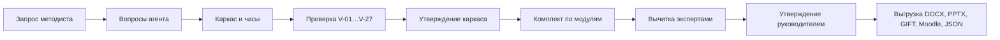

# МетодАгент

**МетодАгент** — агент методиста Академии цифрового развития (АЦР). Методист описывает программу обычным текстом, а агент собирает дополнительную программу по шаблону АЦР и полный комплект материалов к ней. Затем программа проходит вычитку экспертами и утверждение руководителем, и всё это происходит в одном интерфейсе.

> **Демо:** https://methodagent.ru
> Адрес ведёт на стенд команды в хабе хакатона (https://tochka-sborki-2026-team-098.hub.gigaschool.ru). Сначала нужно войти в хаб, затем в само приложение. Демо-учётки и пароль `demo` описаны в разделе [Быстрый старт](Быстрый-старт).

## Что умеет агент

Агент поддерживает три типа программ:

| Тип | Код в системе | Шаблон | Выдаваемый документ |
|---|---|---|---|
| Дополнительная профессиональная программа повышения квалификации (ДПП ПК) | `dpp_pk` | «ДПП ПК» | удостоверение о повышении квалификации |
| ДПП ПК в форме стажировки | `dpp_pk_internship` | «ДПП ПК (стажировка)» | удостоверение |
| Дополнительная общеобразовательная общеразвивающая программа (ДООП) | `doop` | «ДООП» | сертификат |

В комплект входят:

- карта компетенций (знать, уметь, владеть) с результатами обучения, а для ДПП ещё профстандарт и трудовые функции из реестра;
- учебный план, учебно-тематический план (УТП) и календарный график;
- рабочие программы модулей;
- лекции с планом по минутам, примерами кода и слайдами;
- тесты с ключами, задания семинаров с критериями и баллами;
- материалы итоговой аттестации и проект приказа.

Готовый комплект выгружается в DOCX по шаблону АЦР, PPTX, GIFT, Moodle XML и JSON по схеме 4.8 ТЗ.

## Чем он отличается от «просто нейросети»

| Принцип | Что это значит на практике |
|---|---|
| Часы считает код | Модель предлагает только структуру и веса. Часы раскладывает детерминированный солвер методом наибольших остатков, поэтому суммы сходятся в каждой строке и каждом столбце |
| Реквизиты только из реестров | Нормативные акты, профстандарты, коды трудовых функций и литература берутся из проверенных реестров. Всё, чего в реестре нет, помечается «не подтверждено» |
| Автопроверка перед выдачей | 27 правил V-01…V-27 объединены в 10 блокирующих проверок. Пока каркас не утверждён, содержание не генерируется |
| Люди принимают решения | По каждому спорному пункту «!» решение принимает методист, каждый модуль принимает эксперт, программу утверждает руководитель |
| Пустые поля для людей | Номер и дату приказа, ФИО и подписи агент не заполняет: это контролирует правило V-11 |
| Работа без модели | Если шлюз LLM недоступен или исчерпан дневной лимит, агент собирает программу по библиотеке типовых структур и прямо пишет об этом в заметках |

## Навигация по ролям

| Вы | С чего начать | Что ещё пригодится |
|---|---|---|
| **Методист** | [Методисту](Методисту) | [Как работает агент](Как-работает-агент), [Часы и календарь](Часы-и-календарь), [Автопроверка](Автопроверка), [Выгрузка](Выгрузка) |
| **Эксперт** | [Эксперту](Эксперту) | [Автопроверка](Автопроверка), [Глоссарий](Глоссарий) |
| **Руководитель** | [Руководителю](Руководителю) | [Автопроверка](Автопроверка), [LLM и стоимость](LLM-и-стоимость) |
| **Администратор** | [Администратору](Администратору) | [Роли и права](Роли-и-права), [Настройки](Настройки), [Нормативная база](Нормативная-база), [Развёртывание](Развёртывание) |
| **Разработчик, интегратор** | [Разработка](Разработка) | [Архитектура](Архитектура), [API](API), [Модель данных](Модель-данных) |

Если вы видите систему впервые, начните с [Быстрого старта](Быстрый-старт): за пять минут можно собрать первую программу на демо-стенде.

## Текущее состояние

| | |
|---|---|
| Версия поставки | v18 от 18.10.2026 (см. [История изменений](История-изменений)) |
| Версия приложения в `/health` | `0.1.0` (настройка `APP_VERSION`) |
| Автопроверка | 27 правил: 23 кодом, 4 смысловых с моделью-судьёй; 10 блокирующих проверок |
| Нормативная база | 74 действующих акта, 36 профстандартов из открытых источников, 34 ФГОС, 52 выжимки актов |
| Модели | `GigaChat/GigaChat-3-Pro` (генерация), `ai-sage/GigaChat3.5-432B-A28B-Reasoning` (судья), `ai-sage/Giga-Embeddings-instruct-3B` (эмбеддинги) |
| Стек | FastAPI, SQLAlchemy (async) и SQLite; интерфейс на React 19 и Vite |
| Лицензия | GPL-3.0 |

Встроенная справка открывается в приложении по адресу `/help`, интерактивная документация API — по адресу `/docs`.

## Карта вики

- **Начало:** [Быстрый старт](Быстрый-старт)
- **Пользователям:** [Методисту](Методисту), [Эксперту](Эксперту), [Руководителю](Руководителю), [Администратору](Администратору), [Роли и права](Роли-и-права)
- **Как устроено:** [Как работает агент](Как-работает-агент), [Часы и календарь](Часы-и-календарь), [Автопроверка](Автопроверка), [Выгрузка](Выгрузка), [Нормативная база](Нормативная-база), [LLM и стоимость](LLM-и-стоимость)
- **Разработчикам:** [API](API), [Архитектура](Архитектура), [Модель данных](Модель-данных), [Настройки](Настройки), [Развёртывание](Развёртывание), [Разработка](Разработка)
- **Справочное:** [Соответствие ТЗ](Соответствие-ТЗ), [Глоссарий](Глоссарий), [Частые вопросы](Частые-вопросы), [Решение проблем](Решение-проблем), [История изменений](История-изменений)
