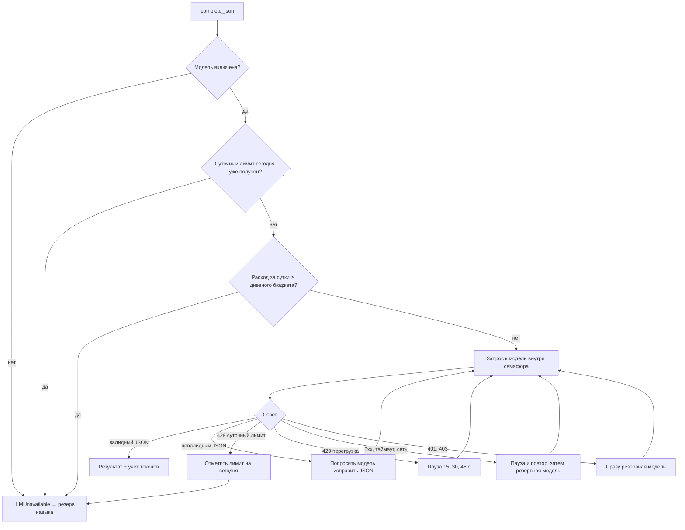

# LLM и стоимость

Слой моделей — `src/app/llm/client.py` — клиент шлюза Cloud.ru, написанный на httpx без сторонних SDK, (Cloud.ru Evolution Foundation Models или шлюз хакатона) с моделями GigaChat. Он обслуживает роли «генерация» и «судья» с резервной моделью, эмбеддинги для базы знаний организации, повторы с паузами, бюджет времени навыка, общий лимит параллельности, учёт токенов и рублей, дневной бюджет и распознавание суточного лимита шлюза.

Главное свойство: **любая неустранимая ошибка модели превращается в исключение `LLMUnavailable`**, которое навыки перехватывают и переходят на детерминированный резерв. Поэтому сбой шлюза не останавливает работу: программа будет собрана, хотя и по шаблону, а методист увидит об этом заметку.

## Модели и тарифы

| Назначение | Настройка | По умолчанию | ₽ за 1 млн токенов (вход / выход) |
|---|---|---|---|
| Генерация: каркас и содержание | `llm_model_generate` | `GigaChat/GigaChat-3-Pro` | 73,03 / 176,39 |
| Судья | `llm_model_judge` | `ai-sage/GigaChat3.5-432B-A28B-Reasoning` | 96,22 / 288,60 |
| Резерв генерации | `llm_model_reserve` | `GigaChat/GigaChat-3-Pro` | как у генерации |
| Эмбеддинги | `llm_model_embed` | `ai-sage/Giga-Embeddings-instruct-3B` | не учитывается (0 ₽) |

Порядок моделей роли: для генерации — основная, затем резервная (по умолчанию они совпадают, и тогда модель одна); для судьи — судья, затем модель генерации.

## Режимы провайдера

| `LLM_PROVIDERS` | Поведение |
|---|---|
| `cloudru` (по умолчанию) | Рабочий режим. Модель включена, если задан ключ |
| `fixtures` | Без сети. Навыки сразу идут в резервную генерацию, судья не вызывается, ссылки источников не проверяются. Удобно для разработки и тестов |

Ключ ищется в `LLM_API_KEY` или `CLOUDRU_API_KEY`; адрес — в `LLM_BASE_URL` или `CLOUDRU_BASE_URL` (по умолчанию `https://foundation-models.api.cloud.ru/v1`). Режим, ключ, адрес и модели можно поменять в админке без перезапуска.

## Где вызывается модель

| Место | Навык | Роль | Температура / max_tokens |
|---|---|---|---|
| Разбор запроса | `intake` | generate | 0,1 / 1200 |
| Каркас | `skeleton` | generate | 0,2 / 3500 |
| Содержание модуля | `content` | generate | 0,5 / 6000 (4500, если слайды не нужны) |
| Переписывание упавшего примера кода | `content` | generate | 0,2 / 900 |
| Предложение правки по замечанию эксперта | `review_assist` | generate | 0,3 / 800 |
| Смысловые правила | `judge` | judge | 0,0 / 4096 |
| Индексация документов организации | — | эмбеддинги | — |

Сколько вызовов на программу: один на разбор запроса, один на каркас, по одному на модуль, один для судьи, плюс по одному на каждый упавший пример кода.

## Как проходит вызов



- **Попытки.** Для судьи — одна попытка (ответ долгий и дорогой), затем резерв. Для остальных — до 3 попыток с паузами 1 и 3 с.
- **Бюджет времени навыка** = `timeout_s × (retries + 1)` из `SKILL.md`. Считается только активное время запросов, ожидание очереди не считается. Бюджет исчерпан — навык уходит в резерв.
- **Разбор ответа.** Из ответа убираются блоки `<think>…</think>`, обрамление ```` ```json ````, текст до первой скобки и после последней, висячие запятые. Затем ответ проверяется схемой Pydantic.
- **Невалидный JSON.** Если ответ пустой (рассуждающая модель израсходовала лимит токенов), запрос повторяется. Иначе модели отправляются её ответ и текст ошибки с просьбой вернуть исправленный JSON.

### Бюджеты времени навыков

| Навык | `timeout_s` | Повторы | Бюджет |
|---|---|---|---|
| `intake` | 30 с | 2 | 90 с |
| `skeleton` | 60 с | 2 | 180 с |
| `content` | 120 с | 2 | 360 с |
| `review_assist` | 30 с | 1 | 60 с |
| судья | — | — | 360 с (`llm_timeout_s × 3`) |

Таймаут одного запроса — не больше `llm_timeout_s` (по умолчанию 120 с) и не больше остатка бюджета.

## Параллельность

- Один семафор на процесс: к шлюзу одновременно уходят не больше `llm_concurrency` запросов (по умолчанию 2, потому что шлюз хакатона допускает 2 параллельных запроса на команду). Судья и эмбеддинги используют тот же семафор.
- Генерация модулей запускает `max(4, gen_workers)` задач (по умолчанию `gen_workers = 6`), но к шлюзу одновременно идут только 2 запроса. Экран сборки честно показывает оба числа.
- Одновременных фоновых заданий — не больше `max_parallel_jobs` (по умолчанию 4); сверх — `429`.

## Учёт токенов и стоимости

После каждого успешного ответа берутся `usage.prompt_tokens` и `usage.completion_tokens`:

```
стоимость = (токены_входа × цена_входа + токены_выхода × цена_выхода) / 1 000 000
```

Пример. Каркас: 3 000 токенов на входе и 2 500 на выходе по тарифу генерации.
`(3000 × 73,03 + 2500 × 176,39) / 1 000 000 = 0,22 + 0,44 ≈ 0,66 ₽`.

Расход копится по навыкам и попадает:

- в шапку карточки программы и блок качества у руководителя;
- в ответ автопрогона: `tokens` (`in`, `out`, `cost_rub`, `calls`);
- в журнал приложения (навык, модель, токены, задержка, номер попытки). Ключ и тексты запросов не логируются.

Эмбеддинги учитываются только по входным токенам, со стоимостью 0.

## Дневной бюджет и суточный лимит

Это два разных ограничения:

| | Дневной бюджет приложения | Суточный лимит шлюза |
|---|---|---|
| Что это | Порог расхода, заданный администратором | Лимит, который ставит сам шлюз |
| По умолчанию | `llm_daily_budget_rub = 90` ₽ | 100 ₽ на шлюзе хакатона |
| Как узнаёт приложение | Считает расход само | Ответ 429 со словами `daily`, `spending limit`, `llm_daily_limit` |
| Что происходит | Новые вызовы сразу получают `LLMUnavailable`, навыки уходят в резерв | Отметка лимита на сегодня; без повторов и без резервной модели (лимит общий для всех моделей шлюза); судья не запускается |
| Когда сбрасывается | В 00:00 МСК | В 00:00 МСК, или раньше после успешной проверки `ping()` |

Сутки считаются по Москве (UTC+3), а не по времени контейнера. Расход за сутки и день отметки лимита хранятся в `data/runtime/llm_spend.json` и переживают перезапуск.

Когда лимит исчерпан, методист видит заметку «Дневной лимит шлюза LLM исчерпан, до 00:00 МСК модули собираются по шаблону…».

## Проверка шлюза

`GET /api/v1/llm/status` делает проверочный запрос к модели генерации и возвращает:

| Поле | Содержание |
|---|---|
| `enabled` | Включена ли модель; при выключенной — ещё `provider` |
| `ok`, `model`, `latency_s` | Результат проверочного запроса |
| `error` | Тип исключения при неудаче |
| `spent_today_rub`, `daily_budget_rub` | Расход за сутки по МСК и бюджет |
| `daily_limit_reached` | Отметка суточного лимита |
| `models` | `generate`, `judge`, `embed` |
| `judge_enabled` | Включён ли судья |

Проверочный запрос не учитывается в расходе. В интерфейсе он доступен администратору кнопкой проверки в «Настройках агента».

```bash
curl -s http://localhost:8000/api/v1/llm/status
```

## Частые вопросы

- **Сколько стоит одна программа?** Зависит от объёма и числа модулей. Стоимость считается по тарифу и видна в карточке программы и в ответе API.
- **Как сэкономить?** Выключите судью (`llm_judge_enabled`): он использует самую дорогую модель. Утверждайте каркас только после проверки: комплект — самая дорогая часть.
- **Можно ли подключить другую модель?** Да, если шлюз совместимый с Cloud.ru Foundation Models: поменяйте адрес, ключ и имена моделей в админке. Тариф для отчёта о стоимости задаётся переменными `LLM_PRICE_*` и требует перезапуска.
- **Почему судья включён по умолчанию?** Значение `LLM_JUDGE_ENABLED` по умолчанию — `true`.

См. также: [Настройки](Настройки), [Решение проблем](Решение-проблем).
