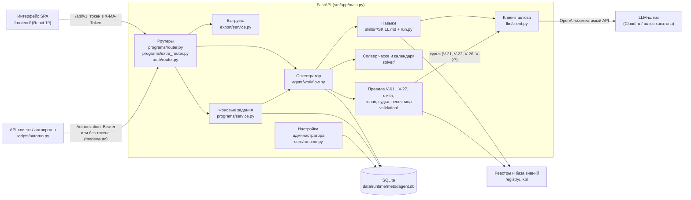
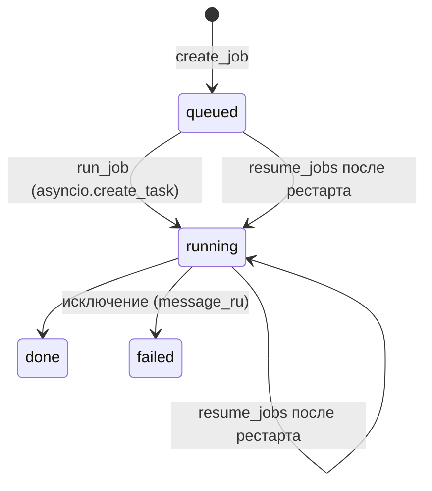
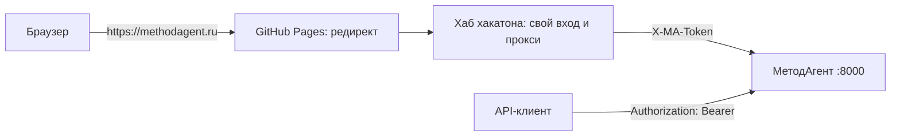

# Архитектура

МетодАгент — веб-сервис из одного процесса. Бэкенд на FastAPI с асинхронным SQLAlchemy поверх SQLite (`src/app`), интерфейс на React 19 и Vite (`frontend/`). Интерфейс собирается в `frontend/dist` и раздаётся тем же процессом FastAPI. Языковая модель вызывается через OpenAI-совместимый шлюз; всё, что можно посчитать детерминированно (часы, календарь, реквизиты, проверки), считает код.

## Общая схема

## Принципы

| Принцип | Как обеспечивается |
|---|---|
| **Часы считает солвер** | Модель предлагает только структуру, веса и доли; часы раскладывает `solver/hours.py` методом наибольших остатков |
| **Реквизиты только из реестра** | ПС, коды ТФ, НПА и литература берутся из `registry/`; источник, которого нет в реестре, помечается «не подтверждено» (V-15, V-16) |
| **Пустые поля для людей** | Реквизиты приказа, ФИО и подписи остаются пустыми полями (V-11) |
| **Без утверждённого каркаса содержание не генерируется** | `generate_kit` отклоняет вызов с `SKELETON_NOT_APPROVED` |
| **Устойчивые идентификаторы и граф** | Компетенция → индикатор → РО → тема → лекция, слайд, вопрос, задание; правка пересобирает только потомков узла |
| **Деградация без модели** | При недоступном шлюзе, исчерпанном бюджете или в режиме `fixtures` навыки собирают программу по библиотеке типовых структур и шаблонам |
| **Разделение ролей** | Программы создаёт методист, вычитывает эксперт, утверждает руководитель; администратор программ не видит (403) |
| **Секреты только в окружении или зашифрованными в БД** | Наружу ключи отдаются маской, в журнал не пишутся |

## Структура каталогов

| Путь | Назначение |
|---|---|
| `src/app/main.py` | Точка входа: приложение FastAPI, инициализация БД, загрузка пользователей и настроек, возобновление заданий, `/health`, раздача SPA |
| `src/app/core/` | Настройки (`config.py`), настройки из админки (`runtime.py`), шифрование секретов (`crypto.py`), ORM и БД (`db.py`), роли и JWT (`security.py`), ошибки API (`errors.py`) |
| `src/app/agent/` | Оркестратор `workflow.py`, тексты разделов шаблона `sections.py`, сценарии сверх потока `extras.py` |
| `src/app/skills/` | Навыки: `SKILL.md`, `schema_in.json`, `run.py`; загрузчик `base.py` |
| `src/app/solver/` | Солвер часов `hours.py` и календаря `calendar.py` |
| `src/app/validation/` | 27 правил `rules.py`, отчёт `report.py`, починка `repair.py`, судья `judge.py`, песочница `sandbox.py`, оригинальность `ngrams.py` |
| `src/app/kb/` | Реестры `registry.py`, выжимки `norms.py`, документы организации `orgdocs.py`, разбор файлов `files.py` |
| `src/app/llm/` | Клиент шлюза `client.py` |
| `src/app/export/` | Выгрузки `service.py` |
| `src/app/programs/` | Схема `ProgramDoc` (`schemas.py`), хранилище и задания (`service.py`), роутеры (`router.py`, `extra_router.py`) |
| `src/app/auth/` | Вход, регистрация, кабинет, `/admin/*` (`router.py`); хранение пользователей (`service.py`) |
| `frontend/src/` | `App.tsx` (маршруты и оболочка), `api.ts` (клиент), `pages/` (страницы), `components/ui.tsx` |
| `registry/` | Проверенные реестры; `registry/norms/` — 52 выжимки актов |
| `testset/cases.json` | 5 открытых запросов кейса для автопрогона |
| `tests/` | Тесты pytest |
| `scripts/` | `autorun.py` (автопрогон), `deploy_vm.sh` (Docker), `run_vm.sh` (без Docker) |
| `data/samples/` | Образцы программ АЦР (.docx) |
| `data/runtime/` | Рабочие данные (не в git) |
| `docs/` | Подробная документация по модулям |

## Жизненный цикл запроса

1. **Создание.** `POST /api/v1/programs` (JSON) или `POST /api/v1/programs/upload` (multipart, используется интерфейсом). Файлы разбираются `kb/files.py`. Создаётся `ProgramDoc` с id `prg-xxxxxxxxxx`, вызывается `intake_step` (навыки `intake`, `classify`, `clarify`), пишется событие `created`.
2. **Вопросы.** Если есть вопросы, статус `questions`; после ответов ставится задание `skeleton`.
3. **Каркас.** Навык `skeleton`, солвер часов, календарь, правила каркаса. Статус `skeleton`, снимок версии.
4. **Работа с каркасом.** Правка, решения по «!», возврат с комментарием.
5. **Утверждение каркаса.** Проверка ошибок и решений, статус `skeleton_approved`, задание `kit` (с проверкой лимита заданий).
6. **Комплект.** Модули параллельно, разделы, источники, 27 правил, repair, судья. Статус `kit_ready`. Прогресс пишется в `jobs.progress` и читается интерфейсом через `GET /jobs/{job_id}`.
7. **Правки.** Точечная правка с предпросмотром; пересобираются только потомки узла.
8. **Вычитка.** Назначение экспертов (статус `on_review`), комментарии, решения по модулям.
9. **Утверждение.** `submit` → `on_approval`; руководитель → `approved` или `returned`.
10. **Выгрузка.** `GET /programs/{id}/export/{fmt}`.

Автопрогон (`mode=auto`) выполняет шаги 1–6 без участия человека. Подробно — [Как работает агент](Как-работает-агент).

## Фоновые задания

Отдельного брокера очередей нет. Задания — это корутины asyncio в том же процессе:

- Виды заданий: `skeleton`, `kit`, `auto`.
- `check_capacity()` отклоняет запуск с `429`, если уже выполняются `MAX_PARALLEL_JOBS` задач (проверяется перед заданием `kit` и асинхронным автопрогоном).
- При старте незавершённые задания перезапускаются; `auto` после рестарта, если каркас уже утверждён, собирает только комплект.

Счётчики, живущие только в памяти процесса: активные задачи, лимит анонимных автопрогонов по IP, кэш пользователей. При нескольких воркерах uvicorn они не разделяются, поэтому конфигурация запуска использует один процесс.

## Хранение данных

| Что | Где |
|---|---|
| База SQLite | `DATA_DIR/metodagent.db` (по умолчанию `data/runtime/metodagent.db`) или `DATABASE_URL` |
| Сгенерированный `SECRET_KEY` | `DATA_DIR/.secret_key` (права 600) |
| Правки реестров и профиля | `DATA_DIR/registry/*.json` (перекрывают `registry/`) |
| Документы организации | `DATA_DIR/kb/` (индекс `index.json`) |
| Правки параметров навыков | `DATA_DIR/skills_overrides.json` |
| Расход LLM за сутки | `DATA_DIR/llm_spend.json` |
| Журнал приложения без Docker | `logs/app.log`, `logs/reboot.log` |
| Результаты автопрогона | `logs/autorun/<id>.json`, `logs/autorun/summary.md` |

В контейнере `registry/` и `src/` доступны только для чтения, поэтому всё изменяемое лежит в `data/runtime`, который монтируется томом и при обновлении не затирается.

## Доступ через хаб

Демо-стенд открыт через хаб хакатона (`https://tochka-sborki-2026-team-098.hub.gigaschool.ru`) со своим входом. Прокси хаба перехватывает запросы с заголовком `Authorization`, поэтому интерфейс передаёт токен приложения в заголовке `X-MA-Token`; `Authorization: Bearer` остаётся для API-клиентов, которые обращаются к сервису напрямую.

Домен `methodagent.ru` указывает на GitHub Pages (отдельный репозиторий с редиректом, сертификат Let's Encrypt, Enforce HTTPS), откуда выполняется переадресация на адрес хаба.

## Интерфейс

Одностраничное приложение на React 19, React Router 6 и Vite 6. Маршруты: `/` (лендинг), `/auth` (вход и регистрация), `/help` (справка), `/app` (программы), `/app/p/:id` (карточка программы), `/app/reviews` (вычитка), `/app/kb` (база знаний), `/app/admin` (администрирование), `/app/me` (личный кабинет).

Клиент API повторяет безопасные запросы при сетевой ошибке до 3 раз, затем проверяет `/api/v1/health`: если ответ похож на страницу входа хаба, страница перезагружается через вход хаба; иначе интерфейс показывает «Сервер временно недоступен» и опрашивает сервер каждые 3 секунды до восстановления. Подробно — `docs/frontend.md`.

См. также: [Модель данных](Модель-данных), [Настройки](Настройки), [Развёртывание](Развёртывание).
