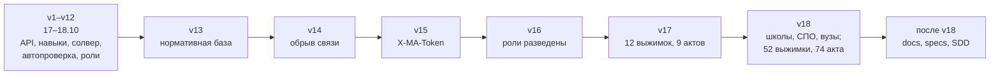

# История изменений

Версии поставки на стенд команды и главное в каждой. Даты по МСК. Подробности — в истории коммитов и в `docs/changelog.md`.

## v26 — 19.10.2026

- Поиск по базе знаний: выдача документов организации и выжимок норм сливается по местам (reciprocal rank fusion), а не по сырым оценкам разных шкал, поэтому найденное по смыслу не уступает совпадению слов в выжимках норм.

## v25 — 19.10.2026

Закрыты оставшиеся частичные пункты ТЗ по доступу и навыкам.

- Вход: токен доступа на 30 минут и токен обновления на 30 дней (`POST /api/v1/auth/refresh`); интерфейс продлевает вход сам.
- Администратор выдаёт и отзывает токены API (`/api/v1/admin/api-tokens`, вкладка «Токены API»); в базе хранится только хэш.
- Не больше 30 новых программ в час на пользователя и отдельный лимит для роли api, оба настраиваются.
- Настройки `SANDBOX_TIMEOUT_S` и `SANDBOX_MEMORY_MB` для песочницы.
- У каждого навыка есть `schema_out.json`, сгенерированный из модели ответа; `scripts/export_skill_schemas.py --check` сверяет их с кодом.
- Поиск по базе знаний: пока часть документов без векторов, совпадение слов не вытесняет найденное по смыслу.
- Регресс: pytest 299 тестов, покрытие 92 %; API по всем ролям и 5 кейсам 1381/1381; интерфейс 90/90. Сверка с ТЗ: 324 выполнено, 51 частично, 6 не выполнено.

## v24 — 19.10.2026

Полный регресс и закрытие инструментов разработки по ТЗ 4.11.

- Интерфейс: ESLint (правила TypeScript и хуков React, без предупреждений) и юнит-тесты vitest для клиента API (`npm run lint`, `npm run test`, `npm run check`).
- Схема OpenAPI хранится в `docs/openapi.json`, `scripts/export_openapi.py --check` сверяет её с кодом в тестах и CI.
- `Makefile`: `make check` повторяет CI, `make e2e` запускает сквозной регресс на поднятом сервисе.
- Регресс на финальном коде: pytest 290 тестов, покрытие 91 %; API по всем ролям и 5 кейсам 1381/1381; интерфейс по ролям 89/89; smoke и автопрогон зелёные. Сверка с ТЗ: 318 выполнено, 57 частично, 6 не выполнено (только метрики пилота и замеры с методистом).

## v21 — 19.10.2026

- Только Cloud.ru: собственный клиент на httpx, без сторонних LLM-SDK и переменных `OPENAI_*`.
- Параллельная сборка модулей без гонок, узкие перехваты ошибок, журнал отказов `step_errors`, таймауты и повторы у всех вызовов модели.
- Уточняющие вопросы доступны через API (`needs_answers`, `POST /programs/{id}/answers`), слайды хотя бы одного модуля собираются и без модели.
- Образы по digest, lock-файлы с хешами, CI, порог покрытия 70 %, пошаговый запуск без Docker и без LLM.
- Сквозной регресс по всем ролям, сверка с ТЗ (`docs/tz-compliance.md`), расчёт эффекта, 47 профстандартов.

## v20 — 19.10.2026

- Разработка по SDD: 16 спецификаций в `specs/` (EARS), 257 требований, 236 проверяются тестами.
- 221 тест, покрытие 90%, порог 60% в `.coveragerc`.
- Эта wiki.
- Исправлены три ошибки, найденные тестами: ключ вопроса при V-19, детерминизм привязки к РО при V-14, фрагмент `#c0`/`#p0` в вычитке.

## v18 — 18.10.2026

**Нормативная база для школ, колледжей и вузов.**

- 14 выжимок: ФОП и порядок № 115, ГИА-9 и ГИА-11, воспитание, ФАОП и инклюзия, учебники, ЦОС, ФГОС СПО, ГИА СПО и демоэкзамен, приём, «Профессионалитет», ФГОС ВО 3++, ГИА ВО, аспирантура, пилот новых уровней ВО. В реестр добавлено 22 акта.
- У каждого акта в реестре есть поля уровней `applies` и `core_for`. Функция `norm_base_for_level` собирает нормативную базу основной программы.
- Ещё 14 выжимок по актам реестра: 149-ФЗ, ТК (ст. 195.1–195.3), 238-ФЗ, 148н, 544н, ЕКС, ФРДО, профобучение, целевая модель ДО, указы № 809 и № 309, методические письма. **Всего 52 выжимки и 74 акта.**
- Загрузка `.txt` на русском больше не отклоняется, если граница первых 2000 байт режет букву.
- В поиске по базе знаний документы организации стоят выше общих выжимок при близкой оценке.

## v17 — 18.10.2026

- 12 новых выжимок и 9 актов: персональные данные, защита детей от информации, платные услуги, сетевая форма, порядок СПО, профстандарты педагогов, регулирование ИИ (указ № 490, 243-ФЗ, письмо № СК-702/08), ГОСТ по ЭО, документы об обучении и ФРДО, нормы часов, ЭО и ДОТ в ДООП.
- Узкие ключевые слова актов: акт попадает в нормативную базу программы только при явной связи с запросом.

## v16 — 18.10.2026

- **Роли разведены.** Администратор ведёт пользователей, настройки и базу знаний, но программы не видит (403). Переключатель демо-пользователей убран из шапки.
- Кнопка «Выйти» в шапке и «Выйти из аккаунта» в личном кабинете. Имя и роль показаны в шапке, в кабинете есть подсказка о правах роли.
- В справке появились разделы «Роли и права» и «Вход, выход, регистрация и личный кабинет».

## v15 — 18.10.2026

- Токен интерфейса передаётся в заголовке `X-MA-Token`: прокси хаба перехватывает `Authorization`.
- При истёкшей сессии интерфейс переходит на страницу входа. На форме входа показаны все демо-пользователи с правами.

## v14 — 18.10.2026

- Устойчивость к обрыву связи: повтор запросов, автоматический возврат через вход хаба, сообщение о восстановлении связи.

## v13 — 18.10.2026

- Сборка программ на нормативной базе: реестры НПА, профстандартов и ФГОС из открытых источников, выжимки актов в промптах, акты в разделе 1.4. Утративший силу приказ № 499 заменён на приказ № 266.

## v12 и раньше — 17–18.10.2026

- Вход по логину, регистрация с минимальными правами, личный кабинет, настройки администратора, задел под SSO.
- Права по таблице 19 ТЗ, вычитка только назначенным экспертом, журнал и уведомления.
- JSON по схеме 4.8, методы администратора, правка часов и лекций с отменой, качество для руководителя.
- Решения по каждому пункту проверки, перестановка тем, ТФ по смыслу, хронометраж лекций, таблицы часов в PDF, документы организации в генерации.
- Суточный лимит шлюза по МСК, устойчивость к перегрузке шлюза, судья.
- Песочница для примеров кода с изоляцией.
- Сверка с шаблонами АЦР, адаптив и инструменты методиста, интерфейс и справка.
- Первая версия: API, навыки, солвер часов, автопроверка и выгрузка.

## После v18

- Документация по всем модулям в `docs/`, README со ссылками на неё.
- Разработка по спецификациям: каталог `specs/` с требованиями `SPEC-<MODULE>-NN`, ссылки на требования в докстрингах тестов, проверка трассировки `scripts/spec_trace.py`, порог покрытия 60 % в `.coveragerc`. См. [Разработка](Разработка).
- Вики проекта.

См. также: [Соответствие ТЗ](Соответствие-ТЗ).
