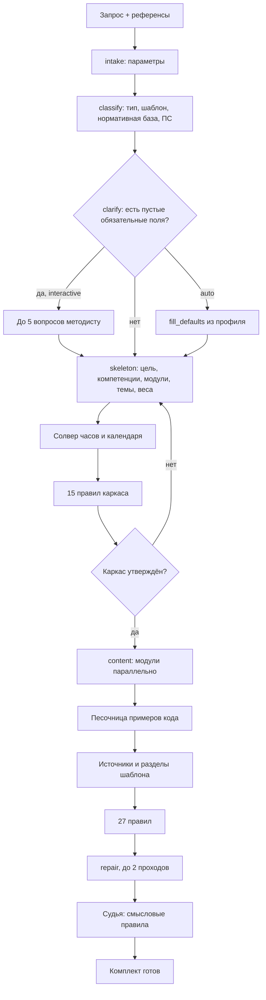
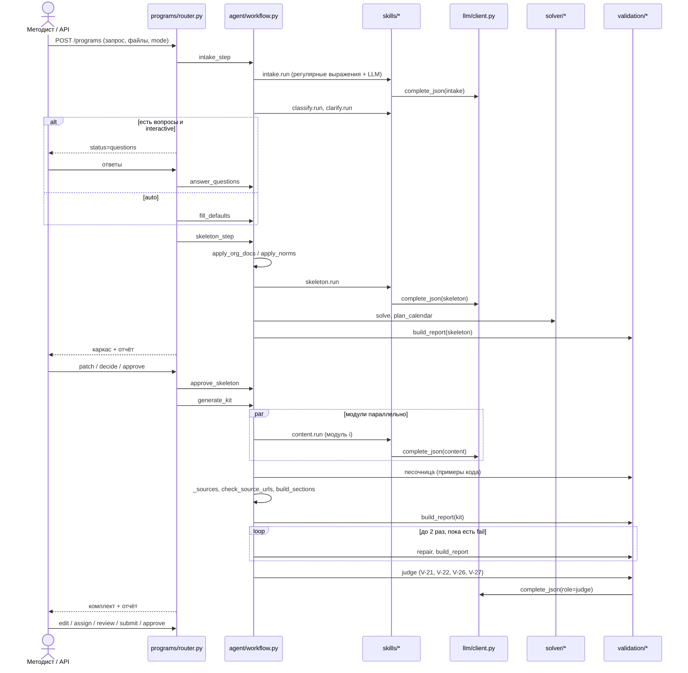
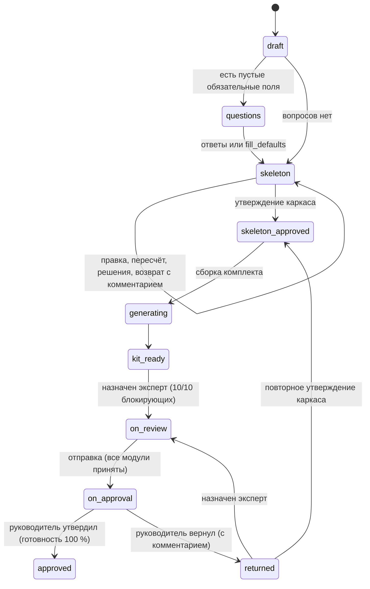

# Как работает агент

МетодАгент не пишет программу одним большим запросом к модели. Работа разбита на шаги, и у каждого шага свой исполнитель: где-то модель, где-то код. Модель отвечает за смысл (цель, компетенции, темы, тексты лекций и вопросов), а всё, что можно посчитать или проверить, делает код: часы, календарь, реквизиты, проверки, выгрузку.

Оркестратор (навык `workflow`) реализован в `src/app/agent/workflow.py` как конечный автомат над документом программы `ProgramDoc`.

## Конвейер в одной схеме

## Последовательность вызовов

## Состояния программы

| Статус | Подпись в интерфейсе | Что происходит |
|---|---|---|
| `draft` | Черновик | Документ создан; роутер сразу переводит его дальше |
| `questions` | Нужны ответы | Агент ждёт ответов методиста |
| `skeleton` | Каркас на проверке | Методист правит и проверяет каркас |
| `skeleton_approved` | Каркас утверждён | Можно собирать комплект |
| `generating` | Собираю комплект | Идёт генерация модулей |
| `kit_ready` | Комплект готов | Можно править, назначать экспертов |
| `on_review` | Вычитка экспертов | Эксперты вычитывают модули |
| `on_approval` | На утверждении | Ждёт решения руководителя |
| `approved` | Утверждена | Финальное состояние |
| `returned` | Возвращена | Руководитель вернул с комментарием |
| `failed` | Ошибка | Синхронный автопрогон прервался исключением |

Ключевое правило: **генерация содержания недоступна, пока каркас не утверждён** (`SKELETON_NOT_APPROVED`). Это защищает от дорогих переделок: проще поправить часы и темы в каркасе, чем пересобирать комплект.

## Этапы подробно

| Этап | Функция | Что происходит |
|---|---|---|
| 1. Запрос | `intake_step` | Навык `intake` извлекает параметры. Для референсов пишутся заметки о сходимости таблиц часов |
| 2. Классификация | `_classify` | Навык `classify`: тип программы, шаблон АЦР, выдаваемый документ, нормативная база, ПС |
| 3. Вопросы | `clarify.run`, `answer_questions`, `fill_defaults` | До 5 вопросов по пустым обязательным полям. После ответов классификация повторяется |
| 4. Каркас | `skeleton_step` | Документы организации или выдержки НПА, навык `skeleton`, солвер часов, календарь, отчёт этапа `skeleton` |
| 5. Проверка каркаса | `patch_skeleton`, `recompute`, `decide`, `approve_skeleton`, `return_skeleton` | Правка часов и формулировок, решения по «!», утверждение или возврат |
| 6. Комплект | `generate_kit` | Модули параллельно, лекции, итоговая аттестация, песочница, источники, разделы, 27 правил, repair, судья |
| 7. Отчёт | `build_report` | Правила, блокирующие проверки, матрица покрытия, действия, предложения, допущения |
| 8. Точечная правка | `edit` | Пересобираются только потомки узла; при регрессии правка откатывается |
| 9. Согласование | `assign_expert`, `review_decision`, `add_comment`, `submit`, `head_decision` | Вычитка по модулям, отправка, утверждение |

### Что именно делает генерация комплекта

1. Проверка статуса, перевод в `generating`.
2. Выбор тем со слайдами: модули, названные в запросе (для ДООП все темы с лекциями), и темы, попадающие на номера занятий из запроса.
3. Распределение вопросов итогового теста. Если в запросе задано число вопросов, оно делится по модулям пропорционально часам, и все вопросы идут в итоговый тест. Иначе у каждого модуля свой тест на `max(4, min(12, часы // 3))` вопросов.
4. Параллельная генерация модулей навыком `content`: задач `max(4, gen_workers)`, но к шлюзу одновременно не больше `llm_concurrency` запросов.
5. Для тем с лекционными часами без лекции добавляется план по умолчанию длительностью `ЛК × 45` минут.
6. Материалы итоговой аттестации по форме: отчёт о стажировке, портфолио, экзамен, проект (для ДООП — детский проект).
7. Песочница: первые 12 примеров кода запускаются; упавший пример модель переписывает один раз, иначе он удаляется. Оба исхода видны в заметках.
8. Источники: нормативная база, ПС, литература из реестра; источники от модели сверяются с реестром, неподтверждённые помечаются «[не подтверждено]»; до 8 ссылок проверяются HTTP-запросом.
9. Разделы шаблона, отчёт, до двух проходов `repair`, судья, финальный отчёт, статус `kit_ready`.

## Режимы

### Интерактивный (`mode=interactive`, по умолчанию)

Каждый шаг запускает человек: ответы, правка и утверждение каркаса, генерация комплекта (фоновое задание с прогрессом), вычитка, согласование.

### Автоматический (`mode=auto`)

Используется для автопрогона и интеграций. Весь путь до готового комплекта выполняется без человека:

1. Если в теле переданы `answers`, они применяются; оставшиеся пустые поля заполняются значениями профиля организации и записываются в допущения.
2. Собирается каркас.
3. Если в календаре конфликт: выбирается `six_days`, когда в запросе задан максимум часов в день, иначе `extend`. Выбор пишется в допущения.
4. До трёх попыток утверждения каркаса. По каждому пункту «!» автоматически принимается первое предложение. Если остаются ошибки ✕, запускаются `repair` и пересчёт. Если не помогло, каркас всё равно утверждается, а ответ получает статус `done_with_errors`.
5. Собирается комплект.

С `wait=false` автопрогон ставится в очередь и сразу возвращает `202` с `job_id`. При исключении документ получает статус `failed`, а не HTTP 500.

Статусы ответа автопрогона:

| Статус | Значение |
|---|---|
| `done` | Комплект готов, проваленных правил нет |
| `done_with_errors` | Комплект есть, но часть правил не прошла |
| `failed` | Автопрогон прервался |

## Навыки

Навык — это каталог `src/app/skills/<имя>/` с инструкцией `SKILL.md` (YAML-заголовок с параметрами вызова модели и текст системного промпта), схемой `schema_in.json` и, если навык выполняется кодом, модулем `run.py`.

| Навык | Модель | Температура / max_tokens | Таймаут / повторы | Резерв без модели |
|---|---|---|---|---|
| `intake` | generate | 0.1 / 1200 | 30 с / 2 | регулярные выражения и эвристики |
| `classify` | нет (правила) | — | 5 с / 0 | — |
| `clarify` | нет (правила) | — | 15 с / 1 | — |
| `skeleton` | generate | 0.2 / 3500 | 60 с / 2 | библиотека типовых каркасов |
| `content` | generate | 0.5 / 6000 (4500 без слайдов) | 120 с / 2 | шаблонное содержание из каркаса |
| `review_assist` | generate | 0.3 / 800 | 30 с / 1 | шаблонная формулировка |
| `repair` | нет (код) | — | — | — |
| `validate` | судья для V-21, V-22, V-26, V-27 | — | — | эвристики правил |
| `hours_solver` | нет | — | — | — |
| `export` | нет | — | — | — |
| `workflow` | нет | — | — | — |

Модель вызывают только `intake`, `skeleton`, `content` и `review_assist`. У каждого из них есть детерминированный резерв, поэтому без модели (режим `fixtures`, нет ключа, исчерпан лимит или бюджет) агент собирает полный, хотя и шаблонный, комплект.

### intake

Сначала всегда работает разбор без модели: тип программы по ключевым словам, название в кавычках, объём, срок (месяц = 4,3 недели), нагрузка в день, режим «по N часа M раз в неделю», часы итоговой аттестации, форма, ДОТ, «аудиторных занятий нет», «практика не меньше половины», материалы, ограничения, ожидание заказчика. Числительные словами тоже понимаются. Если модель доступна, она добавляет смысловые поля (аудитория, входной уровень, обязательные темы), но числа из разбора без модели имеют приоритет.

### classify

Тип берётся из параметров; если его нет, слова «школьник», «класс», «детей», «подростк» дают ДООП; иначе тип уходит в вопрос. Нормативная база подбирается функцией `norm_base_for`, профстандарт — `pick_ps` (только для ДПП). Подробно — [Нормативная база](Нормативная-база).

### clarify

До 5 вопросов только по пустым обязательным полям: тип программы, объём, аудитория вместе с входным уровнем, форма обучения, форма итоговой аттестации.

### skeleton

Модель получает тип, название, направление, объём, аудиторию, обязательные темы, ограничения, подсказку по числу модулей (до 24 ч — 3–4 модуля; до 80 ч — 5–6; до 200 ч — 6–8; больше — 7–10), профстандарт с ТФ, структуру референса, комментарий методиста, фрагменты документов организации и выдержки НПА. Часы модель не считает: она отдаёт веса и доли видов работы.

После ответа модели код ограничивает число компетенций (до 8), модулей (до 12) и тем (до 8 на модуль), сопоставляет ТФ по смыслу, связывает каждый РО хотя бы с одной темой, убирает модули вида «Итоговая аттестация» и добавляет обязательные темы направления.

Резерв — библиотека доменов: `python_school`, `ai_teachers`, `data_analysis`, `cybersecurity`, `devops`, а если домен не найден — общий каркас.

### content

Генерирует содержание одного модуля: рабочую программу, тест, задания, лекции и слайды, источники, вопросы собеседования для стажировки. Вопросы, упоминающие сервисы, недоступные в России, отбрасываются, а в остальном тексте такие сервисы заменяются на «зарубежный сервис». Модули из резерва попадают в список «нужна доработка эксперта».

### review_assist

Предлагает правку по комментарию эксперта в пределах его модуля; часы и РО не меняются.

## Разделы программы

Тексты разделов шаблона АЦР собирает код (`src/app/agent/sections.py`) из графа программы, текст референса не копируется. Порядок разделов задан списками `SECTIONS_DPP` (31 строка для ДПП ПК) и `SECTIONS_DOOP` (21 строка для ДООП).

Раздел 1.4 «Программа разработана на основе» составляется так:

1. Для ДПП — профстандарт с кодом и приказом; если ПС не подтверждён, добавляется пометка о сверке кодов ТФ.
2. Все акты из нормативной базы программы. Если их нет — 273-ФЗ и приказ № 629 (ДООП) или приказ № 266 (ДПП).
3. Требования заказчика к содержанию (до 6 обязательных тем).

## Сценарии сверх основного потока

| Сценарий | Что делает |
|---|---|
| Смена шаблона | До утверждения каркаса: переклассификация, для ДООП снимаются ПС и ТФ, часы, календарь и отчёт пересчитываются |
| Адаптация | Новая программа по готовой: копия графа компетенций и модулей, объём 8–2000 ч, пересчёт срока, практики и числа вопросов |
| Актуализация | Устаревшие конструкции, версии ниже минимальной или текущей, недоступные в России сервисы ИИ, источники 1950–2015 годов |
| Сравнение версий | Поля, модули, темы, часы, компетенции, РО и узлы комплекта по хэшам |
| Песочница | Запуск каждого примера, версии библиотек, время, устаревшие конструкции |
| Подсказка экспертов | По совпадению навыков эксперта с темами модуля, при равенстве — по нагрузке |

## Частые вопросы

- **Почему агент задаёт вопросы, а не собирает сразу?** Чтобы не додумывать. «Примерно месяц» не задаёт объём в часах, а от типа программы зависят шаблон и выдаваемый документ. В режиме `auto` вопросы не задаются, а ответы берутся из профиля.
- **Сколько вызовов модели на программу?** Один на разбор запроса, один на каркас и по одному на модуль, плюс судья и, при необходимости, переписывание упавших примеров кода.
- **Почему в отчёте модуль помечен «нужна доработка эксперта»?** Модель не ответила для этого модуля в пределах бюджета времени, и его содержание собрано по шаблону. Пересоберите модуль точечной правкой или передайте эксперту.

См. также: [Часы и календарь](Часы-и-календарь), [Автопроверка](Автопроверка), [LLM и стоимость](LLM-и-стоимость), [Модель данных](Модель-данных).
