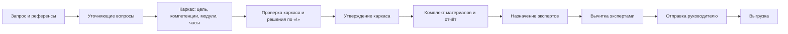

# Методисту

Методист — главный пользователь МетодАгента. Он создаёт программу, отвечает на вопросы агента, правит и утверждает каркас, собирает комплект, назначает экспертов, отвечает на их замечания, отправляет программу руководителю и выгружает файлы. Права методиста подробно перечислены на странице [Роли и права](Роли-и-права).

Демо-учётка методиста: `madina`, пароль `demo`. После входа вы попадаете в раздел «Программы».

## Весь путь программы

Карточка программы устроена как шаговый мастер из шести шагов: «Запрос», «Вопросы», «Каркас», «Проверка», «Комплект», «Согласование». Доступность шагов зависит от статуса программы: пока каркас не утверждён, шаг «Комплект» закрыт.

## Сценарий 1. Новая программа

### Шаг 1. Запрос

1. «Программы» → «Новая программа».
2. Опишите программу своими словами. Чем больше сведений, тем меньше вопросов задаст агент. Полезно указать:
   - тип программы (повышение квалификации, стажировка, общеразвивающая для детей);
   - название в кавычках;
   - объём в часах и срок в неделях;
   - аудиторию и её входной уровень («для учителей без опыта программирования»);
   - форму обучения (очная, очно-заочная, заочная, с ДОТ);
   - режим занятий («по 2 часа два раза в неделю» или «не больше 4 часов в день»);
   - форму итоговой аттестации и её длительность;
   - обязательные темы («темы: pandas, визуализация, SQL»);
   - ограничения («только сервисы, доступные в России», «данные обезличенные»);
   - требования к материалам («итоговый тест на 10 вопросов», «слайды для первых двух занятий»);
   - ожидание заказчика («чтобы после курса могли работать…»).
3. Приложите референсы, если хотите взять из них структуру: `.docx`, `.pdf` или `.txt`, до 5 файлов, каждый до 20 МБ. Формат определяется по содержимому, а не по расширению.
4. Выберите нормативную основу: «Госстандарты» (реестр актов и профстандартов) или «Документы организации» (загруженные администратором шаблоны и положения).

Хороший пример запроса:

> Нужна программа повышения квалификации на 72 часа «Анализ данных на Python» для сотрудников региональных отделений банков, которые сейчас работают в Excel. Формат очно-заочный, срок 4 недели. Основные темы это pandas, визуализация, SQL для выгрузки данных и основы статистики.

Справа появится панель «Распознанные параметры». Если в приложенной программе таблицы часов не сходятся, агент сообщит об этом и не перенесёт ошибку в каркас.

> Важно. Агент не копирует текст референса. Правило V-17 требует, чтобы доля совпадающих 8-грамм была меньше 5 %, а автоисправление удаляет совпадающие предложения.

### Шаг 2. Уточняющие вопросы

Агент задаёт не больше пяти вопросов и только по пустым обязательным полям: тип программы, объём, аудитория вместе с входным уровнем, форма обучения, форма итоговой аттестации. У каждого вопроса есть варианты и поле для своего ответа.

«На ваше усмотрение» означает, что агент возьмёт значение из профиля организации. Если в профиле значения нет, используются встроенные умолчания: ДПП ПК, 72 ч, «Взрослые слушатели с базовой компьютерной грамотностью», очно-заочная форма, «Защита проекта». Такие значения помечаются «принято агентом» и попадают в список допущений.

### Шаг 3. Каркас

Каркас состоит из цели, компетенций с индикаторами «знать / уметь / владеть», результатов обучения (РО), профстандарта и трудовых функций (только для ДПП), модулей и тем с часами, итоговой аттестации, нормативной базы и календарного графика.

Что можно делать на этом шаге:

| Действие | Как |
|---|---|
| Поменять часы модуля | Жёлтое поле в учебном плане. Солвер заново поделит часы модуля по темам |
| Поменять часы темы | Жёлтое поле темы. Модуль станет суммой своих тем, солвер их больше не перераспределяет |
| Поменять часы итоговой аттестации | Поле в строке «Итоговая аттестация» |
| Переименовать модуль или тему | Щелчок по названию, до 200 символов |
| Переформулировать цель, компетенцию, РО | Щелчок по тексту |
| Сменить шаблон | Переключатель шаблона (ДПП ПК, стажировка, ДООП), только до утверждения каркаса |
| Выбрать вариант графика | Если срок не помещает объём, появятся три варианта (см. [Часы и календарь](Часы-и-календарь)) |

После каждой правки итоги и проверки пересчитываются сразу.

### Шаг 4. Проверка каркаса

На каркасе работают 15 правил из 27 (остальные требуют готового комплекта). Статусы:

- **✓** — всё в порядке;
- **!** — нужно ваше решение. Агент показывает предложение по каждому пункту отдельно, вы нажимаете «Принять» или «Оставить как есть», и решение пишется в журнал;
- **✕** — ошибка. Утвердить каркас нельзя, пока она не исправлена.

Типичные предложения по «!»:

| Правило | Что предлагает агент |
|---|---|
| V-22 | Переформулировать РО проверяемым действием: «Объясняет и применяет на примере: …» |
| V-21 | Поменять местами две темы, если тема опирается на более позднюю |
| V-10 | Выбрать вариант графика: продлить срок, перейти на шестидневку или поднять нагрузку |
| V-27 | Сформулировать результаты как начальный уровень, если обещания нереалистичны |
| V-15 | Сверить коды трудовых функций с реестром Минтруда |

Ниже отчёта — матрица покрытия: для каждого РО видно, в каких темах он раскрывается и какими средствами проверяется (на каркасе это плановые средства «Контроль Мn», «Сем. Мn», «ИА»).

Когда всё готово, нажмите «Утвердить каркас». Если каркас не устраивает, напишите комментарий и нажмите «Вернуть с комментарием»: агент получит текущий каркас и ваш комментарий и изменит только указанные части. Если модель недоступна, каркас останется прежним, а вы увидите заметку.

### Шаг 5. Комплект

После утверждения агент собирает материалы по модулям параллельно:

- рабочую программу модуля (аннотация и содержание тем);
- тест с ключами и дистракторами;
- задания семинаров с условием, ожидаемым результатом, критериями и баллами;
- планы лекций по минутам, примеры кода и слайды для запрошенных занятий или модулей;
- материалы итоговой аттестации и требования к отчёту;
- для стажировки — вопросы собеседования.

Затем код собирает разделы шаблона АЦР и список источников, прогоняет все 27 правил, до двух раз запускает автоисправление и, если включён судья, добавляет смысловые замечания.

На экране сборки видны статусы модулей, лента событий, токены, стоимость и прогноз. Модули обрабатываются в несколько потоков, но к шлюзу одновременно уходят не больше двух запросов, поэтому часть модулей ждёт очереди.

> Если модель не ответила для какого-то модуля, его содержание собирается по шаблону из каркаса. Отчёт прямо называет такие модули с пометкой «нужна доработка эксперта».

### Шаг 6. Согласование

1. Назначьте экспертов на модули. Кнопка «Назначить по подсказке агента» подбирает эксперта по навыкам из профиля организации и нагрузке. Один эксперт может вести несколько модулей.
2. Назначать экспертов можно только при 10 из 10 пройденных блокирующих проверок. Иначе сервер ответит ошибкой `BLOCKING_FAILED`.
3. Отвечайте на замечания экспертов: ответьте текстом, передайте замечание агенту («Передать агенту») или примените готовое предложение («Применить предложение»). Правку по замечанию эксперта подтверждает сам эксперт.
4. Когда все модули приняты, нажмите «Отправить на утверждение». Руководители получат уведомление.

Реквизиты приказа, ФИО и подписи остаются пустыми полями: их заполняют люди после утверждения.

## Сценарий 2. Точечная правка готового комплекта

Пример: «В теме 2.3 добавь пример с группировкой по месяцам».

1. В блоке правки выберите элемент: тему, часы темы, лекцию, слайд, вопрос или задание. Можно ничего не выбирать и просто описать правку: агент найдёт элемент по словам инструкции.
2. Нажмите предпросмотр. Экран покажет «было / станет» и список того, что пересоберётся и что останется.
3. Примените правку.

Как агент защищает комплект:

- пересобираются только потомки выбранного узла графа (тема → лекция, слайды, вопросы, задания);
- если правка задела бы элементы вне потомков, нарушила бы часы или оставила РО меньше чем с двумя средствами проверки, она откатывается целиком с ошибкой `EDIT_REJECTED`;
- при правке часов темы итог модуля сохраняется: разницу забирает самая большая соседняя тема, хронометраж лекций пересчитывается;
- каждая правка создаёт новую версию;
- если правка затронула принятый модуль, он возвращается эксперту на вычитку.

Правка запрещена, когда программа на утверждении или уже утверждена.

## Сценарий 3. Инструменты под отчётом

| Инструмент | Зачем |
|---|---|
| **Текст программы** | Все разделы в порядке выгрузки DOCX. Для ДПП ПК — 1.1–1.9, 2.1–2.5.3, 3.1–3.4 и приложения; для ДООП — пояснительная записка, 1.1–1.6, 2.1–2.4, 3.1–3.4 и приложение № 1 |
| **Версии** | Список версий с причиной. Выберите две версии и увидите изменённые поля, модули, темы, часы, РО и узлы комплекта. Любую версию можно откатить: содержание вернётся, а статус и решения людей пересчитаются так, что откат не возвращает утверждение без руководителя |
| **Актуализация** | Сверка тем, лекций, заданий, вопросов и источников с реестром версий 2026 года: устаревшие конструкции, версии ниже поддерживаемых, сервисы, недоступные в России, источники 1950–2015 годов. Кнопка «Поправить» открывает точечную правку с готовой инструкцией |
| **Песочница кода** | Каждый пример из лекций запускается в отдельном процессе без сети, с лимитами времени и памяти. Видны результат, вывод, версии библиотек и время |
| **Адаптация** | Новая программа на основе готовой для другой аудитории или объёма (8–2000 ч). Компетенции и РО сохраняются, часы пересчитывает солвер, комплект собирается заново после утверждения нового каркаса |

Отдельно на странице «Программы» есть карточка «Актуализация старой программы»: загрузите файл прошлой программы, и агент покажет находки, не создавая черновика.

## Сценарий 4. Выгрузка

Кнопки выгрузки находятся в блоке «Документы» карточки программы:

| Кнопка | Что получите |
|---|---|
| DOCX | Программа по шаблону АЦР с титульным листом, таблицами и приложениями |
| PPTX | Слайды лекций |
| Moodle XML, GIFT | Тесты для импорта в LMS |
| JSON | Весь комплект по схеме 4.8 ТЗ |
| Лекции DOCX | Планы лекций по минутам, примеры кода, тезисы слайдов |
| Проект приказа | DOCX с пустыми реквизитами |

Подробности по каждому формату — на странице [Выгрузка](Выгрузка).

## Подсказки

- **Часы не сходятся после правки?** Посмотрите правила V-01…V-04 в отчёте: они называют конкретную строку. Если вы задали часы тем вручную, модуль стал их суммой, и объём программы мог измениться.
- **Агент выбрал не тот профстандарт?** ПС подбирается по ключевым словам запроса. Уточните направление в запросе или верните каркас с комментарием.
- **Нужен другой тип программы?** Смените шаблон до утверждения каркаса: часы, график и отчёт пересчитаются, у ДООП снимутся ПС и ТФ.
- **Каркас утверждён, а часы надо поменять?** Используйте точечную правку часов темы: итог модуля сохранится.
- **Модель не ответила.** Агент соберёт программу по библиотеке типовых структур и напишет об этом в заметках. Суточный лимит шлюза сбрасывается в 00:00 МСК.
- Методисты организации ведут программы совместно: любой методист может открыть и править любую программу.

См. также: [Как работает агент](Как-работает-агент), [Автопроверка](Автопроверка), [Частые вопросы](Частые-вопросы).
