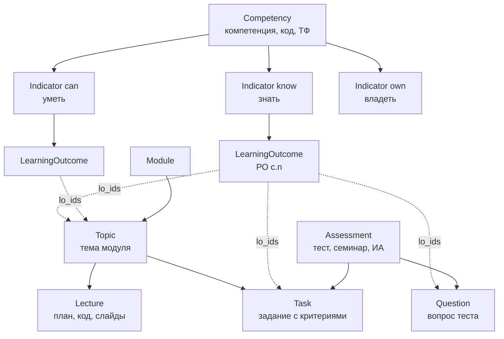
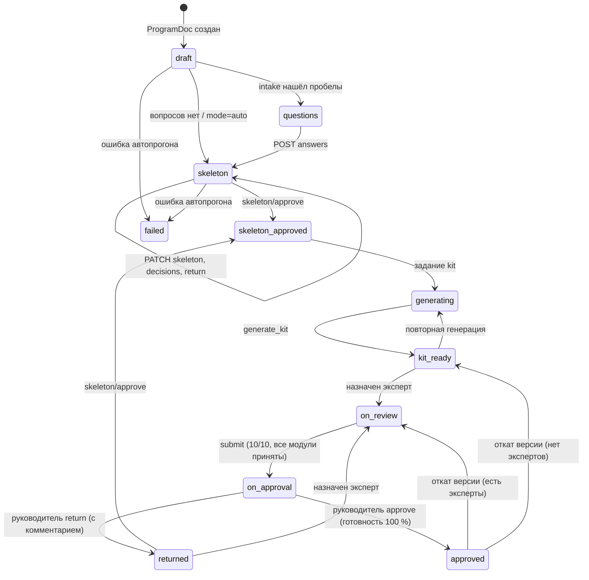

# Модель данных

Программа целиком хранится одним JSON-документом `ProgramDoc` (`src/app/programs/schemas.py`) в столбце `programs.doc`. Это граф с устойчивыми идентификаторами. Граф используется для проверки покрытия (V-12…V-14) и для пересборки только потомков изменённого узла.

Каждое сохранение со снимком увеличивает номер версии и кладёт копию документа в `program_versions`; действия людей и агента пишутся в `audit_events`. Внешний формат — JSON-выгрузка по схеме подраздела 4.8 ТЗ.

## Граф программы

Пример: при правке темы 2.3 пересобираются её лекция, слайды, вопросы и задания, а остальные элементы проверяются по хэшам: если что-то вне потомков изменилось, правка откатывается.

## ProgramDoc

| Поле | Тип | По умолчанию | Смысл |
|---|---|---|---|
| `id` | str | — | `prg-` + 10 hex-символов |
| `org_id` | str | `acr` | Организация |
| `status` | Status | `draft` | Статус |
| `version` | int | 1 | Номер версии; растёт при сохранении со снимком |
| `mode` | `interactive` \| `auto` | `interactive` | Режим создания |
| `request` | str | — | Исходный запрос методиста |
| `references` | list | [] | Разобранные референсы |
| `norm_mode` | `gos` \| `org` | `gos` | Нормативная база: государственная или документы организации |
| `org_fragments`, `norm_fragments` | list | [] | Фрагменты документов организации и выдержки НПА для промптов |
| `params` | Params | — | Распознанные параметры запроса |
| `assumptions` | list | [] | Значения, принятые агентом без ответа методиста |
| `questions` | list | [] | Уточняющие вопросы |
| `type` | ProgramType | None | `dpp_pk`, `dpp_pk_internship`, `doop` |
| `template`, `issued_document` | str | `''` | Шаблон АЦР и выдаваемый документ |
| `norm_base` | list[Source] | [] | Нормативная база программы |
| `profstandard` | ProfStandard | None | Профстандарт с ТФ (только из реестра) |
| `title`, `goal` | str | `''` | Название и цель |
| `volume_h` | int | 0 | Объём, ч |
| `competencies` | list | [] | Карта компетенций |
| `modules` | list | [] | Модули с темами и часами |
| `final_assessment` | FinalAssessment | — | Форма, часы, описание ИА |
| `calendar` | Calendar | — | Календарный график |
| `min_practice_hours` | int | 0 | Минимум практики |
| `sources` | list[Source] | [] | Литература и ресурсы |
| `kit` | Kit | — | Комплект материалов |
| `report` | Report | None | Отчёт автопроверки |
| `decisions` | list | [] | Решения методиста по пунктам «!» |
| `comments` | list | [] | Комментарии экспертов и ответы |
| `approvals` | list | [] | Утверждения и возвраты |
| `agent_notes` | list[str] | [] | Заметки агента |
| `usage` | Usage | — | Токены и стоимость |
| `timing_s` | dict | {} | Длительность шагов, с |
| `progress` | dict | {} | Прогресс для интерфейса |
| `created_at`, `updated_at` | str | `''` | ISO 8601 (UTC) |

При каждом сохранении хронометраж плана лекции приводится к её длительности с шагом 5 минут.

## Параметры и вопросы

**Params** (результат `intake`): `program_type`, `title`, `direction`, `volume_h`, `audience`, `entry_level`, `form`, `duration_weeks`, `sessions_per_week`, `session_hours`, `max_hours_per_day`, `days_per_week`, `final_assessment_form`, `final_assessment_hours`, `required_topics[]`, `constraints[]`, `min_practice_hours`, `min_practice_share`, `distance`, `no_classroom`, `customer_expectation`, `materials`, `reference_used`, `reference_structure_only`, `ps_hint`.

**Materials** (явно запрошенные материалы, V-09): `test_questions`, `slides_modules[]`, `slides_lessons[]`, `slides_topic_hint`.

**Question**: `id`, `field`, `text`, `options[]`, `allow_custom`, `answer`. **Assumption**: `field`, `value`, `source`.

**ReferenceInfo**: `name`, `chars`, `structure[]`, `hours_issues[]` (ошибки в таблицах часов референса), `text_sample` (до 120 000 символов).

## Компетенции, модули, часы

| Модель | Поля |
|---|---|
| `Competency` | `id`, `code`, `title`, `ps_code`, `tf_codes[]`, `indicators[]` |
| `Indicator` | `id`, `kind` (`know` \| `can` \| `own`), `text`, `outcomes[]` |
| `LearningOutcome` | `id`, `code`, `text`, `verb`, `bloom_level` |
| `ProfStandard` | `code`, `title`, `order`, `confirmed`, `tf[]` |
| `Module` | `id`, `n`, `title`, `weight`, `lk_share` (0,33), `srs_share` (0,2), `lb_hours`, `hours`, `control` (`Тест`), `expert_id`, `review_status`, `accepted_items[]`, `manual_topics`, `topics[]` |
| `Topic` | `id`, `n` («1.2»), `title`, `description`, `weight`, `hours`, `lo_ids[]`, `prerequisites[]` |
| `Hours` | `total`, `lk`, `pr`, `lb`, `srs`; контактная работа = lk + pr + lb |
| `FinalAssessment` | `form`, `hours`, `description` |

Итог программы = сумма часов модулей + часы итоговой аттестации.

Статус вычитки модуля: `not_started` → `in_review` → `accepted` \| `returned` \| `question`. Приём модуля требует, чтобы каждый элемент был принят.

## Календарь

| Модель | Поля |
|---|---|
| `Calendar` | `weeks`, `work_days`, `hours_per_day`, `days_per_week` (5), `hours_per_week`, `sessions`, `session_hours`, `requested_weeks`, `conflict`, `options[]`, `chosen_option`, `schedule[]` |
| `CalendarOption` | `id` (`extend`, `six_days`, `raise_load`), `title`, `weeks`, `hours_per_day`, `days_per_week` |
| `CalendarWeek` | `week`, `hours`, `days`, `lk`, `pr`, `lb`, `srs`, `ia`, `items[]` |

## Комплект

| Модель | Поля |
|---|---|
| `Kit` | `module_programs[]`, `assessments[]`, `questions[]`, `tasks[]`, `lectures[]`, `sections`, `final_assessment`, `report_requirements[]`, `drafts[]` (модули по шаблону без ответа модели), `judge` |
| `ModuleProgram` | `module_id`, `annotation`, `content[]`, `control_questions[]` |
| `Assessment` | `id`, `module_id`, `kind` (`test` \| `seminar` \| `project` \| `final` \| `interview`), `title` |
| `Question_` | `id`, `assessment_id`, `module_id`, `stem`, `options[]`, `key` (индекс верного варианта), `lo_ids[]`, `difficulty` |
| `Task` | `id`, `assessment_id`, `module_id`, `topic_id`, `title`, `statement`, `expected_result`, `criteria[]`, `lo_ids[]` |
| `Criterion` | `text`, `points` |
| `Lecture` | `id`, `topic_id`, `module_id`, `title`, `duration_min` (90), `plan[]` (`{min, text}`), `code_examples[]`, `slides[]` |
| `Slide` | `id`, `n`, `title`, `bullets[]`, `notes` |
| `Source` | `id`, `kind` (`book` \| `doc` \| `law` \| `ps` \| `url`), `bibl`, `url`, `confirmed`, `checked_at` |

Идентификаторы оценочных средств: `test-<id модуля>` (тест модуля), `sem-<id модуля>` (семинар или, для стажировки, собеседование), `test-final` (итоговый тест, если число вопросов задано в запросе), `final` (ИА).

## Проверка, решения, вычитка, утверждение

| Модель | Поля |
|---|---|
| `Report` | `stage` (`skeleton` \| `kit`), `rules[]`, `blocking_passed`, `blocking_total`, `coverage[]`, `actions[]`, `proposals[]`, `assumptions[]` |
| `RuleResult` | `id`, `title`, `check` (1–10 или `None`), `kind` (`code` \| `llm`), `status` (`pass` \| `warn` \| `fail` \| `skip`), `messages[]`, `nodes[]`, `owner` |
| `Decision` | `rule_id`, `node`, `proposal`, `decision` (`accept` \| `keep`), `actor`, `at` |
| `Comment` | `id`, `module_id`, `node_id`, `author`, `text`, `agent_proposal`, `new_text`, `affected[]`, `status` (`open` \| `answered` \| `proposed` \| `applied`), `answer`, `at` |
| `Approval` | `stage` (`skeleton` \| `module` \| `program`), `actor`, `decision` (`approve` \| `return`), `comment`, `module_id`, `score` (1–5), `at` |
| `Usage` | `tokens_in`, `tokens_out`, `cost_rub`, `calls`, `by_skill` |

`Comment.status = proposed` означает, что правка агента по замечанию эксперта ждёт подтверждения самого эксперта.

## Статусы и переходы

| Действие | Допустимо из | Результат | Ошибка (409) |
|---|---|---|---|
| `answer_questions` | `questions` | роутер ставит `skeleton` | `NO_QUESTIONS` |
| `skeleton_step` | тип программы определён | `skeleton` | `QUESTIONS_PENDING` |
| `patch_skeleton` | `skeleton`, `returned` | без смены статуса | `SKELETON_LOCKED` |
| `approve_skeleton` | `skeleton`, `returned`; нет блокирующих ошибок; решение по каждому «!» | `skeleton_approved` | `BAD_STATE`, `SKELETON_HAS_ERRORS`, `DECISIONS_PENDING` |
| `return_skeleton` | — | пересборка каркаса | `COMMENT_REQUIRED` |
| `generate_kit` | `skeleton_approved`, `kit_ready`, `generating` | `generating` → `kit_ready` | `SKELETON_NOT_APPROVED` |
| `edit` | не `on_approval`/`approved`; комплект собран | без смены статуса | `LOCKED`, `KIT_NOT_READY`, `EDIT_REJECTED`, `HOURS_MISMATCH` |
| `assign_expert` | не `on_approval`/`approved`; 10/10 блокирующих | `on_review` | `LOCKED`, `BLOCKING_FAILED` |
| `review_decision` | комплект собран | меняет статус модуля | `KIT_NOT_READY`, `ITEMS_NOT_CHECKED`, `COMMENT_REQUIRED` |
| `submit` | 10/10 блокирующих; все модули приняты | `on_approval` | `BLOCKING_FAILED`, `MODULES_NOT_ACCEPTED` |
| `head_decision` | `on_approval`; для approve — готовность 100 % | `approved` или `returned` | `BAD_STATE`, `NOT_READY`, `COMMENT_REQUIRED` |
| `restore_into` | любой | пересчёт статуса (см. ниже) | — |

Замечания:

- `failed` ставится только в синхронном автопрогоне при исключении. Ошибка фонового задания отражается в статусе задания, а статус программы остаётся прежним.
- В автопрогоне каркас с неисправимыми ошибками всё равно переводится в `skeleton_approved`, а ответ получает статус `done_with_errors`.

## Версии

Отдельного списка версий в документе нет: поле `version` хранит текущий номер, а снимки лежат в таблице `program_versions` с причиной: «каркас», «комплект», «каркас утверждён», «правка <id>», «на утверждении», «решение руководителя», «откат к версии N» и др. Сохранение без снимка (ответы на вопросы, правка каркаса, решения по «!») не меняет номер.

**Откат** возвращает содержание версии, но сохраняет текущие комментарии, утверждения и назначения экспертов. Принятые модули снова уходят на вычитку, статус пересчитывается: если версия или текущий документ были на вычитке, утверждении, утверждены или возвращены — `on_review` (есть эксперты) или `kit_ready`; без комплекта — `skeleton`. Откат не возвращает утверждение без руководителя.

## Таблицы БД

SQLAlchemy 2 (async), таблицы создаются `create_all` при старте. Системы миграций нет.

| Таблица | Столбцы | Назначение |
|---|---|---|
| `programs` | `id`, `owner`, `title`, `status`, `version`, `doc` (JSON), `updated_at` | Текущее состояние программы |
| `program_versions` | `id`, `program_id`, `version`, `reason`, `doc` (JSON), `created_at` | Снимки версий |
| `audit_events` | `id`, `program_id`, `actor`, `action`, `node_id`, `text`, `version`, `at` | Журнал; «было / стало» хранятся в `text` через разделитель `\x1f`; события администратора — с `program_id='org'` |
| `jobs` | `id` (`job-…`), `program_id`, `kind`, `status`, `progress` (JSON), `error`, `created_at`, `updated_at` | Фоновые задания |
| `notifications` | `id`, `user_id`, `program_id`, `text`, `read`, `at` | Уведомления (отдаются последние 30) |
| `users` | `id`, `login`, `name`, `email`, `title`, `roles` (JSON), `password_hash` (bcrypt), `source` (`demo`, `local`, `sso`), `active`, `created_at` | Учётные записи |
| `settings` | `key`, `value` (JSON; секреты — `enc1:…`), `updated_by`, `updated_at` | Настройки администратора |

Связи между таблицами логические (по `program_id`), внешних ключей нет.

## JSON-выгрузка 4.8

`GET /api/v1/programs/{id}/export/json`, поле `kit` ответа автопрогона и поле `program` в карточке программы (кроме эксперта) возвращают один и тот же объект `{"program": {...}}`. Состав и пример — на странице [Выгрузка](Выгрузка).

Не выгружаются: `params`, уточняющие `questions`, `references`, `report`, `decisions`, `comments`, `usage`, `timing_s`, `progress`, `agent_notes`, фрагменты НПА и документов организации.

См. также: [Архитектура](Архитектура), [API](API).
