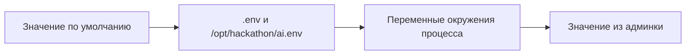

# Настройки

Все настройки описаны в классе `Settings` (`src/app/core/config.py`) и читаются из переменных окружения и файлов `.env` и `/opt/hackathon/ai.env`. Имена переменных нечувствительны к регистру, неизвестные переменные игнорируются.

Часть настроек (ключ и адрес шлюза, модели, лимиты, вход, SSO, пароль почты) администратор меняет в интерфейсе без перезапуска. Такие значения хранятся в таблице `settings` и перекрывают окружение; секреты в ней зашифрованы.

## Приоритет источников



От низшего к высшему:

1. Значение по умолчанию в `Settings`.
2. Файлы `.env` (в текущем каталоге процесса) и `/opt/hackathon/ai.env`; при совпадении ключей берётся значение из `/opt/hackathon/ai.env`.
3. Переменные окружения процесса.
4. Значение, сохранённое администратором (только для полей из раздела «Из админки»). Применяется при старте и сразу после сохранения.

## Переменные окружения

### Общие

| Переменная | По умолчанию | Смысл |
|---|---|---|
| `ENVIRONMENT` | `development` | `production` включает строгий режим ключа: если `SECRET_KEY` не задан и `DATA_DIR` недоступен для записи, запуск падает |
| `LOG_LEVEL` | `INFO` | Уровень журнала |
| `APP_NAME` | `МетодАгент` | Название приложения |
| `APP_VERSION` | `0.1.0` | Версия в `/health` и OpenAPI |
| `API_V1_PREFIX` | `/api/v1` | Префикс API |
| `DOCS_ENABLED` | `true` | Swagger UI на `/docs` |

### Хранилище

| Переменная | По умолчанию | Смысл |
|---|---|---|
| `DATA_DIR` | `<корень репозитория>/data/runtime` | БД, ключ, правки реестров, база знаний, расход LLM |
| `DATABASE_URL` | пусто | URL SQLAlchemy; если пусто — `sqlite+aiosqlite:///<DATA_DIR>/metodagent.db` |
| `MAX_FILE_SIZE_MB` | `20` | Максимальный размер одного файла |
| `MAX_FILES_PER_REQUEST` | `5` | Максимум файлов в запросе |

### Авторизация

| Переменная | По умолчанию | Смысл |
|---|---|---|
| `SECRET_KEY` | `dev-secret-change-me` | Ключ подписи JWT и вывода ключа шифрования секретов |
| `JWT_ALGORITHM` | `HS256` | Алгоритм JWT |
| `ACCESS_TOKEN_EXPIRE_MINUTES` | `720` | Срок жизни токена, мин |

### LLM

| Переменная | По умолчанию | Смысл |
|---|---|---|
| `LLM_API_KEY` (синоним `CLOUDRU_API_KEY`) | пусто | Ключ шлюза |
| `LLM_BASE_URL` (синоним `CLOUDRU_BASE_URL`) | `https://foundation-models.api.cloud.ru/v1` | Адрес шлюза |
| `LLM_MODEL_GENERATE` | `GigaChat/GigaChat-3-Pro` | Модель каркаса и содержания |
| `LLM_MODEL_JUDGE` | `ai-sage/GigaChat3.5-432B-A28B-Reasoning` | Модель-судья |
| `LLM_MODEL_RESERVE` | `GigaChat/GigaChat-3-Pro` | Резервная модель |
| `LLM_MODEL_EMBED` | `ai-sage/Giga-Embeddings-instruct-3B` | Модель эмбеддингов |
| `LLM_CONCURRENCY` | `2` | Одновременных запросов к шлюзу |
| `LLM_TIMEOUT_S` | `120.0` | Таймаут запроса, с |
| `LLM_PROVIDERS` | `cloudru` | `cloudru` — через шлюз; `fixtures` — без сети |
| `LLM_JUDGE_ENABLED` | `true` | Судья для V-21, V-22, V-26, V-27 |
| `LLM_PRICE_IN_RUB` / `LLM_PRICE_OUT_RUB` | `73.03` / `176.39` | Тариф генерации, ₽ за 1 млн токенов |
| `LLM_JUDGE_PRICE_IN_RUB` / `LLM_JUDGE_PRICE_OUT_RUB` | `96.22` / `288.60` | Тариф судьи |
| `LLM_DAILY_BUDGET_RUB` | `90.0` | Дневной бюджет; сутки по МСК, сброс в 00:00 МСК |
| `GEN_WORKERS` | `6` | Потоков сборки модулей (фактически `max(4, GEN_WORKERS)`) |
| `ANON_RUNS_PER_HOUR` | `12` | Автопрогонов без токена в час с одного IP |
| `MAX_PARALLEL_JOBS` | `4` | Одновременных фоновых заданий; сверх — 429 |

LLM считается включённой, если `LLM_PROVIDERS=cloudru` и ключ не пуст.

### Вход, регистрация, SSO, почта

| Переменная | По умолчанию | Смысл |
|---|---|---|
| `REGISTRATION_ENABLED` | `true` | Открыта ли регистрация |
| `REGISTRATION_DEFAULT_ROLE` | `expert` | Роль нового пользователя (`expert`, `methodist`, `head`) |
| `DEMO_ACCOUNTS_ENABLED` | `true` | Демо-учётки; при `false` токены демо-учёток (кроме `u-api`, `u-admin`) отклоняются |
| `SSO_ENABLED` | `false` | Показывать кнопку SSO (заготовка) |
| `SSO_PROVIDER` | `oidc` | `oidc` или `saml` |
| `SSO_DISPLAY_NAME` | `Единый вход организации` | Текст кнопки |
| `SSO_ISSUER_URL`, `SSO_CLIENT_ID`, `SSO_CLIENT_SECRET` | пусто | Параметры провайдера |
| `SMTP_PASSWORD` | пусто | Пароль почты; сервер, порт, логин и отправитель — в профиле организации |

## Из админки

`GET /api/v1/admin/settings` возвращает группы и поля; `PUT /api/v1/admin/settings` принимает `{"values": {...}, "clear": [...]}` (роль `admin`).

| Группа | Ключи | Ограничения |
|---|---|---|
| Модель и ключи | `llm_providers` (cloudru, fixtures), `llm_base_url`, `llm_api_key` (секрет), `llm_model_generate`, `llm_model_judge`, `llm_model_reserve`, `llm_model_embed`, `llm_judge_enabled` | — |
| Лимиты | `llm_concurrency` 1–16, `gen_workers` 1–32, `llm_timeout_s` 5–900, `llm_daily_budget_rub` 0–1 000 000, `max_parallel_jobs` 1–64, `anon_runs_per_hour` 0–10 000 | проверка диапазона |
| Вход и регистрация | `registration_enabled`, `registration_default_role` (expert, methodist, head), `demo_accounts_enabled`, `access_token_expire_minutes` 15–43 200 | — |
| SSO | `sso_enabled`, `sso_provider` (oidc, saml), `sso_display_name`, `sso_issuer_url`, `sso_client_id`, `sso_client_secret` (секрет) | — |
| Почта | `smtp_password` (секрет) | — |

Пример: снизить дневной бюджет и выключить судью.

```bash
curl -s -X PUT $HOST/api/v1/admin/settings -H "Authorization: Bearer $ADMIN_TOKEN" \
  -H 'Content-Type: application/json' \
  -d '{"values": {"llm_daily_budget_rub": 50, "llm_judge_enabled": false}}'

# Вернуть значение окружения
curl -s -X PUT $HOST/api/v1/admin/settings -H "Authorization: Bearer $ADMIN_TOKEN" \
  -H 'Content-Type: application/json' -d '{"values": {}, "clear": ["llm_daily_budget_rub"]}'
```

Правила:

- значение приводится к типу поля и проверяется по диапазону или списку вариантов; ошибка — 400 с указанием ключа;
- для секретов пустое значение или строка, начинающаяся с `••••` (маска), означает «не менять»;
- ключ из `clear` удаляет переопределение и возвращает значение окружения;
- для каждого поля сообщается источник: `admin`, `env` или `none`; секреты отдаются только маской и флагом `set`;
- после любого изменения сбрасывается клиент LLM, поэтому новый ключ, адрес или лимит действует со следующего запроса;
- изменение пишется в журнал списком названий полей, без значений;
- настройки вне списка (`DATA_DIR`, `DATABASE_URL`, `SECRET_KEY`, тарифы, `ENVIRONMENT` и др.) меняются только через окружение и требуют перезапуска.

## SECRET_KEY

- Если `SECRET_KEY` короче 16 символов или содержит `change-me` (в том числе значение по умолчанию), генерируется случайный ключ и сохраняется в `DATA_DIR/.secret_key` с правами 600; при следующих запусках он читается оттуда.
- Если записать ключ не удалось: в `production` запуск падает, в остальных окружениях используется исходная строка.
- `scripts/deploy_vm.sh` и `scripts/run_vm.sh` дописывают случайный `SECRET_KEY` в `.env`, если его там нет.
- **Смена ключа делает недействительными все выданные токены и зашифрованные в БД секреты.**

## Шифрование секретов

- Из `SECRET_KEY` через PBKDF2-HMAC-SHA256 (соль `metodagent-settings`, 200 000 итераций) выводятся ключ шифрования и ключ MAC.
- Шифр — поток HMAC-SHA256 в режиме счётчика со случайным 16-байтным nonce; целостность — HMAC-SHA256 над nonce и шифртекстом.
- Формат хранения: `enc1:` + base64url(nonce ‖ tag ‖ шифртекст).
- Если `SECRET_KEY` сменился, секрет не расшифруется: при старте пишется предупреждение и используется значение из окружения.

## Файлы окружения

| Файл | Назначение |
|---|---|
| `.env.example` | Образец: `SECRET_KEY`, `LLM_PROVIDERS`, `LLM_JUDGE_ENABLED`, закомментированные `LLM_BASE_URL`, `LLM_API_KEY`, модели |
| `.env` | Локальные значения; в git не попадает, в образ не копируется |
| `/opt/hackathon/ai.env` | Ключ и адрес шлюза на ВМ (scripts/deploy_vm.sh переносит ключ и адрес в `.env` как `LLM_API_KEY` и `LLM_BASE_URL`) |

Минимальный `.env` для разработки без сети:

```bash
SECRET_KEY=          # пусто: ключ сгенерируется в data/runtime/.secret_key
LLM_PROVIDERS=fixtures
```

Для работы с моделью:

```bash
SECRET_KEY=...
LLM_PROVIDERS=cloudru
LLM_API_KEY=...
# LLM_BASE_URL=https://foundation-models.api.cloud.ru/v1
```

В `docker-compose.yml` дополнительно задаются `ENVIRONMENT=production` и `DATA_DIR=/app/data/runtime`, а `SECRET_KEY`, `LLM_PROVIDERS`, `LLM_JUDGE_ENABLED` пробрасываются из окружения оболочки (по умолчанию пусто, `cloudru`, `true`).

См. также: [Администратору](Администратору), [Развёртывание](Развёртывание), [LLM и стоимость](LLM-и-стоимость).
