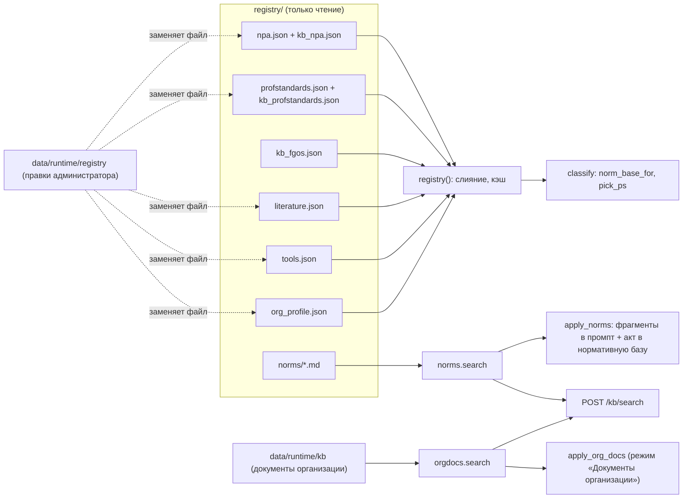
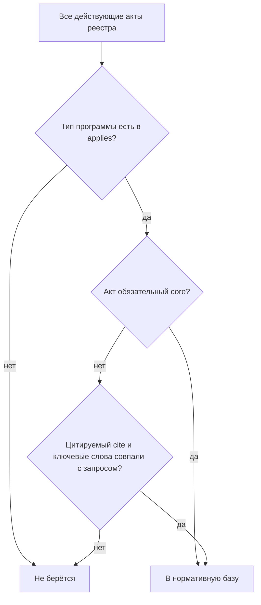

# Нормативная база

Агент опирается на три слоя знаний:

1. **Реестры** `registry/*.json`: нормативные правовые акты (НПА), профессиональные стандарты (ПС), ФГОС, литература, версии инструментов и профиль организации. Коды и реквизиты попадают в программу только отсюда, всё прочее помечается «не подтверждено».
2. **Выжимки актов** `registry/norms/*.md`: 52 файла с номерами пунктов. Поиск по ним детерминирован, не тратит бюджет LLM, а найденные фрагменты идут в промпты навыков каркаса и комплекта.
3. **Документы организации**: шаблоны и положения, которые загружает администратор. Они режутся на фрагменты, индексируются эмбеддингами или ключевыми словами и используются в режиме «Документы организации».



## Реестры

| Файл | Раздел | Содержимое | Записей |
|---|---|---|---|
| `npa.json` | `npa` | Основной реестр НПА (обязательные акты) | 4 |
| `kb_npa.json` | `npa` (дополнение) | Нормативная база из открытых источников | 74 |
| `profstandards.json` | `ps` | Основной реестр ПС с вручную проверенными ключевыми словами | 6 |
| `kb_profstandards.json` | `ps` (дополнение) | ПС из открытых источников, с ОТФ и ТФ | 36 |
| `kb_fgos.json` | `fgos` | ФГОС (направления ВО, СПО) | 34 |
| `literature.json` | `literature` | Литература и официальная документация | 34 |
| `tools.json` | `tools` | Версии инструментов, устаревшие конструкции, сервисы ИИ | объект |
| `org_profile.json` | `org` | Профиль организации | объект |

У каждой записи есть дата проверки `checked_at` и ссылка на источник.

### Поля записи НПА

| Поле | Назначение |
|---|---|
| `id` | Идентификатор акта (`law-273`, `order-266`, `decree-1678`…), ключ слияния |
| `kind` | Вид: `law`, `order`, `decree`, `letter` и т. п. |
| `bibl` | Библиографическое описание — так акт попадает в программу |
| `url` | Ссылка на официальный или справочный источник |
| `applies` | Типы и уровни программ: `dpp_pk`, `dpp_pk_internship`, `dpp_pp`, `doop`, `vo`, `spo`, `school` |
| `topics` | Темы акта |
| `status` | Статус. Слова «утратил», «repealed», «отмен», «не действует» исключают акт |
| `summary` | Краткое содержание |
| `checked_at` | Дата проверки |
| `core` | Обязательный акт для типов из `applies` (у `law-273`, `order-266`, `order-629`, `order-245`, `order-762`) |
| `core_for` | Уровни, для которых акт обязателен в основных программах (`school`, `spo`, `vo`) |
| `cite` | Акт можно добавлять в нормативную базу при совпадении ключевых слов |
| `keywords` | Основы слов для сопоставления с запросом |

Умолчания: если поля `core` нет, акт считается обязательным, когда у него нет `keywords`; если нет `cite`, акт цитируемый, когда у него есть `keywords`.

### Слияние

Для каждого раздела читается файл из `data/runtime/registry/`, если он есть, иначе из `registry/`. Затем основной реестр дополняется записями из `kb_*.json`:

- ключ записи — `code` для ПС и ФГОС, иначе `id`;
- запись дополнения заменяет одноимённую (у неё свежая проверка), поля объединяются;
- **утратившие силу записи удаляются**, даже если были в основном реестре;
- для ПС ключевые слова основного реестра идут первыми.

## Уровни: ДПП, ДООП, школа, колледж, вуз

Сейчас агент собирает дополнительные программы (ДПП ПК, стажировка, ДООП). Реестр и выжимки при этом размечены и для основных программ трёх уровней — задел на расширение:

| Уровень | Код | Обязательные акты (`core_for`) и примеры выжимок |
|---|---|---|
| Школа | `school` | ФОП НОО, ООО, СОО; порядок № 115; ГИА-9 и ГИА-11; воспитание; учебники и рабочие программы; ЦОС «Моя школа» |
| Колледж | `spo` | Порядок СПО № 762; ФГОС СПО; ГИА СПО и демоэкзамен; приём и «Профессионалитет» |
| Вуз | `vo` | Порядок № 245; ФГОС ВО 3++; ГИА ВО; аспирантура; реформа уровней ВО |

Функция `norm_base_for_level(level, text)` собирает нормативную базу основной программы: всегда `law-273`, затем акты с уровнем в `core_for` и цитируемые по ключевым словам. Неизвестный уровень — ошибка.

## Как подбираются акты для программы



1. **Классификация** (`norm_base_for(тип, текст)`): действующие акты, у которых тип программы есть в `applies` и которые обязательны или цитируемы и совпали с текстом по ключевым словам.
2. **Совпадение ключевого слова** (`_kw_hit`): ключевое слово — фраза из основ; совпадение, если все основы встречаются в тексте. Короткая основа (до 3 символов: ДОТ, ИБ, SQL) ищется только с начала слова. Ключевые слова узкие: акт попадает в программу только при явной связи с запросом.
3. **Выдержки в промпт** (`apply_norms`): при сборке каркаса агент ищет до 12 фрагментов выжимок по типу программы, оставляет до 4 из актов, относящихся к запросу, передаёт их навыкам `skeleton` и `content` и добавляет акт в нормативную базу программы.

### Пример: какие акты взял агент по открытым кейсам

| Кейс | ПС | Акты в программе |
|---|---|---|
| 1. ДООП «Первые шаги в Python» | нет (ДООП) | 273-ФЗ, № 629, письмо № 09-3242, СанПиН 1.2.3685-21, СП 2.4.2.4283-26, распоряжение № 678-р |
| 2. ПК «ИИ в работе учителя» | 01.001 Педагог | 273-ФЗ, № 266, ПП № 1678 (ДОТ), письмо № ВК-1032/06 |
| 3. ПК «Анализ данных на Python» | 06.042 Специалист по большим данным | 273-ФЗ, № 266, 152-ФЗ (обезличенные данные), письмо № ВК-1032/06 |
| 4. Курс по кибербезопасности | 06.033 Защита информации в АС | 273-ФЗ, № 266 |
| 5. Стажировка DevOps | 06.026 Системный администратор ИКС | 273-ФЗ, № 266, письмо № ВК-1032/06, приказ № 885/390 о практической подготовке |

Таблица — из сверки с ТЗ на версии v13; после добавления новых актов в v17–v18 состав по кейсам может расшириться за счёт актов, совпавших по ключевым словам.

## Профстандарты

Подбор ПС (`pick_ps`) — только для ДПП: по коду-подсказке, иначе по наибольшей оценке. Проверенные вручную слова и фразы дают 2 балла, прочие — 1. Слишком общие основы (`программ`, `обучен`, `образован`, `курс`, `данн`, `систем`, `работ`) не считаются, если не проверены вручную.

Если у ПС больше 12 трудовых функций, в программу идут 12 ближайших к запросу. Для ДООП профстандарт не используется, а правило V-15 проверяет, что его нет.

## Выжимки актов

Каждая выжимка — Markdown с заголовком YAML:

```yaml
---
id: 02-poryadok-dpp-266
title: "Порядок по дополнительным профессиональным программам (...)"
source: "Приказ Минобрнауки России от 24.03.2025 № 266 ..."
url: https://base.garant.ru/411917644/
npa_id: order-266
applies: [dpp_pk, dpp_pk_internship]
keywords: [повышени квалификац, дополнительн профессиональн, стажировк, итогов аттестац, удостоверени]
checked_at: "2026-10-18"
---
```

Поиск (`norms.search`): оценка фрагмента = доля слов запроса, найденных во фрагменте, плюс 0,15 за каждое совпавшее ключевое слово выжимки. Выжимки, не применимые к типу программы, пропускаются; фрагменты с оценкой не выше 0,05 отбрасываются.

### Перечень 52 выжимок по группам

| Группа | Выжимки |
|---|---|
| Основа ДПП и ДООП | 273-ФЗ; порядок ДПП № 266 (заменил № 499); порядок ДООП № 629; ЭО и ДОТ — ПП № 1678 (заменил № 816); СанПиН 1.2.3685-21 и СП 2.4.2.4283-26; МР по ДПП на основе ПС (№ ВК-1032/06); МР по ДООП (№ 09-3242, № АБ-3935/06); концепция ДО детей (№ 678-р); практическая подготовка (№ 885/390) |
| Профстандарты и квалификация | ПС и ДПП (ТК ст. 195.1–195.3, ст. 76 273-ФЗ); ТК ст. 195.1–195.3; 238-ФЗ о НОК; уровни квалификации № 148н; ПС 01.003 «Педагог ДО»; ПС 01.004 (утратил силу) и 01.015; ПС «Педагог» № 544н; ЕКС № 761н; МР № ДЛ-1/05вн |
| Данные, информация, ИИ | 152-ФЗ о персональных данных; 436-ФЗ о защите детей; 149-ФЗ об информации; ИИ в образовании (указ № 490, 243-ФЗ, рекомендации 2026); ГОСТ Р 53620-2009 и 55751-2013 |
| Организация обучения | платные услуги (ПП № 1441); сетевая форма (№ 882/391); нормы часов (№ 269); ЭО и ДОТ в ДООП (№ ДГ-245/06); ДПП с ЭО и ДОТ (№ ВК-1013/06); обновление ДООП (№ АБ-3935/06); целевая модель ДО (№ 467); профобучение (№ 438) |
| Документы об обучении | ст. 60 273-ФЗ и ФИС ФРДО; ФИС ФРДО (ПП № 825) |
| Государственная политика | традиционные ценности (указ № 809); национальные цели (указ № 309); инклюзия (ст. 79, ФАОП) |
| Школа | ФГОС НОО, ООО, СОО; ФОП; порядок № 115; ГИА-9, ГИА-11 и промежуточная аттестация; воспитание (304-ФЗ); учебники (№ 436 от 22.06.2026); ЦОС «Моя школа» (ПП № 1241) |
| СПО | порядок СПО № 762; ФГОС СПО (№ 336); ГИА СПО (№ 800) и демоэкзамен; приём (№ 457) и «Профессионалитет» |
| ВО | порядок ВО № 245; ФГОС ВО 3++ (№ 1061, № 89); ГИА ВО (№ 636); аспирантура (№ 951, ПП № 2122); реформа уровней ВО (указ № 343) |

Полный перечень с файлами, уровнями и связью с реестром — `docs/knowledge-base.md`.

## Документы организации

- Загружает администратор (`POST /kb/documents`). Размер — до 20 МБ. Виды: `template` (шаблон программы), `regulation` (положение), `other`.
- Формат определяется по сигнатуре: PDF (до 200 страниц, таблицы часов распознаются и пересчитываются), DOCX (проверка размера после распаковки до 100 МБ, макросы не исполняются), текст (UTF-8).
- Текст делится по абзацам на фрагменты до 900 символов, не больше 200 фрагментов на документ.
- Фрагменты индексируются моделью эмбеддингов `ai-sage/Giga-Embeddings-instruct-3B`. Если модель недоступна, документ индексируется по словам.
- Общий поиск `POST /kb/search` объединяет документы организации и выжимки НПА; документам организации добавляется бонус 0,25, поэтому при близкой оценке свои документы важнее общей нормативной базы.

**Режим «Документы организации».** При создании программы методист выбирает `norm_mode = org`. При сборке каркаса агент ищет до 4 фрагментов, добавляет документы в нормативную базу программы, передаёт фрагменты в промпт и, если у референсов нет структуры, берёт структуру первого загруженного шаблона. Если ничего не найдено, агент оставляет пометку и использует госстандарты.

## Как добавить акт

### Через файлы реестра (с выкладкой)

1. **Запись в реестр.** Добавьте объект в `registry/kb_npa.json`:

   ```json
   {
     "id": "order-123",
     "kind": "order",
     "bibl": "Приказ Минпросвещения России от 01.09.2026 № 123 «О ...»",
     "url": "https://publication.pravo.gov.ru/...",
     "applies": ["dpp_pk", "doop"],
     "status": "действует",
     "checked_at": "2026-10-19",
     "cite": true,
     "keywords": ["цифров компетенц", "наставничеств"]
   }
   ```

   Поставьте `core: true`, если акт обязателен для типов из `applies`, или `core_for` для основных программ уровней. Ключевые слова — основы слов; короткие (до 3 символов) сопоставляются с начала слова.

2. **Выжимка (по желанию).** Создайте `registry/norms/NN-<slug>.md` с заголовком YAML (`id`, `title`, `source`, `url`, `npa_id` = `id` из шага 1, `applies`, `keywords`, `checked_at`) и текстом в Markdown с номерами пунктов. Непроверенные пункты помечайте «не сверено».
3. **Тест.** `pytest -q tests/test_norms.py`: проверяет связь выжимок с реестром и отсутствие отменённых актов.
4. **Перезапуск.** Реестры и выжимки кэшируются, изменения файлов применяются после перезапуска.
5. **Проверка.** `GET /api/v1/org/registry?kind=npa`, `GET /api/v1/kb/norms`, поиск — `POST /api/v1/kb/search`.

### Через API (без выкладки)

`PUT /api/v1/org/registry` с `{"kind": "npa", "items": [...]}` (роль `admin`) записывает раздел в `data/runtime/registry/` и применяется сразу. Обязательные поля: `ps` — `code`, `title`; `npa` — `id`, `bibl`; `literature` — `bibl`; `tools` — объект с `current` и `outdated`.

> Ограничение. API заменяет файл основного реестра, а дополнения `kb_*.json` из образа продолжают сливаться поверх. Поэтому запись, которая есть в `kb_npa.json`, нельзя удалить или полностью переопределить через API. Раздел `fgos` через API не меняется.

### Акт утратил силу

Поменяйте `status` на «утратил силу»: запись будет исключена при слиянии, в том числе из основного реестра.

## Частые вопросы

- **Почему в программе приказ № 266, а не № 499, как в ТЗ?** Приказ № 499 утратил силу с 01.09.2025; действующий порядок по ДПП — приказ Минобрнауки от 24.03.2025 № 266.
- **Откуда «не подтверждено» у источника?** Источника нет в реестре литературы, и его ссылка не открылась при проверке. Такой источник помечается и не выдаётся за проверенный.
- **Почему профстандарт для DevOps — 06.026?** Профстандарта DevOps нет, поэтому взят ближайший по ключевым словам.

См. также: [Администратору](Администратору), [Как работает агент](Как-работает-агент).
