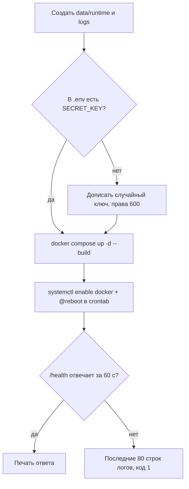

# Развёртывание

МетодАгент — один процесс uvicorn (FastAPI), который обслуживает API `/api/v1`, Swagger `/docs`, проверку `/health` и собранный интерфейс из `frontend/dist`. Данные хранятся в SQLite и файлах каталога `data/runtime`.

Три способа запуска:

| Способ | Когда | Команда |
|---|---|---|
| Локально | Разработка, знакомство | `PYTHONPATH=src uvicorn app.main:app` |
| Docker | Сервер, ВМ | `docker compose up -d --build` или `./scripts/deploy_vm.sh` |
| ВМ без Docker | Нет Docker | `./scripts/run_vm.sh` |

Демо-стенд: https://tochka-sborki-2026-team-098.hub.gigaschool.ru (вход через хаб хакатона), короткий адрес — https://methodagent.ru.

## Локальный запуск

### Бэкенд

```bash
python3.12 -m venv .venv && . .venv/bin/activate
pip install -r requirements-dev.txt          # requirements.txt + pytest, pytest-cov, hypothesis, ruff
cp .env.example .env                          # при необходимости задать LLM_API_KEY
PYTHONPATH=src uvicorn app.main:app --host 0.0.0.0 --port 8000 --reload
```

- Без ключа шлюза (или с `LLM_PROVIDERS=fixtures`) сервис работает на резервной генерации.
- При первом запуске создаются `data/runtime/`, БД `metodagent.db`, `.secret_key` (если `SECRET_KEY` не задан) и демо-учётки.
- Если `frontend/dist/index.html` нет, на `/` отдаётся JSON с указанием на `/docs`.

### Интерфейс

```bash
cd frontend
npm ci
npm run dev        # Vite dev-сервер; /api, /health, /docs проксируются на 127.0.0.1:8000
npm run build      # tsc --noEmit && vite build → frontend/dist
```

После `npm run build` бэкенд сам раздаёт `frontend/dist`.

## Docker

`Dockerfile` — двухэтапная сборка:

1. `node:22-alpine`: `npm ci`, `npm run build` интерфейса.
2. `python:3.12-slim`: установка `requirements.txt`, копирование `src`, `registry`, `testset`, `scripts` и собранного интерфейса; пользователь `app` (uid 1000); порт 8000; `HEALTHCHECK` раз в 30 с запрашивает `/health`; команда `uvicorn app.main:app --host 0.0.0.0 --port 8000 --proxy-headers --forwarded-allow-ips *`.

`docker-compose.yml` (сервис `app`, контейнер `metodagent`):

| Параметр | Значение |
|---|---|
| Порт | `0.0.0.0:8000:8000` |
| Перезапуск | `unless-stopped` |
| Окружение | `env_file: /opt/hackathon/ai.env`; `ENVIRONMENT=production`, `DATA_DIR=/app/data/runtime`; `SECRET_KEY`, `LLM_PROVIDERS`, `LLM_JUDGE_ENABLED` из окружения оболочки |
| Тома | `./data:/app/data`, `./logs:/app/logs` |
| Изоляция | `read_only: true`, `tmpfs /tmp` 256 МБ, `cap_drop: ALL`, `no-new-privileges`, `mem_limit: 2g`, `pids_limit: 256` |

Изоляция важна, потому что примеры кода из лекций выполняются в песочнице внутри контейнера.

Файл `/opt/hackathon/ai.env` должен существовать на хосте. Для запуска вне ВМ хакатона создайте его или уберите `env_file`.

```bash
docker compose up -d --build
docker compose logs -f app
```

## Скрипт deploy_vm.sh

Развёртывание на ВМ через Docker:



Строка автозапуска в crontab помечена `metodagent-autostart`; при повторном запуске старая строка заменяется.

## Скрипт run_vm.sh

Запуск без Docker:

1. Создаёт `data/runtime`, `logs`; при необходимости дописывает `SECRET_KEY` в `.env`.
2. Создаёт `.venv`, ставит `requirements.txt`.
3. Если интерфейс не собран и есть `npm` — собирает; без `npm` предупреждает, что заработает только API.
4. Экспортирует переменные из `.env` и, если доступен, из `/opt/hackathon/ai.env`.
5. Останавливает предыдущий uvicorn и запускает новый через `nohup` с `--proxy-headers`; вывод — в `logs/app.log`.
6. Регистрирует `@reboot` в crontab.
7. До 60 секунд проверяет `/health`; при неудаче печатает хвост `logs/app.log`.

## Публикация за прокси

- Стенд доступен через хаб хакатона. У хаба свой вход, а его прокси перехватывает запросы с заголовком `Authorization`, поэтому интерфейс передаёт токен приложения в `X-MA-Token`. API-клиенты, обращающиеся напрямую, используют `Authorization: Bearer`.
- `uvicorn` запускается с `--proxy-headers --forwarded-allow-ips *`: адрес клиента для лимита анонимных автопрогонов и базовый адрес ссылок на выгрузки берутся из заголовков прокси.
- `methodagent.ru` обслуживается GitHub Pages (отдельный репозиторий с редиректом, сертификат Let's Encrypt, Enforce HTTPS) и переадресует на адрес хаба.

Если ставите свой обратный прокси (nginx и т. п.), передавайте `X-Forwarded-For` и `X-Forwarded-Proto` и не удаляйте заголовок `X-MA-Token`.

## Обновление

```bash
cd ~/project
git pull
./scripts/deploy_vm.sh        # пересборка образа и перезапуск; или scripts/run_vm.sh без Docker
```

- Схема БД создаётся при старте: новые таблицы появятся сами, но изменения существующих столбцов не применяются (миграций нет).
- `data/runtime` лежит в томе и при выкладке не затирается.
- Незавершённые фоновые задания после перезапуска продолжаются автоматически.

## Резервное копирование

Всё состояние — в `data/runtime/`:

| Файл | Содержимое |
|---|---|
| `metodagent.db` | Программы, версии, журнал, задания, уведомления, пользователи, настройки |
| `.secret_key` | Ключ, если `SECRET_KEY` не задан в окружении |
| `registry/` | Правки реестров и профиля организации |
| `kb/` | Документы организации |
| `skills_overrides.json` | Параметры навыков, изменённые в админке |
| `llm_spend.json` | Расход LLM за текущие сутки |

```bash
docker compose stop app
tar czf backup-$(date +%F).tgz data/runtime .env
docker compose start app
```

Без остановки: `sqlite3 data/runtime/metodagent.db ".backup backup.db"`. Храните резервные копии вместе с `.env` (или `SECRET_KEY`) в защищённом месте: без ключа не расшифруются секреты в БД.

### Восстановление

```bash
docker compose stop app
tar xzf backup-2026-10-19.tgz        # восстановит data/runtime и .env
docker compose start app
curl -s http://127.0.0.1:8000/health
```

## Журналы и проверка состояния

| Режим | Где смотреть |
|---|---|
| Docker | `docker compose logs -f app` |
| Без Docker | `logs/app.log` |
| Автозапуск после перезагрузки | `logs/reboot.log` |
| Автопрогон | `logs/autorun/` |

Формат: `%(asctime)s %(levelname)s %(name)s: %(message)s`, уровень — `LOG_LEVEL`. Ключи API и тексты запросов к модели в журнал не пишутся. Действия пользователей пишутся в таблицу `audit_events`.

| Метод | Ответ |
|---|---|
| `GET /health` | `{"status": "ok", "version": "...", "llm": true/false}` |
| `GET /api/v1/health` | то же под префиксом API |
| `GET /api/v1/llm/status` | доступность шлюза, модели, расход, бюджет, флаг лимита, судья |
| `GET /api/v1/skills` | список навыков |

`"llm": false` означает, что ключ шлюза не задан или выбран режим `fixtures`.

## Чек-лист продакшн-запуска

- Постоянный `SECRET_KEY` в `.env` (не в git), копия в надёжном месте.
- `ENVIRONMENT=production` (в `docker-compose.yml` уже задано).
- Сменён пароль `admin`, выключены демо-учётки.
- Ограничен или выключен `anon_runs_per_hour`.
- Настроено резервное копирование `data/runtime/`.
- Проверены `/health` и `/api/v1/llm/status`.

См. также: [Настройки](Настройки), [Администратору](Администратору), [Решение проблем](Решение-проблем).
