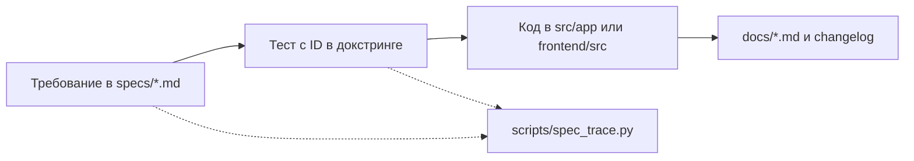

# Разработка

Код приложения лежит в `src/app` и запускается с `PYTHONPATH=src`. Тесты — pytest в `tests/`, линтер — ruff, сквозная проверка — `scripts/autorun.py` по пяти открытым запросам кейса. Разработка ведётся по спецификациям (SDD): **спецификация → тесты → код**.

## Окружение

```bash
python3.12 -m venv .venv && . .venv/bin/activate
pip install -r requirements-dev.txt     # requirements.txt + pytest, pytest-asyncio, hypothesis, ruff, pytest-cov
cd frontend && npm ci && cd ..          # Node 22, как в Dockerfile
cp .env.example .env                    # для разработки: LLM_PROVIDERS=fixtures
PYTHONPATH=src uvicorn app.main:app --reload
```

Режим `LLM_PROVIDERS=fixtures` не ходит в сеть: навыки отвечают детерминированно через резервную генерацию, поэтому одинаковый запрос всегда даёт одинаковую программу.

## Тесты

```bash
PYTHONPATH=src pytest -q                     # все тесты
PYTHONPATH=src pytest -q tests/test_auth.py  # один файл
PYTHONPATH=src pytest -q -k skeleton         # по имени
```

Настройки в `pytest.ini`: `pythonpath = src`, `testpaths = tests`, `asyncio_mode = auto`. Тесты не ходят в сеть: они задают `LLM_PROVIDERS=fixtures` и временный `DATA_DIR`, поэтому БД создаётся заново.

| Файл | Что покрывает |
|---|---|
| `tests/test_core.py` | Солвер часов (property-based на hypothesis), автопрогон пяти открытых кейсов, роли |
| `tests/test_skeleton.py` | Каркас: хронометраж лекций, ТФ по смыслу, часы в PDF-референсе, ручные часы тем, решения по узлам «!», календарь по видам работы |
| `tests/test_access.py` | Права и жизненный цикл: 401 без токена, асинхронный автопрогон, эксперт видит только свои модули, откат не возвращает утверждение, JSON 4.8, правка часов, приём модуля только после всех элементов, качество у руководителя |
| `tests/test_auth.py` | Вход, регистрация с минимальной ролью, администратор ведёт пользователей, но не программы, маскирование и шифрование секретов, переключатели, навыки |
| `tests/test_extras.py` | Анонимный доступ, адаптация, смена шаблона, актуализация, версии, песочница, база знаний, судья, усечённый JSON, дневной лимит, сутки по МСК, кириллический .txt |
| `tests/test_norms.py` | Нормативная база: отменённые акты не используются, обязательные акты и акты по ключевым словам, ПС для кейсов, связь выжимок с реестром, уровни школа, колледж, вуз |
| `tests/test_spec_*.py` | Тесты, написанные под требования спецификаций отдельных модулей (клиент LLM, хранилище, солверы, repair, песочница, судья, навыки content и review_assist) |
| `tests/test_spec_trace.py` | Трассировка: в тестах нет ссылок на неизвестные ID требований |

### Покрытие

Порог покрытия — **70 %** (ТЗ 4.11). Он задан в `.coveragerc`:

```ini
[run]
source = src/app
omit = */__init__.py

[report]
fail_under = 70
```

Проверка:

```bash
PYTHONPATH=src pytest -q --cov --cov-config=.coveragerc
```

Если покрытие ниже порога, прогон завершается с ошибкой.

## Линтер

```bash
ruff check src tests scripts
```

Отдельного файла конфигурации ruff нет, применяются настройки по умолчанию.

## Автопрогон: scripts/autorun.py

Прогоняет запросы из `testset/cases.json` через `POST /api/v1/programs?mode=auto` и проверяет результат по чек-листам.

```bash
python scripts/autorun.py                               # в процессе, без сервера
python scripts/autorun.py --url http://localhost:8000   # против запущенного сервера
python scripts/autorun.py --only 1 3                    # выбранные кейсы
```

| Кейс | Запрос (кратко) | Объём |
|---|---|---|
| 1 | ДООП «Первые шаги в Python» для 8–9 классов, по 2 часа два раза в неделю, практики не меньше половины | 16 ч |
| 2 | ПК «Искусственный интеллект в работе учителя», очно-заочно с ДОТ | 36 ч |
| 3 | ПК «Анализ данных на Python» для сотрудников банков, 4 недели | 72 ч |
| 4 | Курс по кибербезопасности для студентов колледжа, «примерно на месяц» | 72 ч |
| 5 | Стажировка «DevOps-инженер от Linux до CI/CD», аудиторных занятий нет | 256 ч |

Общие проверки для каждого кейса: итоговый объём ровно как в запросе, ЛК + ПР + ЛБ + СРС = «Всего» в каждой строке, сумма тем равна модулю, блокирующие проверки 10/10, есть выгрузки `docx` и `json`. Далее — проверки конкретного кейса. Результаты: `logs/autorun/<id>.json` и сводка `logs/autorun/summary.md`.

## Разработка по спецификациям (SDD)



### Спецификации

У каждого модуля есть спецификация в каталоге `specs/` с пронумерованными требованиями. Спецификация — источник истины о наблюдаемом поведении модуля; документация в `docs/` объясняет устройство и не заменяет её. Порядок и формат описаны в `specs/README.md`.

Файлы спецификаций:

| Файл | Префикс | Модуль |
|---|---|---|
| `auth-and-roles.md` | `SPEC-AUTH` | Вход, токены, регистрация, роли, администрирование, секреты |
| `agent-workflow.md` | `SPEC-FLOW` | Конвейер агента, режимы, каркас, правка, вычитка, согласование |
| `solvers.md` | `SPEC-SOLVER` | Солверы часов и календаря |
| `validation-rules.md` | `SPEC-RULES` | 27 правил, блокирующие проверки, отчёт |
| `validation-repair.md` | `SPEC-REPAIR` | Автоисправление |
| `validation-sandbox.md` | `SPEC-SANDBOX` | Песочница кода |
| `validation-judge.md` | `SPEC-JUDGE` | Модель-судья |
| `knowledge-base.md` | `SPEC-KB` | Реестры, выжимки, документы организации |
| `export.md` | `SPEC-EXPORT` | Выгрузка |
| `api.md` | `SPEC-API` | REST API |
| `programs-service.md` | `SPEC-SVC` | Хранение программ, версий, событий, заданий |
| `skills-core.md` | `SPEC-SKILLS` | Каталог навыков; intake, classify, clarify, skeleton |
| `skill-content.md` | `SPEC-CONTENT` | Навык content |
| `skill-review-assist.md` | `SPEC-REVIEW` | Навык review_assist |
| `llm-client.md` | `SPEC-LLM` | Клиент шлюза LLM |
| `frontend.md` | `SPEC-UI` | Интерфейс |

Число требований в каждом файле и покрытие их тестами меняются; актуальную сводку печатает `scripts/spec_trace.py`.

### Формат требования

ID — `SPEC-<MODULE>-NN`: короткий префикс модуля латиницей и двузначный номер. ID не переиспользуются: удалённое требование оставляет пропуск в нумерации.

Текст требования пишется в нотации EARS (ТЗ, п. 4.11): ключевые слова латиницей, остальное по-русски, одно требование — одно проверяемое поведение.

| Шаблон | Пример |
|---|---|
| `THE SYSTEM SHALL …` | THE SYSTEM SHALL хранить пароли только хешем bcrypt. |
| `WHEN <событие>, THE SYSTEM SHALL …` | WHEN методист меняет часы тем каркаса, THE SYSTEM SHALL сохранить ручное распределение. |
| `WHILE <состояние>, THE SYSTEM SHALL …` | WHILE активная роль — `expert`, THE SYSTEM SHALL показывать только назначенные модули. |
| `IF <ситуация>, THEN THE SYSTEM SHALL …` | IF каркас не утверждён, THEN THE SYSTEM SHALL отказать в генерации комплекта. |
| `WHERE <функция включена>, THE SYSTEM SHALL …` | WHERE включён судья, THE SYSTEM SHALL уточнять смысловые правила моделью. |

Таблица требований в спецификации: `ID | Требование | Источник | Тест`. «Источник» — номер требования ТЗ (FR-NN, NFR-NN) или «код»; «Тест» — `test_файл.py::test_функция` или «—», если теста пока нет.

### Как начинается изменение

1. **Спецификация.** Добавьте или измените требование в нужном `specs/*.md` (новый ID — следующий свободный номер).
2. **Тест.** Первой строкой докстринга перечислите ID требований через запятую и впишите тест в колонку «Тест»:

   ```python
   def test_module_accept_requires_all_items(client, kit) -> None:
       """SPEC-FLOW-17, SPEC-API-13"""
   ```

   Убедитесь, что тест падает на старом коде (или явно фиксирует существующее поведение).
3. **Код.** Меняйте код, пока тесты не станут зелёными.
4. **Документация.** Обновите `docs/*.md` и `docs/changelog.md`, если меняется описанное там поведение.

Исправление ошибки начинается так же: требование (или его уточнение), тест, воспроизводящий ошибку, исправление.

### Трассировка

`scripts/spec_trace.py` читает таблицы требований из `specs/*.md` и докстринги всех тестов в `tests/` и печатает по каждому файлу спецификации число требований, сколько из них упомянуто в тестах и непокрытые ID. Скрипт ничего не записывает.

```bash
python scripts/spec_trace.py             # сводка; код 1, если тест ссылается на неизвестный ID
python scripts/spec_trace.py --markdown  # таблица «требование → тест» для specs/README.md
```

- **Ошибка:** тест ссылается на ID, которого нет в спецификациях. Сначала добавьте требование.
- **Предупреждения:** ID объявлен дважды; тест назван в колонке «Тест», но в его докстринге нет ID.
- **Не ошибка, а долг:** непокрытое требование («—» в колонке «Тест»), например интерфейс, который проверяется вручную.

То же правило проверяет `tests/test_spec_trace.py`, поэтому нарушение трассировки роняет обычный прогон pytest.

### Готово, когда

- `PYTHONPATH=src pytest -q` — все тесты зелёные.
- Покрытие не ниже 70 % (`pytest --cov --cov-config=.coveragerc`).
- `ruff check` без замечаний.
- `python scripts/spec_trace.py` завершается с кодом 0.
- Спецификация и документация отражают новое поведение.
- Перед коммитом также `python scripts/autorun.py` (правило из `AGENTS.md`).

## Правила для разработчиков

- Часы считает только солвер `src/app/solver/hours.py`; модель часы не придумывает.
- Профстандарты, НПА и литература берутся только из `registry/`; то, чего нет в реестре, помечается «не подтверждено».
- Секреты только в окружении (`/opt/hackathon/ai.env`, `.env`), в git и логи не попадают.
- Ошибки API бросаются классами из `src/app/core/errors.py` (`BadRequest`, `Conflict`, `ForbiddenRole`, `Unauthorized`, `NotFound`, `RateLimited`) с русским текстом.
- Изменяемые данные пишутся только в `DATA_DIR`: в контейнере файловая система только для чтения.
- Миграций нет: не меняйте существующие столбцы БД без плана переноса данных.
- Доступ к методам — через зависимости `require(...)` и `current_principal`; администратор к программам доступа не имеет.

## Как добавить навык

1. Создайте `src/app/skills/<имя>/` с пустым `__init__.py`.
2. `SKILL.md`: YAML-заголовок между `---` и текст инструкции модели. Поля: `name` (обязательно), `description`, `version`, `model_role` (`generate`, `judge`, `rules`, `none`), `temperature` (0.2), `max_tokens` (2000), `timeout_s` (60), `retries` (2).

   ```markdown
   ---
   name: glossary
   description: Глоссарий терминов модуля
   version: 1.0.0
   model_role: generate
   temperature: 0.2
   max_tokens: 1500
   timeout_s: 60
   retries: 2
   ---
   Ты методист. Составь глоссарий терминов модуля ...
   ```

3. `schema_in.json` — JSON Schema входа.
4. `run.py` — функция запуска: параметры через `skill('<имя>')`, вызов модели через `get_llm()` с `CallStats` для учёта токенов. Обязательно предусмотрите детерминированный ответ для режима `fixtures` и недоступного шлюза.
5. Вызовите навык из `src/app/agent/workflow.py` в нужном шаге.
6. Добавьте требования в спецификацию и тесты. Навык сразу появится в `GET /api/v1/skills` и в админке («Навыки агента»).

## Как добавить правило проверки

1. В `src/app/validation/rules.py` напишите функцию `vNN(doc, stage) -> (status, messages, nodes)`, где `status` — `pass`, `warn`, `fail` или `skip`. Правило — чистая функция над `ProgramDoc`, без БД.
2. Добавьте `Rule('V-NN', 'Название', check, kind, vNN)` в `RULES`: `check` — номер блокирующей проверки 1–10 или `None` для предупреждения; `kind` — `code` или `llm`.
3. Если правило работает уже на каркасе, добавьте id в `SKELETON_RULES`.
4. При необходимости добавьте починку в `repair.py` и уточнение судьёй в `judge.py`.
5. Обновите тексты, где фигурирует число правил: README, `frontend/src/pages/Help.tsx`, описание приложения в `src/app/main.py`, `skills/validate/SKILL.md`, документацию и эту вики.

## Как добавить акт в реестр

См. [Нормативная база](Нормативная-база), раздел «Как добавить акт». После правки прогоните `pytest -q tests/test_norms.py`.

## Как добавить страницу интерфейса

1. Компонент в `frontend/src/pages/<Имя>.tsx`; общие элементы — `components/ui.tsx`; запросы — через `api.ts` (токен идёт в `X-MA-Token`).
2. Маршрут в `<Routes>` в `App.tsx`; страницы рабочей области оборачиваются в `<Shell>`.
3. Пункт навигации с учётом роли пользователя.
4. `npm run build` (включает `tsc --noEmit`).
5. Дополните справку `frontend/src/pages/Help.tsx`.

См. также: [Архитектура](Архитектура), [Модель данных](Модель-данных), [Как работает агент](Как-работает-агент).
