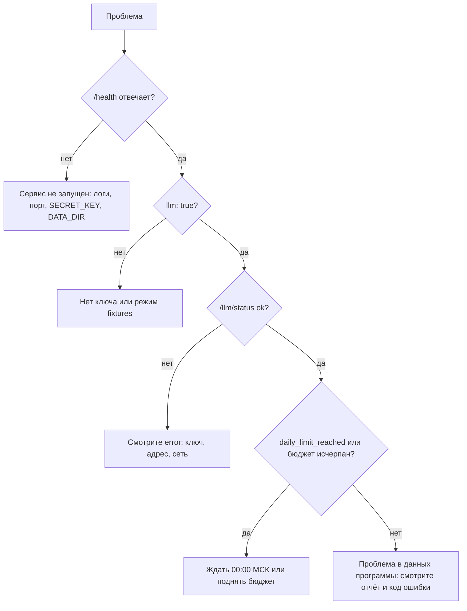

# Решение проблем

Справочник по типовым проблемам: симптом, причина, что делать. Коды ошибок API приходят в поле `code` тела ответа `{"code", "message_ru", "details"}`.

## Быстрая диагностика

```bash
curl -s http://127.0.0.1:8000/health              # жив ли сервис и включена ли модель
curl -s http://127.0.0.1:8000/api/v1/llm/status   # шлюз, расход, бюджет, суточный лимит
docker compose logs --tail 100 app                # журнал (Docker)
tail -n 100 logs/app.log                          # журнал (без Docker)
```



## Вход и доступ

| Симптом | Причина | Что делать |
|---|---|---|
| Вместо приложения страница входа хаба | Демо-стенд стоит за входом хаба | Войдите в хаб, затем в приложение |
| «Сервер временно недоступен» | Обрыв связи или истекла сессия хаба | Подождите: интерфейс повторяет подключение. Если не помогло — обновите страницу (Cmd+Shift+R) или откройте адрес команды заново и нажмите «Войти» |
| Перекинуло на `/auth?expired=1` | Токен истёк (по умолчанию 12 ч) или сменился `SECRET_KEY` | Войдите снова |
| `401 UNAUTHORIZED` при входе | Неверный логин или пароль, учётка отключена, демо-учётки выключены | Проверьте данные; администратор может включить учётку или сбросить пароль |
| Демо-плиток нет на форме входа | Администратор выключил `demo_accounts_enabled` | Используйте свои учётки; `admin` и `api` работают всегда |
| `403 REGISTRATION_CLOSED` | Регистрация выключена | Попросите администратора создать учётку |
| После регистрации ничего не видно | Роль эксперта без модулей | Администратор выдаёт нужную роль |
| `403 FORBIDDEN_ROLE` | Активная роль не допущена к действию | Переключите роль в шапке или войдите другой учёткой; `details.allowed` перечисляет допустимые роли |
| Администратор получает 403 на программы | Так задумано: администратор не работает с программами | Используйте учётку методиста или руководителя |
| API-клиент через хаб получает HTML или 401 | Прокси хаба перехватывает `Authorization` | Обращайтесь к сервису напрямую или передавайте токен в `X-MA-Token` |

## Модель и стоимость

| Симптом | Причина | Что делать |
|---|---|---|
| В заметках «собрано по шаблону», модули помечены «нужна доработка эксперта» | Модель не ответила в пределах бюджета времени навыка | Пересоберите модуль точечной правкой или передайте эксперту; при частых таймаутах увеличьте `timeout_s` навыка `content` в админке |
| «Дневной лимит шлюза LLM исчерпан, до 00:00 МСК…» | Шлюз ответил 429 «суточный лимит» | Дождитесь 00:00 МСК; сутки считаются по Москве, а не по часам сервера |
| «Дневной бюджет LLM … ₽ исчерпан» | Расход за сутки достиг `llm_daily_budget_rub` | Дождитесь 00:00 МСК или поднимите бюджет в админке |
| `/health` показывает `"llm": false` | Ключ не задан или `LLM_PROVIDERS=fixtures` | Задайте ключ в окружении или в админке; переключите режим на `cloudru` |
| `/llm/status` → `ok: false`, `error: AuthenticationError` и подобное | Неверный ключ или адрес шлюза | Проверьте `llm_api_key` и `llm_base_url` в админке |
| Ключ в админке «пропал» после перезапуска | Сменился `SECRET_KEY`, секрет не расшифровывается | Введите ключ заново; задайте постоянный `SECRET_KEY` |
| Сборка комплекта идёт долго | К шлюзу одновременно идут только 2 запроса | Это ограничение шлюза; экран показывает очередь и прогноз |
| Судья не добавил замечаний | Судья выключен, модель недоступна или исчерпан лимит | Проверьте `llm_judge_enabled` и `/llm/status`; замечания кода остаются в любом случае |

## Каркас и часы

| Симптом или код | Причина | Что делать |
|---|---|---|
| Кнопка «Утвердить каркас» неактивна, `SKELETON_HAS_ERRORS` | В отчёте есть ✕ | Исправьте ошибки: правила называют конкретную строку или узел |
| `DECISIONS_PENDING` | Есть нерешённые пункты «!» | Нажмите «Принять» или «Оставить как есть» по каждому |
| `SKELETON_LOCKED` | Каркас уже утверждён | Правьте точечной правкой комплекта; часы темы — правкой `hours:<тема>` |
| `QUESTIONS_PENDING` | Тип программы не определён | Ответьте на вопросы агента |
| `COMMENT_REQUIRED` | Возврат без комментария | Напишите, что изменить |
| V-04: итог не равен объёму | Вы задали часы тем вручную, и модуль стал их суммой | Подгоните часы тем или верните ручное распределение, поменяв часы модуля |
| V-07: мало практики | Структура не позволяет набрать минимум | Поднимите долю практики (уменьшите ЛК у модулей) или уточните требование |
| V-10: конфликт календаря | Срок не помещает объём при заданной нагрузке | Выберите вариант: продлить срок, шестидневка или большая нагрузка |
| V-15: ПС не подтверждён | ПС или коды ТФ не найдены в реестре | Сверьте коды ТФ с реестром Минтруда; уточните направление в запросе |
| Агент выбрал не тот тип программы | В запросе нет явного типа | Смените шаблон до утверждения каркаса |

## Комплект и правки

| Код или симптом | Причина | Что делать |
|---|---|---|
| `SKELETON_NOT_APPROVED` | Генерация запрошена до утверждения каркаса | Утвердите каркас |
| `KIT_NOT_READY` | Комплект ещё не собран | Дождитесь окончания задания |
| `EDIT_REJECTED` | Правка задела элементы вне потомков, нарушила часы или оставила РО меньше чем с двумя средствами | Сузьте инструкцию или выберите конкретный элемент; документ уже откатан к снимку |
| `HOURS_MISMATCH` | У соседней темы не хватает часов нужного вида | Уменьшите изменение или поправьте часы другой темы |
| `LOCKED` | Программа на утверждении или утверждена | Попросите руководителя вернуть программу |
| `429 RATE_LIMIT` при сборке | Достигнут `max_parallel_jobs` | Подождите завершения других заданий или увеличьте лимит |
| Пример кода удалён из лекции | Пример упал в песочнице, и модель не смогла его исправить | Посмотрите заметки и песочницу; попросите агента добавить пример точечной правкой |
| Источник с пометкой «[не подтверждено]» | Нет в реестре литературы, ссылка не открылась | Замените источник или добавьте его в реестр |

## Согласование

| Код | Причина | Что делать |
|---|---|---|
| `BLOCKING_FAILED` | Не все 10 блокирующих проверок пройдены | Откройте отчёт комплекта и исправьте ✕ |
| `MODULES_NOT_ACCEPTED` | Не все модули приняты экспертами | Дождитесь приёмки или ответьте на замечания |
| `ITEMS_NOT_CHECKED` | Эксперт принимает модуль, не отметив все элементы | Отметьте каждый элемент проверенным |
| `NOT_READY` | Руководитель утверждает при готовности меньше 100 % | Закройте пункты из списка незакрытых |
| `BAD_STATE` | Действие недоступно в текущем статусе | Проверьте статус программы в шапке карточки |
| Эксперт получает 403 на программу | Ему не назначены модули этой программы | Методист назначает эксперта на модуль |

## Файлы и база знаний

| Симптом | Причина | Что делать |
|---|---|---|
| 400 «Неподдерживаемый формат файла» | Не .docx, .pdf или текст в UTF-8 | Сохраните файл в поддерживаемом формате |
| 400 из-за размера | Файл больше `MAX_FILE_SIZE_MB` (20 МБ) или больше 5 файлов | Уменьшите файл или число вложений |
| Документ организации проиндексирован «по словам» | Модель эмбеддингов недоступна | Поиск работает; при необходимости загрузите документ снова, когда модель доступна |
| Новый акт не появился | Реестры кэшируются | Перезапустите приложение после правки файлов; правки через `PUT /org/registry` применяются сразу |
| Не удаётся удалить акт через API | Запись есть в `kb_npa.json` образа и сливается поверх | Поменяйте `status` на «утратил силу» в файле реестра и перезапустите |

## Развёртывание

| Симптом | Причина | Что делать |
|---|---|---|
| Контейнер не стартует: нет `/opt/hackathon/ai.env` | `docker-compose.yml` подключает этот файл | Создайте файл (можно пустой) или уберите `env_file` |
| Запуск падает в `production` | `SECRET_KEY` не задан, а `DATA_DIR` недоступен для записи | Задайте `SECRET_KEY` или дайте права на `DATA_DIR` |
| `deploy_vm.sh` завершился с кодом 1 | `/health` не ответил за 60 секунд | Смотрите напечатанные 80 строк логов |
| На `/` JSON вместо интерфейса | Интерфейс не собран | `cd frontend && npm ci && npm run build` |
| После обновления не появился новый столбец БД | Миграций нет, `create_all` не меняет существующие таблицы | Так задумано: код хранит новые данные без изменения схемы |
| Ссылки на выгрузку ведут на внутренний адрес | Прокси не передаёт `X-Forwarded-*` | Настройте заголовки прокси; uvicorn запускается с `--proxy-headers` |
| Лимит анонимных автопрогонов срабатывает у всех сразу | Прокси не передаёт `X-Forwarded-For`, все запросы с одного IP | Настройте передачу адреса клиента |

## Куда смотреть дальше

- Журнал приложения: `docker compose logs -f app` или `logs/app.log`.
- Журнал программы: шаг «Согласование» → журнал, или `GET /api/v1/programs/{id}/events`.
- Журнал администрирования: «Администрирование» → «Журнал».
- Результаты автопрогона: `logs/autorun/summary.md`.

См. также: [Частые вопросы](Частые-вопросы), [Развёртывание](Развёртывание), [LLM и стоимость](LLM-и-стоимость).
