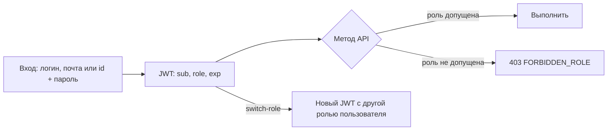
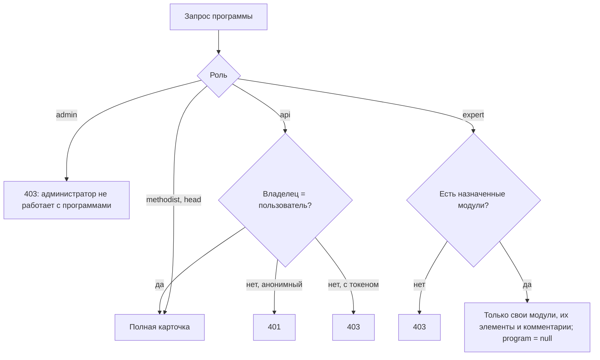

# Роли и права

В МетодАгенте пять ролей: `methodist`, `expert`, `head`, `admin`, `api`. Роли не пересекаются, и это соответствует таблице 19 ТЗ:

- **методист** создаёт программы и доводит их до отправки на утверждение;
- **эксперт** вычитывает только назначенные ему модули;
- **руководитель** видит всё и утверждает;
- **администратор** ведёт пользователей, настройки агента и базу знаний, но не создаёт и не видит программы;
- **API** — служебная роль для автопрогона и интеграций, видит только свои программы.

Права проверяет сервер на каждом действии. Интерфейс лишь скрывает недоступные разделы для удобства.

## Как устроена проверка прав

У пользователя может быть несколько ролей, но токен входа (JWT) несёт ровно одну активную роль. Каждый метод API проверяет именно её. Без подходящей роли метод отвечает `403 FORBIDDEN_ROLE`, а в поле `details.allowed` перечисляет допустимые роли.

## Роли

| Роль | Подпись в интерфейсе | Назначение |
|---|---|---|
| `methodist` | методист | Создаёт программу, отвечает на вопросы, правит и утверждает каркас, назначает экспертов, отправляет на утверждение |
| `expert` | эксперт | Вычитывает только назначенные модули: правки, комментарии, решения по модулю |
| `head` | руководитель | Видит все программы, отчёты, версии и журнал; утверждает или возвращает программу |
| `admin` | администратор | Пользователи, настройки агента, навыки, база знаний, профиль и реестры организации, журнал |
| `api` | API | Автопрогон и интеграции; видит только свои программы |

## Матрица «действие × роль»

Обозначения: **да** — разрешено; **свои** — с ограничением из примечания; **—** — запрещено (403, или 401 для анонимного запроса). Пути указаны относительно `/api/v1`.

### Программы

| Действие | methodist | expert | head | admin | api |
|---|---|---|---|---|---|
| Создать программу `POST /programs`, `POST /programs/upload` | да | — | — | — | да |
| Список программ `GET /programs` | да (все) | свои (с назначенными модулями) | да (все) | — | свои (владелец) |
| Карточка программы `GET /programs/{id}` | да | свои (только назначенные модули) | да | — | свои |
| Ответы на вопросы `.../answers` | да | — | — | — | — |
| Правка каркаса, решения по «!» | да | — | — | — | — |
| Утвердить или вернуть каркас | да | — | — | — | — |
| Сменить шаблон | да | — | — | — | — |
| Отчёт автопроверки `.../report` | да | — | да | — | свои |
| Точечная правка `.../edits` | да | свои (без часов, только свои модули) | — | — | — |
| Версии и сравнение | да | — | да | — | — |
| Откат к версии | да | — | — | — | — |
| Текст по разделам `.../sections` | да | да | да | — | свои |
| Выгрузка `.../export/{fmt}` | да | — | да | — | свои |
| Журнал программы `.../events` | да | — | да | — | — |
| Актуализация программы `GET .../actualize` | да | да | да | — | да |
| Актуализация файла `POST /actualize` | да | — | — | — | да |
| Песочница кода `.../sandbox` | да | свои (лекции своих модулей) | да | — | — |
| Адаптация `.../adapt` | да | — | — | — | да |
| Подсказка экспертов `.../experts` | да | — | да | — | — |
| Назначить эксперта на модуль | да | — | — | — | — |
| Комментарий и ответ на комментарий | да | свои модули | — | — | — |
| Решение по модулю (принять, вернуть, вопрос, принять элемент) | — | да | — | — | — |
| Задания на вычитку `GET /reviews` | — | да | — | — | — |
| Отправить на утверждение `.../submit` | да | — | — | — | — |
| Утвердить или вернуть программу `.../approval` | — | — | да | — | — |
| Статус задания `GET /jobs/{id}` | да | да | да | да* | свои |

\* Задание администратор видит только по идентификатору. Разделы и выгрузка программы проходят общую проверку доступа, которая отвечает администратору 403, как список и карточка.

### База знаний, организация, администрирование

| Действие | methodist | expert | head | admin | api |
|---|---|---|---|---|---|
| Список документов организации | да | — | да | да | — |
| Загрузить или удалить документ | — | — | — | да | — |
| Поиск `POST /kb/search`, выжимки `GET /kb/norms` | да | да | да | да | — |
| Профиль организации `GET /org/profile` | да (без `smtp`) | — | да (без `smtp`) | да | — |
| Изменить профиль | — | — | — | да | — |
| Реестры `GET /org/registry` | да | — | да | да | — |
| Заменить раздел реестра | — | — | — | да | — |
| Пользователи, настройки, навыки, журнал `/admin/*` | — | — | — | да | — |

### Учётная запись

| Действие | Кто |
|---|---|
| `GET /auth/me`, `POST /auth/switch-role`, `GET /me/tasks` | любой вошедший (анонимный — 401) |
| `PUT /auth/me`, `PUT /auth/me/password` | вошедший, кроме демо-учёток (403: их меняет только администратор) |
| `GET /notifications`, `POST /notifications/read` | любой, включая анонимный `api` |

## Видимость программ

- **Эксперт.** В карточке остаются только модули, где он назначен. Из комплекта — только рабочие программы, вопросы, задания, лекции и оценочные средства этих модулей; комментарии — только по ним; полный комплект (`program`) не отдаётся. Выгрузка эксперту запрещена.
- **Эксперт при правке.** Нельзя менять часы и элементы чужих модулей. Правка агента по замечанию эксперта получает статус `proposed` и применяется только после подтверждения экспертом.
- **API-клиент** видит только программы, где он владелец.
- **Методист и руководитель** видят все программы. Методисты организации ведут программы совместно: любой методист может открыть и править любую программу. Поле `quality` в карточке есть только у них.

## Переключение ролей

`POST /auth/switch-role {"role": "..."}` выдаёт новый токен с другой ролью, если она есть у пользователя, иначе 403. В интерфейсе переключатель показывается, если у пользователя больше одной роли (роль `api` скрыта), а рядом с каждой ролью — число задач из `GET /me/tasks`.

При входе через интерфейс учётка с ролями `api` и `methodist` автоматически переключается на `methodist`.

## Демо-учётки

| id | Логин | Имя | Роли | Должность |
|---|---|---|---|---|
| `u-madina` | `madina` | Мадина | methodist | Методист |
| `u-timur` | `timur` | Тимур А. | expert | Эксперт-преподаватель |
| `u-olga` | `olga` | Ольга К. | expert | Эксперт-преподаватель |
| `u-ahmed` | `ahmed` | Ахмед | head | Руководитель учебного центра |
| `u-admin` | `admin` | Администратор | admin | Администратор профиля |
| `u-api` | `api` | API-клиент | api, methodist | Автопрогон |

Пароль у всех — `demo`. Если администратор выключит `demo_accounts_enabled`, вход и токены демо-учёток отклоняются, кроме `u-api` и `u-admin`.

## Регистрация

`POST /auth/register` работает, если включена `registration_enabled`:

- нужно согласие на обработку персональных данных (иначе `400 CONSENT_REQUIRED`);
- не больше 10 регистраций в час с одного IP (`429`);
- роль — `registration_default_role` (по умолчанию `expert`). Допускаются только `methodist`, `expert`, `head`; любое другое значение заменяется на `expert`;
- событие пишется в журнал организации.

## Токены и пароли

- JWT подписывается `SECRET_KEY` алгоритмом `HS256`; содержимое: `sub`, `role`, `exp`.
- Срок жизни — `access_token_expire_minutes`, по умолчанию 720 минут; администратор меняет его в диапазоне 15–43 200 минут.
- Пароли хранятся только хешем bcrypt.
- **`X-MA-Token` имеет приоритет над `Authorization: Bearer`.** Интерфейс использует `X-MA-Token`, потому что прокси хаба перехватывает запросы с `Authorization`. Внешние API-клиенты используют `Authorization: Bearer`.

Запросы без токена:

| Запрос | Результат |
|---|---|
| `GET`, `HEAD`, `OPTIONS` | выполняются как анонимный `api` |
| `POST /programs?mode=auto` | анонимный `api`, не больше `anon_runs_per_hour` (по умолчанию 12) в час с IP, сверх — `429 RATE_LIMIT` |
| остальное | `401 UNAUTHORIZED` |

## Журнал администрирования

`GET /admin/journal` возвращает события организации:

| Событие | Источник |
|---|---|
| `register` | регистрация пользователя |
| `password` | смена своего пароля |
| `user_create`, `user_update` | создание и изменение пользователя (для пароля пишется слово «пароль», не значение) |
| `settings` | изменение настроек (только названия полей) |
| `skill` | изменение или сброс навыка |
| `org_profile`, `org_registry` | изменение профиля и реестров организации |

## Разделы интерфейса по ролям

| Раздел | Путь | Кому показан пункт меню | Защита маршрута |
|---|---|---|---|
| Программы | `/app` | всем, кроме admin | admin перенаправляется на `/app/admin` |
| Карточка программы | `/app/p/:id` | — | admin перенаправляется на `/app/admin` |
| Вычитка | `/app/reviews` | expert | admin перенаправляется на `/app/admin` |
| База знаний | `/app/kb` | admin, methodist, head | нет (эксперт получит 403 от API) |
| Администрирование | `/app/admin` | admin | не-admin перенаправляется на `/app` |
| Справка | `/help` | всем | — |
| Личный кабинет | `/app/me` | всем | — |

Подробная справка по полям и кодам: `docs/roles-and-access.md` в репозитории.
