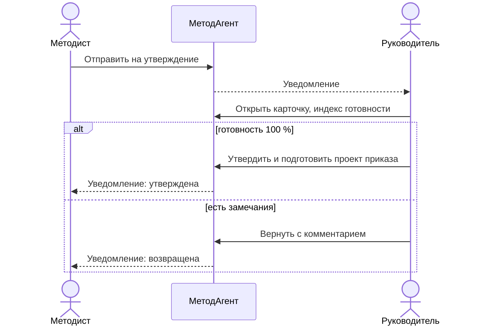

# Руководителю

Руководитель учебного центра видит все программы организации, их готовность, качество, сроки и затраты на LLM, решения людей и журнал событий. Он утверждает программу или возвращает её методисту с комментарием. Создавать и править программы руководитель не может.

Демо-учётка руководителя: `ahmed`, пароль `demo`. После входа вы попадаете в раздел «Программы» с заголовком «Программы организации», где по умолчанию включён фильтр статусов «На утверждении» и «Утверждена».

## Что доступно руководителю

| Действие | Где |
|---|---|
| Список всех программ с фильтром по статусу и периоду | «Программы» (`status`, `since`, `until`) |
| Карточка программы со всеми шагами | `/app/p/<id>` |
| Отчёт автопроверки и матрица покрытия | Шаги «Проверка» и «Комплект» |
| Версии и сравнение версий | Инструменты «Программа, версии и актуальность» |
| Журнал событий программы | Шаг «Согласование» |
| Выгрузка всех форматов | Блок «Документы» |
| Подсказка экспертов (просмотр) | Шаг «Согласование» |
| Песочница кода, актуализация | Инструменты карточки |
| Утвердить или вернуть программу | Блок утверждения на шаге «Согласование» |
| Чтение профиля организации и реестров, поиск по базе знаний | «База знаний» |

Руководитель не откатывает версии (это делает методист) и не ведёт пользователей (это делает администратор).

## Сценарий утверждения



1. Получите уведомление о новой программе на утверждении (колокольчик в шапке) или откройте список «Программы».
2. Откройте карточку. На шаге «Согласование» видны:
   - **индекс готовности** и список незакрытых пунктов с владельцами;
   - **решения людей**: решения методиста по пунктам «!», приёмка модулей экспертами с оценками;
   - **качество комплекта** (см. ниже);
   - **сроки** в рабочих днях и **затраты** на генерацию в рублях.
3. Если всё в порядке, нажмите «Утвердить и подготовить проект приказа». Кнопка активна, только когда индекс готовности равен 100 %.
4. Если нужны доработки, напишите, что исправить, и нажмите «Вернуть с комментарием». Комментарий обязателен. Программа получит статус «Возвращена», методист получит уведомление.

После утверждения проект приказа и программа в DOCX доступны для выгрузки. Номер и дату приказа, ФИО и подписи заполняют люди: агент их не ставит.

## Индекс готовности

Индекс считается так:

```
готовность = round(100 × (пройденные блокирующие проверки + принятые модули) / (10 + число модулей))
```

Пример: программа из 6 модулей, все 10 блокирующих проверок пройдены, принято 4 модуля. Готовность = round(100 × (10 + 4) / 16) = 88 %. Утвердить такую программу нельзя, пока эксперты не примут оставшиеся 2 модуля.

## Показатели качества

| Показатель | Что значит |
|---|---|
| Доля элементов, правленных людьми | Сколько элементов комплекта люди поменяли после агента |
| Модули, принятые без правок | Сколько модулей эксперты приняли без изменений |
| Средняя оценка экспертов | Среднее по оценкам 1–5 при приёмке модулей |
| Примеры кода и доля работающих | По результатам песочницы (правило V-24) |
| Рабочие дни от создания до утверждения | Считаются пн–пт |
| Оценка времени команды | 6 минут на каждое решение человека из журнала |
| Стоимость и время генерации | Токены и рубли по тарифу шлюза, длительность шагов |

Эти показатели отдаются в карточке программы только методисту и руководителю (поле `quality`).

## Сравнение версий

В инструментах «Программа, версии и актуальность» выберите две версии (A и B). Сравнение покажет изменённые поля, модули, темы, часы, компетенции, РО и узлы комплекта по хэшам. Так видно, что поменялось после возврата программы.

## Подсказки

- **Программы нет в списке.** Проверьте фильтр статусов: по умолчанию показаны только «На утверждении» и «Утверждена». Снимите фильтр, чтобы увидеть черновики и программы в работе.
- **Кнопка утверждения неактивна.** Индекс готовности меньше 100 %: остались непройденные блокирующие проверки или непринятые модули. Список незакрытых пунктов с владельцами показан рядом.
- **Хочу понять, сколько стоит программа.** Затраты видны в шапке карточки и в блоке качества. Подробнее о тарифах — [LLM и стоимость](LLM-и-стоимость).
- **Хочу видеть программы как методист.** Если у вашей учётки несколько ролей, переключайте роль кнопками в шапке. Чужую роль так получить нельзя.

См. также: [Автопроверка](Автопроверка), [Роли и права](Роли-и-права).
