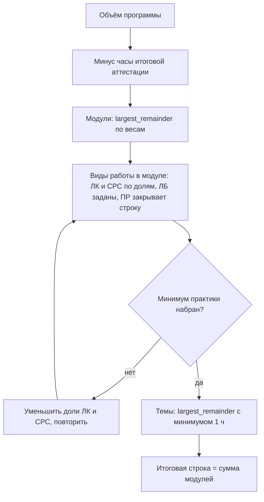

# Часы и календарь

Часы программы и календарный график считает код, а не модель. Модель (навык `skeleton`) предлагает только структуру: веса модулей и тем, доли лекций и самостоятельной работы, часы лабораторных. Дальше работают два солвера:

- `src/app/solver/hours.py` распределяет объём по модулям, видам работы и темам методом наибольших остатков. Суммы сходятся на всех уровнях, а одинаковый вход всегда даёт одинаковый результат;
- `src/app/solver/calendar.py` строит график по дням или по занятиям, раскладывает часы по неделям и при несовместимости объёма, нагрузки и срока не нарушает ограничения молча, а выдаёт конфликт с тремя вариантами решения.

## Виды работы

| Код | Вид | В интерфейсе |
|---|---|---|
| `lk` | лекции | ЛК |
| `pr` | практические занятия | ПР |
| `lb` | лабораторные занятия | ЛБ |
| `srs` | самостоятельная работа | СРС |

Контактная работа = ЛК + ПР + ЛБ. Итог программы = сумма модулей + часы итоговой аттестации.

## Метод наибольших остатков на примере

Задача: разделить 70 часов на три модуля с весами 3, 2 и 2.

| Модуль | Вес | Квота 70 × w / 7 | Целая часть | Дробный остаток | Итог |
|---|---|---|---|---|---|
| М1 | 3 | 30,00 | 30 | 0,00 | 30 |
| М2 | 2 | 20,00 | 20 | 0,00 | 20 |
| М3 | 2 | 20,00 | 20 | 0,00 | 20 |

Теперь 68 часов на те же веса:

| Модуль | Вес | Квота 68 × w / 7 | Целая часть | Дробный остаток | Итог |
|---|---|---|---|---|---|
| М1 | 3 | 29,14 | 29 | 0,14 | 29 |
| М2 | 2 | 19,43 | 19 | 0,43 | **20** |
| М3 | 2 | 19,43 | 19 | 0,43 | 19 |

Сумма целых частей — 67, остался 1 час. Он уходит элементу с наибольшим остатком. У М2 и М3 остатки равны, веса тоже, поэтому выигрывает меньший номер — М2. Сумма ровно 68.

Правила `largest_remainder(total, weights, minimum=0)`:

1. Каждому сначала даётся `minimum` (если `minimum × n ≤ total`).
2. Остаток делится по целым частям квот.
3. Оставшиеся единицы получают элементы с наибольшим дробным остатком; при равенстве — больший вес, затем меньший номер.
4. Отрицательные веса считаются нулём; при нулевой сумме весов деление поровну.

Округление везде арифметическое (`floor(x + 0.5)`), а не банковское.

## Как солвер считает часы

1. **Проверки.** Объём больше нуля, есть хотя бы один модуль.
2. **Итоговая аттестация.** Часы ИА ограничиваются диапазоном `[0, объём − 1]`; на модули остаётся `объём − ИА`.
3. **Модули.** Часы делятся по весам. Если модуль остался с 0 ч, а часов хватает на всех, у самого большого модуля забирается 1 ч.
4. **Виды работы в модуле.** `ЛК = округл(h × lk_share)`, `СРС = округл(h × srs_share)`, `ЛБ` — заданное значение, а **практика закрывает строку**: `ПР = h − ЛК − ЛБ − СРС`. Если ПР получилась отрицательной, обе доли умножаются на 0,85 и расчёт повторяется.
5. **Стажировка.** Все часы модуля идут в СРС, ЛК, ПР и ЛБ равны нулю.
6. **Минимум практики.** Если суммарная ПР меньше требуемой, доля лекций умножается на 0,85, СРС — на 0,8, и деление повторяется (до 30 попыток). Если минимум так и не набран, появляется заметка «Не удалось набрать требуемый минимум практики без нарушения структуры».
7. **Темы.** Итог темы — `largest_remainder(часы модуля, веса тем, minimum=1)`. Виды работы раздаются темам так, чтобы сходились и строки (виды темы = итог темы), и столбцы (сумма тем = модуль по каждому виду). Если тем больше, чем часов, лишние темы отбрасываются с заметкой, а их РО переходят последней оставшейся теме.
8. **Итоговая строка** — сумма модулей по каждому виду.

### Откуда берутся параметры

| Параметр | Источник |
|---|---|
| Объём | из запроса, по умолчанию 72 ч |
| Часы ИА | из запроса; иначе ДООП — 2 ч (объём ≤ 24 ч) или 4 ч; ДПП — 2 ч (≤ 36 ч), 4 ч (≤ 144 ч), 6 ч (больше) |
| Режим стажировки | тип `dpp_pk_internship` или «аудиторных занятий нет» в запросе |
| Минимум практики | из запроса в часах или `ceil(объём × доля)`; «практика не меньше половины» даёт долю 0,5 |
| Доля СРС | для ДООП без ДОТ — 0 |
| Форма контроля модуля | у стажировки — «Собеседование с руководителем стажировки» |
| Форма ИА | по умолчанию «Зачёт» |

### Доля практики для ДПП ПК

Правило V-07 требует, чтобы для ДПП ПК практика (ПР + ЛБ) составляла не меньше 40 % аудиторных часов. Солвер это ограничение напрямую не применяет: оно обеспечивается долями из каркаса (в инструкции навыка `skeleton` доля лекций 0–0,5) и проверяется правилом. Для минимума из запроса солвер учитывает только ПР, а правило V-07 считает ПР + ЛБ.

## Пример: кейс 1

Запрос: ДООП «Первые шаги в Python» для 8–9 классов, 16 часов, по 2 часа два раза в неделю, практики не меньше половины, итог — защита проекта.

- Объём 16 ч, тип ДООП. Часы ИА не заданы, объём ≤ 24 ч, поэтому ИА = 2 ч; на модули остаётся 14 ч.
- Минимум практики = `ceil(16 × 0,5)` = 8 ч.
- ДООП без ДОТ, поэтому СРС = 0.
- Календарь по занятиям: `ceil(16 / 2)` = 8 занятий, `ceil(8 / 2)` = 4 недели.

## Правка часов методистом

| Что правите | Что происходит |
|---|---|
| Часы модуля (до утверждения каркаса) | Солвер заново делит часы модуля по темам; признак ручных часов тем сбрасывается |
| Часы темы (до утверждения каркаса) | Модуль становится суммой своих тем, солвер их больше не трогает |
| Часы темы (после сборки комплекта, точечной правкой) | Разница по каждому виду компенсируется самой большой соседней темой; итог модуля не меняется. Если у соседа не хватает часов вида — ошибка `HOURS_MISMATCH` |

После любой правки календарь перестраивается, отчёт пересобирается, а ранее выбранный вариант графика применяется снова, если конфликт остался.

## Календарный график

`plan_calendar` работает в двух режимах.

### По занятиям

Если в запросе есть «по N часа M раз в неделю»:

- занятий = `ceil(объём / длительность занятия)`;
- недель = `ceil(занятий / занятий в неделю)`.

### По дням

Иначе (по умолчанию 5 учебных дней в неделю):

- нагрузка в день — из запроса; если не задана и есть срок: `min(8, max(2, ceil(объём / (floor(недель) × дней в неделю))))`; без срока — 6 ч;
- рабочих дней = `ceil(объём / нагрузка)`, недель = `ceil(дней / дней в неделю)`.

Для стажировки без ограничения нагрузки берётся 4 ч в день.

### Конфликт и три варианта

Конфликт фиксируется, если задан срок и расчётных недель больше, чем `ceil(запрошенные недели + 0,25)`. Агент объясняет причину и предлагает варианты:

| id | Вариант | Недель | Ч/день | Дней в неделю |
|---|---|---|---|---|
| `extend` | Увеличить срок | расчётное число | как было | как было |
| `six_days` | Перейти на шестидневную неделю | `ceil(дней / 6)` | как было | 6 |
| `raise_load` | Согласовать с заказчиком большую нагрузку в исходном сроке | исходное | `ceil(объём / доступные дни)` | как было |

Пример: 256 часов при нагрузке не больше 4 часов в день требуют 64 рабочих дня, то есть около 13 недель при пятидневке. Если заказчик просит уложиться в 2 месяца (≈ 8,6 недели), агент покажет конфликт и предложит продлить срок до 13 недель, перейти на шестидневку (≈ 11 недель) или согласовать нагрузку 6 ч в день в исходном сроке (43 рабочих дня, 9 недель).

Пока вариант не выбран, правило V-10 даёт ошибку (блокирующая проверка 3 «Календарная выполнимость»). Выбор делает методист: решение по пункту V-10 или переключатель варианта в каркасе. В режиме `auto` выбирается `six_days`, если в запросе задан максимум часов в день, иначе `extend`, и выбор записывается в допущения. После выбора V-10 показывает предупреждение «Конфликт срока решён: …». Если выбранная нагрузка выше максимума из запроса, V-10 снова выдаст ошибку.

### Расписание по неделям

Элементы графика — темы в порядке программы и строка итоговой аттестации. Неделя заполняется до недельной нагрузки, часть темы, не поместившаяся в неделю, переносится на следующую. Внутри темы часы расходуются в порядке ЛК → ПР → ЛБ → СРС → ИА. Для каждой недели хранятся номер, часы, часы по видам, список тем и число учебных дней.

Расписание выгружается таблицей в раздел 2.3 DOCX (учебные дни, всего, ЛК, ПР, ЛБ, СРС, ИА, содержание до 6 тем).

## Частые вопросы

- **Почему у темы 1 час, хотя я ждал больше?** Темы получают минимум 1 час, остальное — по весам. Поменяйте часы темы вручную: модуль станет суммой тем.
- **Почему практики меньше, чем я просил?** Солвер уменьшает доли лекций и СРС, пока не наберёт минимум. Если структура не позволяет, появится заметка, а правило V-07 покажет ошибку.
- **У стажировки нет аудиторных часов — это ошибка?** Нет. Для стажировки все часы модулей идут в СРС, а правило V-06 проверяет, что аудиторных часов нет.

См. также: [Автопроверка](Автопроверка), [Как работает агент](Как-работает-агент).
