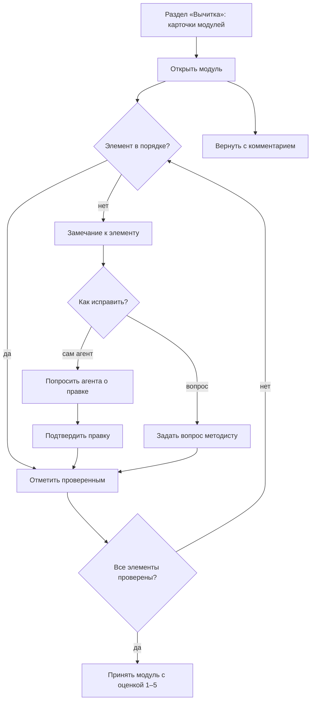

# Эксперту

Эксперт вычитывает модули, которые ему назначил методист: лекции, тесты, задания и рабочую программу модуля. Он оставляет замечания, просит агента предложить правку, отмечает элементы проверенными и в конце принимает модуль с оценкой или возвращает его на доработку.

Демо-учётки экспертов: `timur` и `olga`, пароль `demo`. После входа вы попадаете в раздел «Вычитка».

## Что видит эксперт

| Видит | Не видит и не делает |
|---|---|
| Только программы, где ему назначен хотя бы один модуль | Чужие модули и программы без своих модулей |
| Только свои модули, их элементы комплекта и комментарии | Полный комплект (`program` в карточке приходит пустым) |
| Песочницу кода для лекций своих модулей | Выгрузку файлов и журнал программы |
| Поиск по базе знаний и выжимки НПА | Документы организации, профиль и реестры |

Эксперт не создаёт программы, не правит каркас и не может менять часы.

> Новый пользователь после самостоятельной регистрации по умолчанию получает роль эксперта без назначенных модулей. Такой пользователь не видит ни одной программы, пока ему не назначат модуль.

## Сценарий вычитки

### 1. Найти свои модули

В разделе «Вычитка» показаны карточки назначенных модулей: номер, название, программа, часы, статус вычитки и счётчик «проверено n из N». Щелчок по карточке открывает модуль в карточке программы.

Когда методист назначает вас на модуль, приходит уведомление в интерфейсе (колокольчик в шапке).

### 2. Прочитать элементы

У каждой лекции, вопроса и задания указаны результаты обучения и средства, которыми они проверяются. Это помогает понять, зачем элемент нужен и не потеряется ли покрытие, если его убрать.

Элементы модуля для вычитки: рабочая программа, лекции, вопросы теста, задания.

### 3. Оставить замечание

Замечание можно оставить к модулю целиком или к конкретному фрагменту: лекции, пункту плана, слайду, вопросу, заданию или критерию задания. Поле «К какому фрагменту» выбирает адресат.

Есть два варианта:

- **«Попросить агента о правке».** Агент готовит предложение в пределах вашего модуля, не меняя часы и РО, и показывает, какие элементы затронет. Правка применяется только после того, как вы нажмёте «Подтвердить правку».
- **«Задать вопрос методисту».** Модуль получает статус «вопрос», методист видит замечание и отвечает.

Если методист передал ваше замечание агенту, итоговую правку тоже подтверждаете вы.

### 4. Отметить проверенным

Кнопка «Отметить проверенным» у каждого элемента. Счётчик «n из N проверено» показывает прогресс.

### 5. Принять или вернуть модуль

- **«Принять модуль»** доступно, только когда все элементы отмечены проверенными. Поставьте оценку модуля от 1 до 5: она попадёт в качество программы, которое видит руководитель.
- **«Вернуть с комментарием»** отправляет модуль методисту на доработку. Комментарий обязателен.

Методист видит ваше решение, оценку и замечания.

## Статусы модуля

| Статус | Когда |
|---|---|
| `not_started` | Модуль назначен, вычитка не начиналась |
| `in_review` | Первое действие эксперта или ответ методиста на вопрос |
| `question` | Эксперт задал вопрос |
| `accepted` | Модуль принят |
| `returned` | Модуль возвращён на доработку |

Если методист после приёмки поменял что-то в модуле точечной правкой, модуль снова уходит к вам на вычитку со статусом `in_review`.

## Подсказки

- **Не вижу программу.** Значит, в ней вам не назначен ни один модуль. Попросите методиста назначить.
- **Хочу поменять часы темы.** Эксперту часы недоступны (сервер ответит 403). Напишите замечание методисту.
- **Пример кода в лекции падает.** Откройте песочницу кода: она показывает результат запуска, вывод и версии библиотек. Если пример не работает, попросите агента о правке.
- **Нужно сослаться на норматив.** Поиск по базе знаний доступен эксперту на уровне API (`POST /api/v1/kb/search`); пункт меню «База знаний» эксперту скрыт.

См. также: [Роли и права](Роли-и-права), [Автопроверка](Автопроверка), [Глоссарий](Глоссарий).
